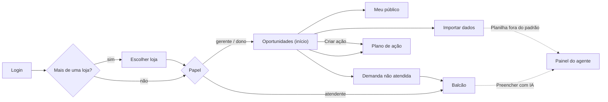

# 01. Proposta e estrutura inicial das telas

**Projeto:** MidiaComercial (inteligência comercial para pequenos lojistas)
**Entrega:** Hackrun, primeira entrega (planejamento e definição técnica)
**Data:** 13/11/2026
**Design system:** Mídia UI (detalhes em `FRONTEND.md`)

---

## 1. Princípios das telas

1. **Evidência antes de opinião:** todo número mostra origem, período e amostra.
2. **A limitação aparece junto do dado**, nunca escondida em tooltip.
3. **Um toque no balcão:** o atendente registra a demanda sem digitar.
4. **Mobile-first para o atendente, desktop-friendly para o dono e o gerente.**
5. **Português de loja:** "9 procuraram e não tinha", nunca "demanda reprimida".
6. **Selo "DADOS DE DEMONSTRAÇÃO"** visível em todas as telas da demo.

## 2. Usuários e o que cada um vê

| Papel | Telas |
| --- | --- |
| **Atendente** | Login → Balcão (registro de demanda) |
| **Gerente** | Todas, menos a gestão de usuários |
| **Dono** | Todas |

## 3. Mapa de navegação



## 4. Inventário de telas

| # | Tela | Rota | Papel | Prioridade |
| --- | --- | --- | --- | --- |
| T0 | Login | `/login` | todos | P0 |
| T1 | Escolher loja | `/lojas` | todos | P0 |
| T2 | Oportunidades (início) | `/` | gerente, dono | P0 |
| T3 | Importar dados e qualidade | `/importar` | gerente, dono | P0 |
| T4 | Meu público | `/publico` | gerente, dono | P0 |
| T5 | Demanda não atendida (ranking) | `/demanda` | gerente, dono | P0 |
| T6 | Balcão (registro rápido) | `/balcao` | todos | P0 |
| T7 | Plano de ação | `/acoes` | gerente, dono | P0 |
| T8 | Painel do agente de IA | sobreposto (gaveta) | conforme papel | P1 |

---

## 5. Telas em detalhe

### T0: Login

**Objetivo:** entrar na loja demo com segurança.

```
┌───────────────────────────┬──────────────────────────────┐
│                           │                              │
│   ▮▮▯ MídiaComercial      │   Entrar                     │
│                           │   Usuário  [               ] │
│   Seus sinais de venda,   │   Senha    [               ] │
│   em uma só mídia.        │                              │
│                           │   [        Entrar        ]   │
│   (ondas violeta/coral)   │   Entrar na demo →           │
│                           │                              │
└───────────────────────────┴──────────────────────────────┘
```

- **Componentes:** Card, Input, Button `primary`.
- **API:** `GET /api/csrf`, `POST /api/auth/login`, `GET /api/me`.
- **Estados:** erro "Usuário ou senha inválidos"; carregando no botão.
- **Aceite:** atendente cai no Balcão; gerente cai em Oportunidades.

### T1: Escolher loja

Lista de cartões com nome da loja e papel do usuário. A escolha é gravada na sessão e **limpa o cache** do frontend, para nunca misturar dados de lojas diferentes.

### T2: Oportunidades (início)

**Objetivo:** mostrar até 3 decisões que valem testar agora, com evidência.

```
┌──────────────────────────────────────────────────────────────────┐
│ ▮▮▯ MídiaComercial  │ Loja Demo Centro ▾ │ DADOS DE DEMONSTRAÇÃO │
├────────┬─────────────────────────────────────────────────────────┤
│ Início │ Oportunidades da semana      06–12/11   [Recalcular]    │
│ Import.│                                                         │
│ Público│ ┌Ticket médio─┐ ┌Procuraram e não tinha┐ ┌Clientes id.┐  │
│ Demanda│ │ R$ 142,30   │ │ 23                   │ │ 41%        │  │
│ Ações  │ │ +4,2% · 312 │ │ 23 registros         │ │ 128 de 312 │  │
│        │ └─────────────┘ └──────────────────────┘ └────────────┘  │
│        │                                                         │
│        │ ① LACUNA DE MIX                    [▮▮▮ Dados suficientes]│
│        │ Investigar reposição: Camiseta Azul M        CAM-AZ-M   │
│        │ [Balcão] 9 procuraram e não tinha · 06–12/11 · 9 reg.   │
│        │ [Estoque] Saldo 0 · atualizado há 18 h                  │
│        │ ┃ Limitação: 9 atendimentos, não 9 vendas garantidas.   │
│        │ Sugestão: conferir estoque físico e consultar fornecedor│
│        │ [Criar ação] [Ver detalhes]                   Descartar │
│        │                                                         │
│        │ ② Cinto marrom sem venda há 21 dias  [▮▮ Amostra limit.] │
│        │ ③ Sábado 10–12h concentra 31% de Calças [▮▮▮ Suficiente] │
│        │ 🔒 Recorrência: bloqueada (cobertura de cliente < 30%)   │
└────────┴─────────────────────────────────────────────────────────┘
```

- **Componentes:** KpiTile ×3, OpportunityCard ×3, SignalBadge, SourceChip, LimitationNote, BlockedRuleRow.
- **API:** `GET /api/oportunidades`, `POST /api/oportunidades/gerar`.
- **Estados:** vazio ("Importe vendas para ver oportunidades" + botão), carregando (skeleton dos cartões), erro com "Tentar de novo".
- **Aceite:** no máximo 3 cartões; cada um com evidência, amostra, status e limitação.

### T3: Importar dados e qualidade

**Objetivo:** trazer o CSV de vendas ou de estoque com segurança, conferindo antes de gravar.

```
┌──────────────────────────────────────────────────────────────┐
│ Importar dados                                               │
│ ● 1 Arquivo ─── ○ 2 Prévia ─── ○ 3 Confirmar                 │
│                                                              │
│ Tipo: (•) Vendas  ( ) Estoque                                │
│ ┌──────────────────────────────────────────┐                 │
│ │   Arraste o CSV aqui ou clique           │  ⬇ Modelo CSV  │
│ └──────────────────────────────────────────┘                 │
│ Total do relatório de origem (R$) [ 18.432,90 ]              │
│                                                              │
│ ── Prévia (5 primeiras linhas) ───────────────────────────── │
│ pedido │ data      │ sku      │ qtd │ receita │ status       │
│ V001   │ 01/11 10h │ CAM-AZ-M │ 2   │ 119,80  │ concluída    │
│                                                              │
│ ✅ 1.204 aceitas   ⚠ 3 duplicadas   ❌ 7 rejeitadas [ver]     │
│ Reconciliação ████████████████████░ diferença R$ 31,80 (0,17%)│
│                                      [Cancelar] [Confirmar]  │
│ Planilha fora do padrão? ✦ Mapear colunas com IA             │
└──────────────────────────────────────────────────────────────┘
```

- **Componentes:** ImportStepper, DropzoneCsv, Table, ReconciliationBar, RejectedRowsTable.
- **API:** `POST /api/importacoes/preview`, `POST /api/importacoes/{id}/confirmar`, `GET /api/importacoes/{id}`.
- **Aceite:** erros por linha em português; reimportar não duplica; diferença de reconciliação visível.

### T4: Meu público

**Objetivo:** entender o comportamento de compra sem inventar perfil.

```
┌──────────────────────────────────────────────────────────────┐
│ Meu público                  Período [Últimos 30 dias ▾]     │
│ ┌Ticket─┐ ┌Pedidos┐ ┌Itens/pedido┐ ┌Clientes identificados┐  │
│ │142,30 │ │ 312   │ │ 1,8        │ │ 41% (128 de 312)     │  │
│ └───────┘ └───────┘ └────────────┘ └──────────────────────┘  │
│ Vendas por categoria   [Receita | Unidades | Pedidos]        │
│ Camisetas ████████████ 38%                                   │
│ Calças    ███████ 22%                                        │
│ Cintos    ███ 11%                                            │
│ Quando compram (dia × hora)   ░░▒▒▓▓██ (violeta)             │
│ Recorrência (só identificados): única 64% · 2+ compras 36%   │
│ ⓘ 59% dos pedidos sem cliente identificado: leitura parcial. │
└──────────────────────────────────────────────────────────────┘
```

- **Componentes:** KpiTile ×4, CategoryBars, HeatmapWeek, CoverageNote.
- **API:** `GET /api/analises/publico?inicio=&fim=`.
- **Aceite:** unidade sempre explícita (receita, unidades ou pedidos); recorrência só com cobertura exibida.

### T5: Demanda não atendida (gerente)

Ranking por variante × motivo, com barras em coral (a cor reservada para demanda), filtro por motivo e período, e o atalho "Registrar".

- **Componentes:** DemandRanking, filtros, Button.
- **API:** `GET /api/demandas/ranking`.

### T6: Balcão (atendente, celular)

**Objetivo:** registrar o que o cliente procurou e não tinha em até 20 s e 4 toques.

```
┌────────────────────────────┐
│ Procurou e não tinha       │
├────────────────────────────┤
│ O quê? [camiseta azul   🔍]│
│ Tamanho                    │
│ [PP][P][ M ][G][GG]        │
│ Cor  [Azul ▾]              │
│ Por quê?                   │
│ [Sem estoque][Sem tamanho] │
│ [Preço] [Prazo] [Outro]    │
│                            │
│ [       REGISTRAR       ]  │
│ ✓ Registrado: Camiseta     │
│   Azul M · sem tamanho     │
│ ✦ Preencher com IA         │
│ Não digite nome ou telefone│
└────────────────────────────┘
```

- **Componentes:** DemandQuickForm, SizePicker, ReasonPicker, Button `balcao` (56 px).
- **API:** `POST /api/demandas`.
- **Aceite:** ≤ 4 toques, ≤ 20 s; confirmação anunciada para leitor de tela.

### T7: Plano de ação

```
┌──────────────────────────────────────────────────────────────┐
│ Plano de ação          [Abertas] [Concluídas] [Descartadas]  │
│ ┌──────────────────────────────────────────────────────────┐ │
│ │ Repor Camiseta Azul M                         ABERTA     │ │
│ │ Responsável: Ana · Prazo: 15/11                          │ │
│ │ Indicador: registros de falta de CAM-AZ-M                │ │
│ │ Antes (06–12/11): 9    Depois (13–19/11): —              │ │
│ │ [Registrar medição] [Concluir] Descartar                 │ │
│ │ ⓘ Antes/depois mostra associação, não prova efeito.      │ │
│ └──────────────────────────────────────────────────────────┘ │
└──────────────────────────────────────────────────────────────┘
```

- **Componentes:** ActionCard, BeforeAfter, Dialog (justificativa ao descartar).
- **API:** `POST /api/acoes`, `PATCH /api/acoes/{id}`, `POST /api/acoes/{id}/medicoes`.

### T8: Painel do agente de IA (P1)

Gaveta lateral (desktop) ou inferior (celular). A pessoa escreve uma frase e o agente devolve um **cartão de proposta** para conferir e confirmar. O agente nunca grava sozinho.

```
┌────────────────────────────┐
│ ✦ Preencher com IA         │
│ você: cliente procurou     │
│ camiseta azul M, não tinha │
│ ┌────────────────────────┐ │
│ │ DEMANDA                │ │
│ │ Camiseta Básica Azul M │ │
│ │ Motivo: sem estoque    │ │
│ │ Cor: azul ⚠ confira    │ │
│ │ [Confirmar] Rejeitar   │ │
│ └────────────────────────┘ │
│ [ escreva aqui…        ➤ ] │
└────────────────────────────┘
```

---

## 6. Estrutura comum (layout)

| Área | Desktop (≥ 1024 px) | Celular (< 768 px) |
| --- | --- | --- |
| Navegação | Sidebar de 264 px (recolhe para 72 px) | Barra inferior: Início, Demanda, Ações, Mais |
| Cabeçalho | Logo, seletor de loja, selo DEMO, usuário | Logo, selo DEMO, menu |
| Conteúdo | Até 1280 px, grid de 12 colunas, gutter 24 | Uma coluna; tabelas viram listas de cartões |

## 7. Estados obrigatórios em toda tela

Carregando (skeleton com o mesmo formato do conteúdo) · vazio (mensagem + próximo passo) · erro (mensagem em português + "Tentar de novo") · sem permissão (redireciona para a tela do papel).

## 8. Identidade visual (resumo do Mídia UI)

| Elemento | Definição |
| --- | --- |
| Cor primária | Violeta Mídia `#6D4AFF` (ações, série principal) |
| Cor de acento | Coral Pulso `#FF6A3D`, reservado à demanda não atendida |
| Neutros | Tinta `#F7F8FC` → `#0B1020` |
| Status | Suficiente (verde), amostra limitada (âmbar), bloqueada (cinza + cadeado) |
| Tipografia | Plus Jakarta Sans (títulos), Inter (interface), JetBrains Mono (SKU) |
| Acessibilidade | Contraste AA, foco visível, status com ícone + texto, alvos ≥ 44 px |
