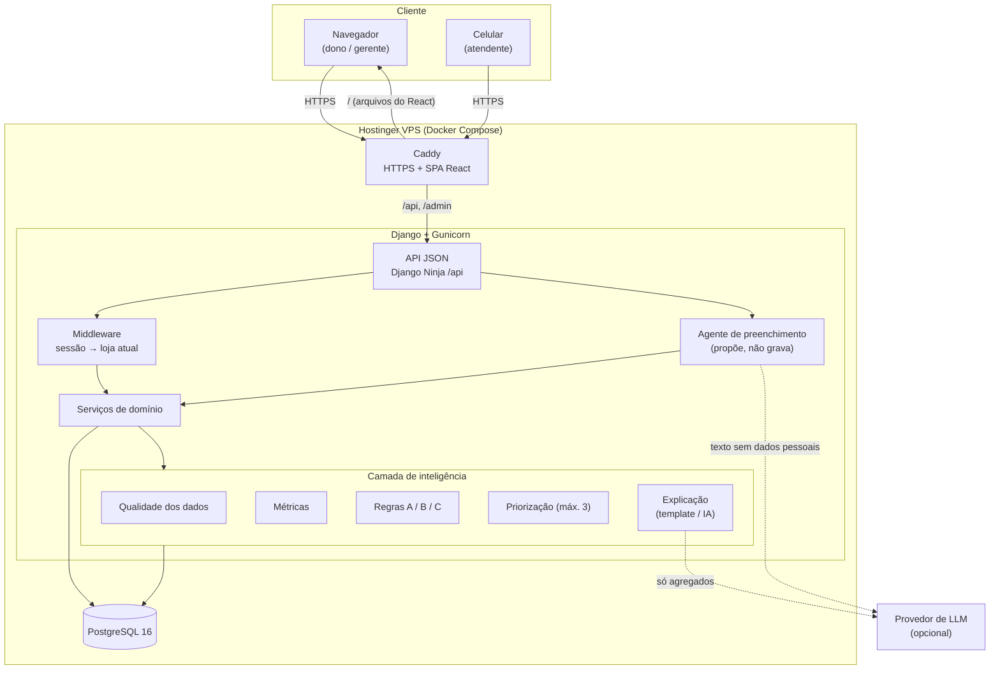
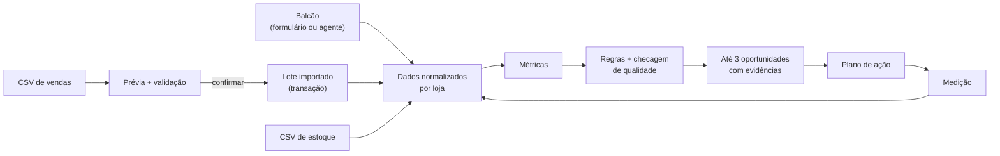
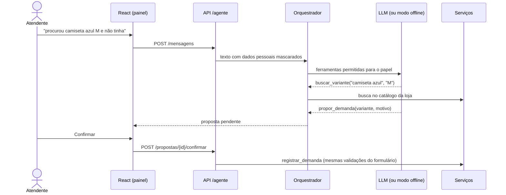
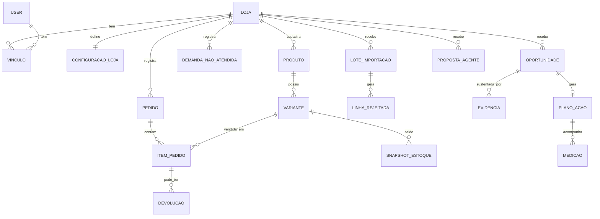
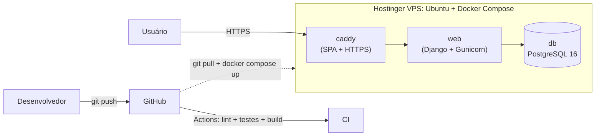

# 04. Arquitetura proposta

**Projeto:** MidiaComercial
**Data:** 13/11/2026

---

## 1. Visão geral

**Estilo:** monólito modular em Django (backend + API) com uma SPA React (frontend), servidos no mesmo domínio.

- **Monólito modular:** um único projeto Django dividido em apps por domínio. Fácil de construir e implantar em 48 h, sem a complexidade de microsserviços.
- **Camadas:** a interface e a API são finas; a regra de negócio fica na camada de serviços; o motor de regras é código puro e testável.
- **Mesmo domínio para SPA e API:** sem CORS; autenticação por sessão com proteção CSRF.



## 2. Componentes

| Componente | Responsabilidade |
| --- | --- |
| **SPA React** | Telas, formulários, gráficos e o painel do agente; consome apenas a API |
| **Caddy** | HTTPS automático, entrega os arquivos do React e encaminha `/api` e `/admin` para o Django |
| **API (Django Ninja)** | Rotas JSON tipadas, validação com Pydantic, documentação OpenAPI em `/api/docs` |
| **Middleware de loja** | Define `request.loja` e `request.papel` a partir da sessão e do vínculo do usuário |
| **Serviços** | Regras de negócio (importar, registrar demanda, criar ação, confirmar proposta) |
| **Camada de inteligência** | Qualidade → métricas → regras → priorização → explicação |
| **Agente de preenchimento** | Transforma texto ou planilhas em propostas que a pessoa confirma |
| **PostgreSQL** | Dados normalizados por loja, com constraints de unicidade e auditoria |

## 3. Apps Django (módulos)

| App | Responsabilidade | Entidades |
| --- | --- | --- |
| `core` | Middleware de loja, consultas com escopo de loja, utilidades | — |
| `contas` | Lojas, usuários, vínculos, papéis, limiares das regras | `Loja`, `Vinculo`, `ConfiguracaoLoja` |
| `importacao` | Upload, prévia, validação, confirmação, reconciliação | `LoteImportacao`, `LinhaRejeitada` |
| `comercio` | Catálogo e histórico de vendas | `Produto`, `Variante`, `Pedido`, `ItemPedido`, `Devolucao` |
| `estoque` | Saldo por variante e momento | `SnapshotEstoque` |
| `publico` | Demanda declarada no balcão | `DemandaNaoAtendida` |
| `inteligencia` | Métricas, regras, oportunidades e evidências | `ExecucaoMotor`, `Oportunidade`, `Evidencia` |
| `acoes` | Plano de ação, medição e auditoria | `PlanoAcao`, `Medicao`, `EventoAuditoria` |
| `agente` | Agente de IA para preenchimento de dados | `SessaoAgente`, `PropostaAgente`, `ChamadaFerramenta` |

### Regra de dependência

```
React  →  API (Ninja)  →  serviços  →  inteligência / modelos  →  PostgreSQL
                              ↑
              nunca o contrário: regras não conhecem request nem HTTP
```

## 4. Fluxo de dados ponta a ponta



## 5. Camada de inteligência

| Etapa | O que faz |
| --- | --- |
| 1. Contexto | Carrega a janela de análise (ex.: 30 dias) da loja autenticada |
| 2. Qualidade | Mede cobertura de cliente identificado, idade do estoque, reconciliação |
| 3. Métricas | Participação por categoria, ticket médio, vendas por dia/hora, demanda por variante |
| 4. Regras | Cada regra declara os dados de que precisa; se faltarem, fica **bloqueada** com motivo |
| 5. Priorização | Ordem transparente: lacuna de mix > estoque parado > padrão de público; corta em 3 |
| 6. Explicação | Texto por template (sempre); IA opcional reescreve, validada contra os números |
| 7. Persistência | Grava oportunidade, evidências, versão da regra e execução |

```python
class Regra(Protocol):
    codigo: str  # "A_LACUNA_MIX"
    versao: str  # "1.0"
    campos_necessarios: set[str]  # {"demanda", "estoque_atualizado"}

    def avaliar(self, ctx: ContextoAnalise) -> ResultadoRegra: ...
```

## 6. Agente de preenchimento (IA)



**Garantias:** propõe e não grava; usa as mesmas validações do sistema; age só na loja da sessão; ferramentas por papel; limite de passos; tudo auditado; funciona offline com um provedor determinístico.

## 7. Modelo de dados



**Regras de integridade:**
- Toda entidade operacional tem `loja`; a loja vem da sessão, nunca do arquivo ou do parâmetro.
- Unicidade garante importação idempotente: pedido por (loja, origem, id), item por (pedido, item), SKU por loja.
- Dinheiro em `DecimalField`; datas com fuso.
- Registros filhos herdam a loja do pai e recusam vínculos com outra loja.

## 8. Segurança

| Camada | Controle |
| --- | --- |
| Transporte | HTTPS (Caddy), HSTS, cabeçalhos de segurança |
| Autenticação | Sessão Django com cookie `HttpOnly`, CSRF obrigatório em escrita |
| Autorização | Papel por vínculo; consultas sempre filtradas pela loja; ID de outra loja → 404 |
| Dados pessoais | Demo sintética; sem CPF/nome/telefone; mascaramento antes de qualquer IA |
| Auditoria | Importações, ações, propostas e chamadas do agente registradas |
| Segredos | `.env` fora do Git; chaves diferentes por ambiente |

## 9. Implantação



**Plano B:** a demo roda localmente com `docker compose up` e o seed, sem internet e sem IA.

## 10. Decisões de arquitetura (resumo)

| # | Decisão | Motivo |
| --- | --- | --- |
| D1 | Monólito modular em vez de microsserviços | Menos infraestrutura e risco em 48 h |
| D2 | Django Ninja em vez de FastAPI separado | Estilo FastAPI sem duplicar autenticação, ORM e deploy |
| D3 | SPA React no mesmo domínio da API | Sem CORS; sessão e CSRF funcionam direto |
| D4 | Regras determinísticas antes de IA | Números reproduzíveis e explicáveis |
| D5 | IA só explica e propõe; nunca decide nem grava | Confiança e segurança |
| D6 | Status descritivo em vez de "% de confiança" | Evitar falsa precisão |
| D7 | Dados sintéticos na demo | LGPD e reprodutibilidade |
