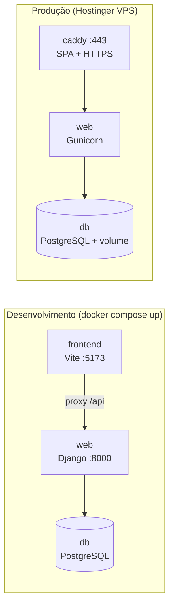

# 05. Plataforma e tecnologias adotadas

**Projeto:** MidiaComercial
**Data:** 13/11/2026

---

## 1. Plataforma

| Item | Escolha |
| --- | --- |
| **Tipo de aplicação** | Aplicação web responsiva (desktop para dono/gerente, celular para atendente) |
| **Hospedagem** | **Hostinger VPS** (Ubuntu) |
| **Execução** | **Docker Compose** com três serviços: `caddy`, `web`, `db` |
| **Código-fonte** | **GitHub** (repositório, Pull Requests, Actions e Projects) |
| **Navegadores-alvo** | Chrome, Edge, Firefox e Safari atuais; Chrome e Safari no celular |

> A hospedagem compartilhada da Hostinger é voltada a PHP/WordPress e não roda Django com PostgreSQL. Por isso o projeto usa um **plano VPS**.

## 2. Backend

| Tecnologia | Uso |
| --- | --- |
| **Python 3.12** | Linguagem do backend, do motor de regras e do agente |
| **Django 5.x** | Framework web: autenticação, ORM, migrações, painel admin |
| **Django Ninja** | API JSON no estilo FastAPI, com OpenAPI automático em `/api/docs` |
| **Pydantic v2** | Validação de entrada da API, das linhas do CSV e das propostas do agente |
| **PostgreSQL 16** | Banco relacional (SQLite apenas no desenvolvimento local sem Docker) |
| **django-environ** | Configuração por variáveis de ambiente (`.env`) |
| **Gunicorn** | Servidor de aplicação em produção |
| **WhiteNoise** | Arquivos estáticos do painel admin |
| **Faker** | Dados sintéticos do seed de demonstração |

## 3. Frontend

| Tecnologia | Uso |
| --- | --- |
| **React 19 + TypeScript** | Interface (SPA) |
| **Vite** | Servidor de desenvolvimento e build |
| **Tailwind CSS v4** | Estilização com tokens do design system |
| **shadcn/ui (Radix UI)** | Componentes acessíveis, com código dentro do projeto |
| **Mídia UI** | Design system próprio: cores, tipografia e componentes do domínio |
| **Recharts** (via shadcn/ui Charts) | Gráficos que herdam as cores do tema |
| **TanStack Query** | Busca de dados, cache e estados de carregamento/erro |
| **TanStack Table** | Tabelas com ordenação e paginação |
| **React Router** | Rotas e permissões por papel |
| **React Hook Form + Zod** | Formulários com validação |
| **Orval** | Gera tipos e hooks a partir do OpenAPI do Django Ninja |
| **MSW** | Dados simulados no frontend enquanto a API não fica pronta |
| **lucide-react · Sonner · date-fns** | Ícones, notificações e datas em pt-BR |

## 4. Inteligência artificial

| Tecnologia | Uso |
| --- | --- |
| **Camada de agente própria** (app `agente`) | Orquestrador, registro de ferramentas, propostas e auditoria |
| **Provedor offline determinístico** | Padrão da demo e dos testes; funciona sem internet |
| **API da Anthropic (Claude)**, opcional | LLM real para entender texto livre e planilhas; ligado por variável de ambiente |

**O que não usamos (e por quê):** banco vetorial, treino de modelo e múltiplos agentes. Não são necessários para o problema e aumentariam o risco no prazo.

## 5. Infraestrutura e entrega

| Tecnologia | Uso |
| --- | --- |
| **Docker** (build multi-stage) | Constrói o React, a imagem Python sem ferramentas de desenvolvimento e o Caddy com a SPA |
| **Docker Compose** | Ambientes de desenvolvimento e produção iguais |
| **Caddy 2** | Proxy reverso, HTTPS automático (Let's Encrypt) e entrega da SPA |
| **GitHub Actions** | CI: lint, testes e build a cada push e PR |
| **GitHub Projects** | Quadro de tarefas P0/P1 |

## 6. Qualidade

| Ferramenta | Uso |
| --- | --- |
| **pytest + pytest-django + pytest-cov** | Testes do backend (regras, importação, isolamento, agente) |
| **factory_boy** | Dados de teste |
| **Vitest + Testing Library** | Testes dos componentes React |
| **Ruff** | Lint e formatação do Python, incluindo regras de segurança |
| **ESLint + Prettier** | Lint e formatação do TypeScript |
| **pre-commit** | Ruff, checagem de YAML/TOML, arquivos grandes e chaves privadas antes de cada commit |

## 7. Ambientes

| Ambiente | Onde | Banco | IA |
| --- | --- | --- | --- |
| Local | Máquina do desenvolvedor (Docker ou venv) | PostgreSQL no Docker ou SQLite | Offline |
| Teste (CI) | GitHub Actions | Banco de teste do pytest | Offline |
| Produção (demo) | Hostinger VPS | PostgreSQL 16 com volume persistente | Offline por padrão; LLM se habilitado |

## 8. Variáveis de ambiente principais

| Variável | Para quê |
| --- | --- |
| `SECRET_KEY`, `DEBUG`, `ALLOWED_HOSTS`, `CSRF_TRUSTED_ORIGINS` | Configuração do Django |
| `DATABASE_URL` / `POSTGRES_*` | Conexão com o banco |
| `MIDIA_IA_HABILITADA` | Liga o agente e o painel de IA |
| `MIDIA_IA_PROVEDOR` | `fake` (offline) ou `anthropic` |
| `MIDIA_IA_API_KEY`, `MIDIA_IA_MODELO` | Chave e modelo do LLM (nunca versionados) |

## 9. Ferramentas de trabalho da equipe

GitHub (código, PRs, Projects) · VS Code · Docker Desktop · navegador com DevTools · documentação em Markdown dentro do repositório (`docs/`).
