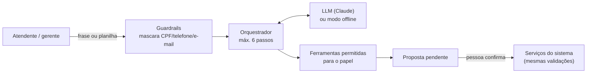

# 06. Descrição de como a tecnologia ou prática sorteada será incorporada

**Projeto:** MidiaComercial
**Data:** 13/11/2026

> ⚠️ **Antes de entregar:** preencha a seção 1 com a tecnologia/prática sorteada e apague as seções do apêndice que não se aplicam. A seção 2 já traz o texto completo para o caso **IA generativa**, porque o projeto já tem a camada do agente de IA planejada; o apêndice traz o plano resumido para as demais possibilidades.

---

## 1. Tecnologia/prática sorteada

| Campo | Preenchimento |
| --- | --- |
| **Tecnologia ou prática** | `__________` |
| **Onde entra na solução** | (camada ou app: ver [Arquitetura](04-ARQUITETURA-PROPOSTA.md)) |
| **Problema que ela resolve no projeto** | |
| **O que muda na arquitetura** | |
| **Como será demonstrada à banca** | |
| **Critério de aceite** | |
| **Responsável na equipe** | |

---

## 2. Caso pronto: IA generativa

### 2.1 Onde entra

No **Agente de Preenchimento** (app `agente`) e na **explicação dos cartões de oportunidade** (app `inteligencia`).

### 2.2 Problema que resolve

O maior risco do MidiaComercial é a falta de dados: o atendente não registra o que faltou e a planilha do lojista não segue o padrão. A IA generativa **reduz o esforço de colocar dados no sistema**:

| Caso | Entrada | O que a IA faz |
| --- | --- | --- |
| Balcão | "cliente procurou camiseta azul M e não tinha" | Encontra a variante e prepara o registro de demanda |
| Importação | Planilha com colunas "Nº venda", "Valor R$", "Data" | Propõe o mapeamento para o contrato do CSV |
| Estoque | "contei 3 camisetas azuis M e nenhuma G" | Prepara os saldos por variante |
| Oportunidades | Cartão já calculado | Reescreve a explicação em linguagem simples, sem mudar números |

### 2.3 Como funciona

**Regras que tornam o uso responsável:**

1. **A IA propõe, a pessoa confirma.** Nada é gravado sem o clique em "Confirmar".
2. **Mesmas validações do sistema.** A proposta passa pelos mesmos schemas e serviços do formulário manual.
3. **Escopo da loja.** As ferramentas recebem a loja da sessão; o modelo não escolhe a loja.
4. **Ferramentas por papel.** O atendente só pode propor demandas; o gerente também estoque, importação e cadastro.
5. **Sem dados pessoais.** CPF, telefone e e-mail são mascarados antes de qualquer chamada.
6. **Texto é dado, não instrução.** Proteção contra comandos escondidos em nomes de produto ou células de planilha.
7. **Números não vêm da IA.** Métricas e oportunidades são calculadas por regras; a IA só explica e preenche.
8. **Funciona sem internet.** Um provedor offline determinístico cobre o caso do balcão na demo e nos testes.
9. **Auditoria.** Cada mensagem, ferramenta chamada, proposta e confirmação fica registrada.

### 2.4 O que muda na arquitetura

- Novo app Django `agente` com orquestrador, registro de ferramentas, provedores (offline e Claude) e modelo `PropostaAgente`.
- Novas rotas: `POST /api/agente/mensagens`, `GET /api/agente/propostas`, `POST /api/agente/propostas/{id}/confirmar` e `/rejeitar`.
- Novos componentes no frontend (Mídia UI): botão "Preencher com IA", painel lateral e cartão de proposta.
- Variáveis de ambiente: `MIDIA_IA_HABILITADA`, `MIDIA_IA_PROVEDOR`, `MIDIA_IA_API_KEY`, `MIDIA_IA_MODELO`.

### 2.5 Como será demonstrada

1. Na tela **Balcão**, o atendente escreve: *"cliente procurou camiseta azul M e não tinha"*.
2. O agente mostra o cartão de proposta com produto, tamanho e motivo, e destaca o campo incerto.
3. O atendente confirma com um toque.
4. Na tela **Oportunidades**, o cartão "Investigar reposição: Camiseta Azul M" mostra a nova procura contada na evidência.
5. Mostramos que, sem confirmar, nada é gravado, e que o modo offline funciona sem internet.

### 2.6 Critérios de aceite

- [ ] A frase do balcão gera 1 proposta com a variante correta
- [ ] Nenhum registro é criado antes da confirmação
- [ ] Confirmar duas vezes não duplica o registro
- [ ] Proposta de outra loja retorna 404
- [ ] CPF e telefone digitados aparecem mascarados no histórico
- [ ] Com a IA desligada ou sem internet, o formulário manual continua funcionando

---

## Apêndice: plano resumido para outras possibilidades

| Se sortear… | Como incorporar no MidiaComercial | Onde aparece | Como demonstrar |
| --- | --- | --- | --- |
| **TDD / testes automatizados** | Testes escritos antes das regras A/B/C, da reconciliação e do isolamento entre lojas | `apps/*/tests`, cobertura no CI | Rodar `pytest --cov` ao vivo e mostrar um teste falhando antes da regra existir |
| **CI/CD / DevOps** | GitHub Actions com lint, testes e build; deploy no VPS após merge na `main` | `.github/workflows/` | Abrir um PR e mostrar o pipeline verde e o deploy |
| **Docker / containers** | `docker compose up` sobe Caddy, Django e PostgreSQL; build multi-stage | `Dockerfile`, compose | Subir o ambiente do zero na apresentação |
| **Microsserviços** | Extrair o motor de inteligência para um serviço FastAPI que recebe agregados e devolve oportunidades | novo serviço `motor/` | Derrubar o serviço do motor e mostrar o sistema seguindo com a explicação por template |
| **API REST / OpenAPI** | Django Ninja com contrato versionado `/api/v1` e cliente tipado gerado pelo Orval | `config/api.py`, `frontend/src/api/gen` | Mostrar `/api/docs` e o frontend quebrando na compilação se o contrato mudar |
| **Cloud / deploy** | Hostinger VPS com Docker Compose, HTTPS e backup diário do volume do banco | infraestrutura | Acessar a URL pública com HTTPS |
| **Mensageria / filas** | Importação assíncrona: upload → fila → worker valida → React acompanha o progresso | `importacao/tasks.py` | Importar um CSV grande e ver a barra de progresso |
| **Segurança / LGPD by design** | Testes de acesso cruzado, minimização de dados, mascaramento e auditoria como protagonistas | `core`, `acoes`, `agente` | Tentar acessar dado de outra loja e receber 404 |
| **Acessibilidade** | WCAG 2.1 AA nas telas, navegação por teclado, contraste, alvos grandes no balcão | `frontend/` | Navegar a demo só com teclado e leitor de tela |
| **PWA / mobile** | Tela do balcão instalável, com fila offline que sincroniza depois | `frontend/` (service worker) | Registrar demanda em modo avião e sincronizar ao voltar |
| **Ciência de dados / ML** | Cesta de produtos complementares (suporte, confiança, lift) ou previsão com baseline e validação temporal | `inteligencia/regras/` | Mostrar um kit sugerido com a evidência estatística |
| **Metodologia ágil** | Quadro Kanban no GitHub Projects com P0/P1, dailies por janela e definição de pronto | GitHub Projects | Mostrar o quadro e o histórico de entregas |
| **Clean Architecture / DDD** | Apps por domínio, serviços e regras puras sem dependência de HTTP | toda a base | Mostrar uma regra testada sem banco nem request |
