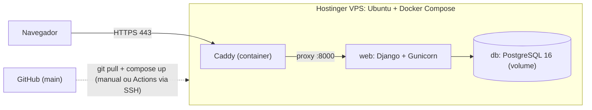
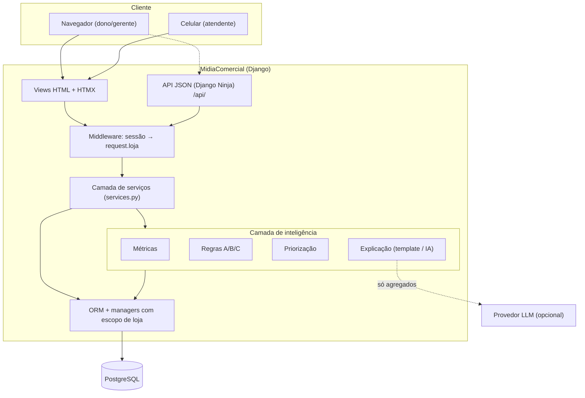
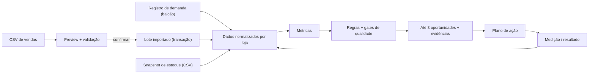
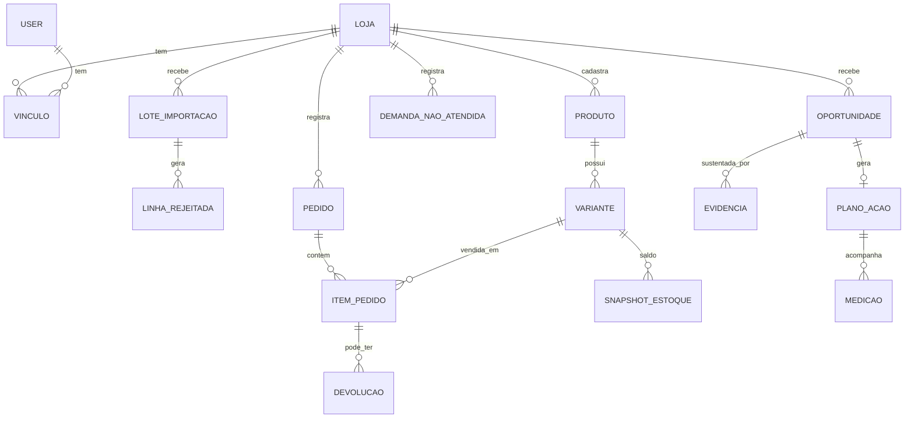
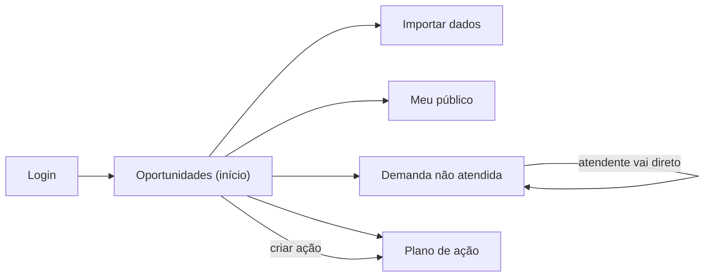

# MidiaComercial: Arquitetura e Planejamento Técnico Inicial

**Hackrun, primeira entrega (planejamento e definição técnica)**
**Versão:** 0.1, 13/11/2026
**Base:** documento *MidiaComercial: Inteligência comercial para pequenos lojistas* (pesquisa v1.0)
**Status:** proposta para a equipe. Não é a entrega final do MVP.

---

## Sumário

0. [Checklist da entrega](#0-checklist-da-entrega)
1. [Problema e escopo congelado](#1-problema-e-escopo-congelado)
2. [Linguagem, plataforma e tecnologias](#2-linguagem-plataforma-e-tecnologias)
3. [Arquitetura proposta](#3-arquitetura-proposta)
4. [A camada de inteligência](#4-a-camada-de-inteligência)
5. [Modelo de dados](#5-modelo-de-dados)
6. [API e rotas](#6-api-e-rotas)
7. [Proposta e estrutura inicial das telas](#7-proposta-e-estrutura-inicial-das-telas)
8. [Segurança, isolamento por loja e privacidade](#8-segurança-isolamento-por-loja-e-privacidade)
9. [IA opcional com limites](#9-ia-opcional-com-limites)
10. [Tecnologia ou prática sorteada](#10-tecnologia-ou-prática-sorteada)
11. [Estrutura do repositório](#11-estrutura-do-repositório)
12. [Plano de execução e divisão da equipe](#12-plano-de-execução-e-divisão-da-equipe)
13. [Riscos e decisões em aberto](#13-riscos-e-decisões-em-aberto)

---

## 0. Checklist da entrega

| Item exigido | Onde está neste documento |
| --- | --- |
| Proposta e estrutura inicial das telas | §7 |
| Documentação inicial do projeto | §1, §4, §5, §6, §11 |
| Linguagem de programação escolhida | §2.1 |
| Arquitetura proposta | §3 e §4 |
| Plataforma e tecnologias adotadas | §2 |
| Como a tecnologia/prática sorteada será incorporada | §10 (preencher após o sorteio) |

---

## 1. Problema e escopo congelado

### 1.1 Problema central

> O pequeno lojista tem sinais espalhados sobre o que vende e sobre o que o cliente procura, mas não tem uma rotina simples para transformar esses sinais em decisões que possam ser verificadas.

### 1.2 Proposta

**MidiaComercial** é uma camada leve de inteligência comercial que fica **ao lado** do PDV/ERP do lojista (não o substitui). Ela:

1. **Importa** vendas (CSV) e, opcionalmente, saldo de estoque.
2. **Registra** demandas não atendidas no balcão ("procurou camiseta azul M e não tinha"), em até 20 s.
3. **Calcula** métricas e aplica regras determinísticas.
4. **Entrega** no máximo **3 oportunidades** priorizadas, cada uma com evidência, amostra e limitação.
5. **Acompanha** a ação escolhida (responsável, prazo, indicador, resultado).

**Diferencial que vai para o pitch:** *observar compras e não compras, decidir e medir.*

### 1.3 Recorte

- **Segmento:** moda e acessórios (variações de tamanho e cor deixam a falta de produto fácil de mostrar).
- **Loja de referência:** persona fictícia, uma loja de moda masculina em Palmas ("Loja Demo Centro"), mais uma segunda loja fictícia para demonstrar o isolamento.
- **Dados:** **100% mockados** (seed sintético). Não haverá teste com lojista real nem importação de dados reais durante o evento.

### 1.4 Dentro do MVP (P0)

| # | Entrega | Critério de aceite |
| --- | --- | --- |
| P0-1 | Login e separação por loja | Usuário da loja A não acessa dados da loja B, nem trocando IDs na URL |
| P0-2 | Importação de CSV com validação | Prévia, erros por linha, reconciliação de totais, reimportação sem duplicar |
| P0-3 | Perfil de compra ("Meu público") | Categorias, ticket, dia/horário; recorrência só com `cliente_ref` e cobertura exibida |
| P0-4 | Registro de demanda não atendida | Produto/categoria + variação + motivo em até 20 s (mobile) |
| P0-5 | Motor de oportunidades | 3 regras (A, B, C), no máximo 3 cartões, com evidência e limitação |
| P0-6 | Plano de ação | Criar, concluir ou descartar ação com indicador e medição |
| P0-7 | Explicação | Texto por template sempre disponível; IA opcional sem alterar números |
| P0-8 | Demo reproduzível | Seed sintético de 90 dias, 2 lojas, sem depender de serviço externo |

### 1.5 Fora do MVP

Integração com ERPs, disparo de campanhas, previsão de vendas, precificação automática, app nativo, câmeras, reconhecimento facial, mapa de concorrentes, benchmark entre lojas. Clima e calendário externo ficam como P1/P2.

---

## 2. Linguagem, plataforma e tecnologias

### 2.1 Linguagem

**Python 3.12.** É a linguagem que a equipe domina, tem bom ecossistema para dados (Decimal, CSV, pandas se precisar) e é a linguagem do Django.

### 2.2 Django + FastAPI: como encaixar

FastAPI **cabe**, mas rodar dois frameworks em 48 h duplica autenticação, ORM, migrações e deploy. A recomendação é usar **Django Ninja**, que traz a experiência do FastAPI para dentro do Django:

| Critério | Django + DRF | **Django + Django Ninja** ✅ | Django + FastAPI separado |
| --- | --- | --- | --- |
| Estilo de código | Serializers e ViewSets | **Igual ao FastAPI**: type hints e Pydantic | FastAPI puro |
| OpenAPI/Swagger automático | Com pacote extra | **Nativo em `/api/docs`** | Nativo |
| Auth, ORM, admin, migrações | Do Django | **Do Django** | Duplicado ou compartilhado (complexo) |
| Deploy | 1 serviço | **1 serviço** | 2 serviços + rede + CORS |
| Risco em 48 h | Baixo | **Baixo** | Alto |

```python
# Exemplo: rota Ninja (sintaxe praticamente igual à do FastAPI)
from ninja import Router
from .schemas import DemandaIn, DemandaOut
from . import services

router = Router(tags=["Demandas"])


@router.post("/", response=DemandaOut)
def registrar_demanda(request, payload: DemandaIn):
    return services.registrar_demanda(loja=request.loja, usuario=request.user, dados=payload)
```

**Quando FastAPI separado faria sentido:** se a tecnologia sorteada for microsserviços ou algo parecido (ver §10). Nesse caso, apenas o **motor de inteligência** vira um serviço FastAPI, e o Django continua com auth, telas e dados.

### 2.3 Stack adotada

| Camada | Tecnologia | Por quê |
| --- | --- | --- |
| Backend | **Django 5.x** | Auth, ORM, admin e migrações prontos |
| API JSON | **Django Ninja** (Pydantic v2) | Estilo FastAPI, OpenAPI automático |
| Banco | **PostgreSQL 16** | Transações, constraints, `NUMERIC` para dinheiro |
| Frontend | **Templates Django + HTMX + Alpine.js** | Interatividade sem SPA, sem build complexo |
| Estilo | **Tailwind CSS** (CLI standalone, sem Node) | Responsivo rápido; CSS final gerado no build |
| Gráficos | **Chart.js** | Leve e suficiente para barras e linhas |
| Validação de CSV | `csv` da stdlib + **schemas Pydantic** por linha | Erros por linha com mensagem clara |
| Dados sintéticos | **Faker** + script próprio (`manage.py seed_demo`) | Demo reproduzível |
| Testes | **pytest + pytest-django + factory_boy** | Testes de isolamento e cálculo |
| Qualidade | **Ruff** (lint + format), pre-commit | Padroniza sem discussão |
| Ambiente | **Docker Compose** (web + db) | Todos rodam igual |
| IA (opcional) | Cliente LLM por trás de uma interface (`ExplicadorLLM`) | Trocável; fallback por template |
| Hospedagem | **Hostinger VPS** (Ubuntu + Docker Compose) | Controle total; mesmo `docker compose` do ambiente local |
| Servidor web | **Gunicorn** + **Caddy** (HTTPS automático) ou Nginx + Certbot | Proxy reverso e certificado TLS |
| Estáticos | **WhiteNoise** | Serve o CSS do Tailwind sem configurar Nginx para isso |

**Fora de propósito:** Redis, Celery, banco vetorial, múltiplos agentes, treino de modelo. Só entram se a importação ficar lenta de verdade (não vai, com CSV de demo).

### 2.4 Tailwind sem Node

Usar o **binário standalone do Tailwind** (ou o pacote `pytailwindcss`, que baixa esse binário via pip). Assim ninguém precisa de `npm` no projeto.

```bash
# desenvolvimento (recompila ao salvar)
tailwindcss -i static/src/input.css -o static/css/app.css --watch
# build (no Dockerfile)
tailwindcss -i static/src/input.css -o static/css/app.css --minify
```

O `tailwind.config.js` aponta o `content` para `templates/**/*.html` e `apps/**/templates/**/*.html`. Evitar o CDN "Play" do Tailwind na demo: ele é para protótipo e deixa a página mais lenta.

### 2.5 Deploy na Hostinger

> **Atenção:** a hospedagem compartilhada da Hostinger é feita para PHP/WordPress e não serve para Django com PostgreSQL. É preciso um **plano VPS**.



Passo a passo:

1. Criar o VPS com Ubuntu (a Hostinger oferece imagem com Docker já instalado; se não usar, instalar Docker + Compose plugin).
2. Apontar o domínio ou subdomínio (registro `A`) para o IP do VPS.
3. Liberar só as portas 22, 80 e 443 no firewall (o painel da Hostinger tem firewall; ou `ufw`).
4. `git clone` do repositório, criar `.env` de produção (`DEBUG=False`, `SECRET_KEY`, `ALLOWED_HOSTS`, `CSRF_TRUSTED_ORIGINS`, `DATABASE_URL`).
5. `docker compose -f docker-compose.prod.yml up -d --build`.
6. `docker compose exec web python manage.py migrate && python manage.py seed_demo`.
7. Conferir HTTPS, login das duas lojas demo e `/api/docs`.

Arquivos extras no repositório: `docker-compose.prod.yml` (web + db + caddy, sem volume de código montado) e `Caddyfile`:

```
midiacomercial.seudominio.com.br {
    reverse_proxy web:8000
}
```

**Plano B para a apresentação:** a demo também roda local com `docker compose up` e o seed, caso o VPS ou a internet do evento falhe. Gravar um vídeo curto do fluxo como último recurso.

---

## 3. Arquitetura proposta

### 3.1 Estilo: monólito modular em camadas

Um único projeto Django, dividido em **apps por domínio**. Dentro de cada app vale a mesma regra: **views e API são finas; a regra de negócio fica em `services.py`.** Assim as telas HTMX e a API JSON chamam exatamente o mesmo código.



### 3.2 Fluxo de dados ponta a ponta



### 3.3 Apps Django

| App | Responsabilidade | Entidades |
| --- | --- | --- |
| `contas` | Usuários, lojas, vínculos, papéis | `Loja`, `Vinculo` (usuário + loja + papel) |
| `importacao` | Upload, mapeamento, preview, confirmação, reconciliação | `LoteImportacao`, `LinhaRejeitada` |
| `comercio` | Histórico de vendas normalizado | `Produto`, `Variante`, `Pedido`, `ItemPedido`, `Devolucao` |
| `estoque` | Saldo por variante e data | `SnapshotEstoque` |
| `publico` | Demanda declarada e referência de cliente | `DemandaNaoAtendida`, `ClienteRef` |
| `inteligencia` | Métricas, regras, oportunidades, evidências, explicação | `Oportunidade`, `Evidencia`, `ExecucaoMotor` |
| `acoes` | Plano de ação e medição | `PlanoAcao`, `Medicao`, `EventoAuditoria` |
| `core` | Middleware de loja, managers com escopo, utilidades | — |

### 3.4 Regras de dependência entre camadas

```
views / api  →  services  →  inteligencia / models
                    ↑
         nunca o contrário; regras não importam views nem request
```

- Regras do motor recebem um `ContextoAnalise` (dados já filtrados pela loja) e **não fazem query livre**.
- Toda query de domínio passa por `Model.objects.da_loja(loja)`.

---

## 4. A camada de inteligência

Este é o coração da solução: a "camada" que transforma sinais em decisão.

### 4.1 Pipeline

```
1. Contexto      → carrega janela (ex.: últimos 30 dias) da loja autenticada
2. Qualidade     → calcula indicadores: cobertura de cliente_ref, idade do estoque,
                   completude de custo, reconciliação
3. Métricas      → participação por categoria, ticket médio, vendas por dia/hora,
                   recorrência identificada, demanda por variante/motivo, cobertura de estoque
4. Regras        → cada regra declara os campos de que precisa; se faltar, ela é BLOQUEADA
5. Priorização   → ordena por critério transparente; corta em 3
6. Explicação    → template determinístico (sempre) + IA opcional (validada)
7. Persistência  → grava Oportunidade + Evidências + versão da regra + execução
```

### 4.2 Contrato das regras

```python
# inteligencia/regras/base.py
from dataclasses import dataclass, field
from datetime import date
from decimal import Decimal
from typing import Literal, Protocol

StatusRegra = Literal["suficiente", "amostra_limitada", "bloqueada"]


@dataclass(frozen=True)
class EvidenciaCandidata:
    fonte: Literal["vendas", "demanda", "estoque", "acao"]
    descricao: str  # "9 registros de procura não atendida"
    valor: Decimal | int
    periodo_inicio: date
    periodo_fim: date
    amostra: int  # quantos registros sustentam o número


@dataclass
class OportunidadeCandidata:
    regra: str  # "A_LACUNA_MIX"
    titulo: str
    acao_sugerida: str
    limitacao: str
    alvo: dict  # {"sku": "CAM-AZ-M"} ou {"categoria": "Cintos"}
    urgencia: int  # 1..3
    esforco: int  # 1..3
    evidencias: list[EvidenciaCandidata] = field(default_factory=list)


@dataclass
class ResultadoRegra:
    status: StatusRegra
    oportunidades: list[OportunidadeCandidata]
    motivo: str | None = None  # explica bloqueio ou amostra limitada


class Regra(Protocol):
    codigo: str
    versao: str
    campos_necessarios: set[str]  # ex.: {"demanda", "estoque_atualizado"}

    def avaliar(self, ctx: "ContextoAnalise") -> ResultadoRegra: ...
```

### 4.3 Regras do MVP

| Regra | Dispara quando | Ação sugerida | Bloqueia quando | Limitação exibida |
| --- | --- | --- | --- | --- |
| **A: Lacuna de mix** | Demanda ≥ N registros para uma variante na janela **e** saldo = 0 ou ausente | Conferir estoque físico e consultar fornecedor | Nenhum registro de demanda na janela | "Registros são atendimentos, não compradores únicos" |
| **B: Estoque com pouca saída** | Saldo > 0 **e** nenhuma venda em X dias | Checar cadastro, exposição e sazonalidade | Estoque com mais de H horas sem atualização | "Ausência de venda não prova desinteresse" |
| **C: Padrão de público** | Concentração de categoria × dia/horário acima de limiar, ou mudança na recorrência identificada | Teste de exposição ou de atendimento no horário | Para recorrência: cobertura de `cliente_ref` abaixo do mínimo | "Associação observada, não causa" |

Todos os limiares (N, X, H, mínimo de cobertura) ficam em `ConfiguracaoLoja`, com padrões razoáveis e **editáveis**, nunca fixos no código.

### 4.4 Priorização sem falsa precisão

```
ordem = (regra A com estoque atualizado) > (regra A com estoque desatualizado)
        > regra B > regra C
desempate = maior amostra → maior urgência → menor esforço
```

Nada de "87% de confiança". Os rótulos são descritivos: **dados suficientes**, **amostra limitada**, **cálculo bloqueado (motivo)**.

### 4.5 Exemplo de saída (cartão)

```json
{
  "regra": "A_LACUNA_MIX", "versao": "1.0",
  "titulo": "Investigar reposição: Camiseta Azul M",
  "status": "suficiente",
  "evidencias": [
    {"fonte": "demanda", "descricao": "9 registros de procura não atendida", "periodo": "06–12/11", "amostra": 9},
    {"fonte": "estoque", "descricao": "Saldo informado = 0, atualizado há 18 h", "amostra": 1}
  ],
  "acao_sugerida": "Conferir estoque físico e consultar fornecedor antes de comprar",
  "limitacao": "São 9 atendimentos, não 9 compradores únicos nem 9 vendas garantidas",
  "medicao_sugerida": "Novos registros de falta para CAM-AZ-M nos próximos 7 dias"
}
```

### 4.6 Fórmulas (todas com `Decimal`)

| Métrica | Fórmula | Condição |
| --- | --- | --- |
| Ticket médio | receita ajustada ÷ pedidos concluídos | Devoluções exibidas à parte |
| Participação por categoria | receita da categoria ÷ receita total | Mesma janela e regra |
| Recorrência identificada | clientes com ≥ 2 pedidos ÷ clientes identificados | Só com `cliente_ref`; mostrar cobertura |
| Cobertura em dias | saldo ÷ média diária vendida | Média 0 → "indeterminada" |
| Margem de contribuição (P1) | receita − custo − variáveis conhecidas | Só se completude de custo for suficiente |

---

## 5. Modelo de dados

### 5.1 Diagrama ER (resumo)



### 5.2 Entidades principais

> Toda entidade operacional tem `loja = ForeignKey(Loja)`. Dinheiro usa `DecimalField(max_digits=12, decimal_places=2)`. Datas usam `DateTimeField` com fuso (`USE_TZ=True`, `TIME_ZONE="America/Araguaina"`).

| Entidade | Campos-chave | Restrições |
| --- | --- | --- |
| `Loja` | nome, segmento, horário de funcionamento, fuso | — |
| `Vinculo` | user, loja, papel (`dono`, `gerente`, `atendente`) | único (user, loja) |
| `LoteImportacao` | loja, tipo (`vendas`/`estoque`), arquivo_hash, status, linhas_ok/rejeitadas/duplicadas, total_importado, total_origem_informado, criado_por | único (loja, arquivo_hash) por tipo |
| `Pedido` | loja, sistema_origem, pedido_id_origem, data_hora, status, cliente_ref (nullable), lote | único (loja, sistema_origem, pedido_id_origem) |
| `ItemPedido` | loja, pedido, item_id, variante, quantidade, receita_item | único (pedido, item_id) |
| `Produto` / `Variante` | sku, categoria, nome, tamanho, cor | único (loja, sku) |
| `Devolucao` | loja, item_original, data, quantidade, valor | — |
| `SnapshotEstoque` | loja, variante, saldo, capturado_em, lote | índice (loja, variante, capturado_em) |
| `DemandaNaoAtendida` | loja, produto_texto ou variante, categoria, tamanho, cor, motivo (`indisponivel`, `variacao_ausente`, `preco`, `prazo`, `outro`), qtd_procurada (opcional), registrado_por, registrado_em | sem dados pessoais |
| `ExecucaoMotor` | loja, janela, executado_em, indicadores de qualidade (JSON) | — |
| `Oportunidade` | loja, execucao, regra, versao_regra, status, titulo, acao_sugerida, limitacao, alvo (JSON), prioridade | — |
| `Evidencia` | oportunidade, fonte, descricao, valor, periodo, amostra | mesma loja da oportunidade |
| `PlanoAcao` | loja, oportunidade, responsavel, prazo, indicador, situação (`aberta`/`concluida`/`descartada`), justificativa | — |
| `Medicao` | plano, período, valor_antes, valor_depois, contexto, versão do cálculo | — |
| `EventoAuditoria` | loja, usuário, ação, objeto, quando | append-only |

### 5.3 Contrato do CSV de vendas

Uma linha por item de pedido. Separador `;`, UTF-8.

| Coluna | Obrigatória | Tipo | Regra |
| --- | --- | --- | --- |
| `pedido_id` | ✅ | texto | — |
| `item_id` | ✅ | texto/int | único dentro do pedido |
| `data_hora` | ✅ | ISO 8601 com fuso | — |
| `sku` | ✅ | texto | uma variante por SKU (M ≠ G) |
| `categoria` | ✅ | texto | normalizada sem fundir variantes |
| `quantidade` | ✅ | int > 0 | — |
| `receita_item` | ✅ | decimal (2 casas) | já com desconto; sem frete e sem tributo destacado |
| `status` | ✅ | `concluida` / `cancelada` | canceladas não contam como venda |
| `cliente_ref` | ⬜ | texto opaco | **nunca** CPF, nome ou telefone |
| `custo_total_item`, `canal`, `variante` | ⬜ | — | habilitam análises extras |

> A loja **nunca** vem do arquivo; vem da sessão.

---

## 6. API e rotas

### 6.1 API JSON (Django Ninja, documentação em `/api/docs`)

| Método e rota | Uso | Papel mínimo |
| --- | --- | --- |
| `POST /api/importacoes/preview` | Valida o CSV e devolve prévia + erros, sem gravar dados de domínio | gerente |
| `POST /api/importacoes/{id}/confirmar` | Confirma o lote em transação e registra auditoria | gerente |
| `GET /api/importacoes/{id}` | Status, totais e reconciliação | gerente |
| `GET /api/analises/publico?inicio=&fim=` | Perfil de compra com cobertura | gerente |
| `POST /api/demandas` | Registra demanda não atendida | atendente |
| `GET /api/demandas/ranking?inicio=&fim=` | Ranking por variante e motivo | gerente |
| `POST /api/oportunidades/gerar` | Roda o motor para a janela | gerente |
| `GET /api/oportunidades` | Cartões válidos + evidências | gerente |
| `POST /api/acoes` | Cria ação a partir de uma oportunidade | gerente |
| `PATCH /api/acoes/{id}` | Concluir ou descartar com justificativa | gerente |
| `POST /api/acoes/{id}/medicoes` | Registra medição | gerente |

Autenticação por **sessão Django** (`django_auth`) com CSRF. Paginação em listas. Upload limitado (ex.: 5 MB).

### 6.2 Rotas HTML (views + HTMX)

`/login` · `/` (redireciona para oportunidades) · `/importar` · `/publico` · `/demanda` (mobile) · `/oportunidades` · `/acoes`

---

## 7. Proposta e estrutura inicial das telas

Princípios: **mobile-first** para o atendente, **desktop-friendly** para o dono, linguagem do lojista (sem "RFM", "lift", "coorte" na interface) e **toda informação com sua limitação ao lado**.

### Mapa de navegação



Atendente vê **só** a tela de Demanda. Gerente e dono veem tudo.

### Tela 1: Importar dados e qualidade

```
┌──────────────────────────────────────────────────────────────┐
│ MidiaComercial  ▸ Importar     Loja: Demo Centro (DEMO)   [sair] │
├──────────────────────────────────────────────────────────────┤
│ 1 Arquivo  →  2 Prévia  →  3 Confirmar                       │
│                                                              │
│ [ Arraste o CSV de vendas aqui ]  ⬇ baixar modelo de CSV     │
│ Tipo: (•) Vendas  ( ) Estoque                                │
│ Total do relatório de origem (R$): [ 18.432,90 ]             │
│                                                              │
│ ── Prévia (5 primeiras linhas) ────────────────────────────  │
│ pedido | data       | sku      | qtd | receita | status      │
│ V001   | 01/11 10h  | CAM-AZ-M | 2   | 119,80  | concluída   │
│ ...                                                          │
│ ✅ 1.204 aceitas   ⚠ 3 duplicadas   ❌ 7 rejeitadas [ver]     │
│ Reconciliação: importado R$ 18.401,10 · origem R$ 18.432,90  │
│                diferença R$ 31,80 (0,17%) ⚠                  │
│                                      [Cancelar] [Confirmar]  │
└──────────────────────────────────────────────────────────────┘
```

### Tela 2: Meu público

```
┌──────────────────────────────────────────────────────────────┐
│ Meu público          Período: [últimos 30 dias ▾]            │
├──────────────────────────────────────────────────────────────┤
│ Ticket médio  R$ 142,30 │ Pedidos 312 │ Clientes identif. 41%│
│                                                              │
│ Vendas por categoria  [receita ▾]   ▇▇▇▇▇ Camisetas 38%      │
│                                     ▇▇▇   Calças    22%      │
│                                     ▇▇    Cintos    11% ...  │
│                                                              │
│ Quando compram (heatmap dia × hora)                          │
│                                                              │
│ Recorrência (só clientes identificados: 128 de 312 pedidos)  │
│ Compra única 64% · 2+ compras 36%                            │
│ ⓘ 59% dos pedidos não têm cliente identificado; a leitura de │
│   recorrência vale só para esse grupo.                       │
└──────────────────────────────────────────────────────────────┘
```

### Tela 3: Demanda não atendida (mobile, atendente)

```
┌────────────────────────────┐
│ Cliente procurou e não     │
│ encontrou                  │
├────────────────────────────┤
│ O quê? [camiseta azul   🔍]│  ← autocomplete por SKU/categoria
│                            │
│ Tamanho  [PP][P][M][G][GG] │
│ Cor      [Azul ▾]          │
│                            │
│ Por quê?                   │
│ [Sem estoque] [Sem tamanho]│
│ [Preço]  [Prazo]  [Outro]  │
│                            │
│ [   REGISTRAR (1 toque)   ]│
│ ✓ Registrado! Camiseta     │
│   Azul M · sem tamanho     │
│ ⓘ Não digite nome ou       │
│   telefone do cliente.     │
└────────────────────────────┘
```

Meta: **≤ 20 segundos e ≤ 4 toques.** Para o gerente, a mesma tela mostra abaixo o **ranking** por variante e motivo.

### Tela 4: Oportunidades (início)

```
┌──────────────────────────────────────────────────────────────┐
│ Oportunidades da semana   Janela 06–12/11   [Recalcular]     │
├──────────────────────────────────────────────────────────────┤
│ ① Investigar reposição: Camiseta Azul M   🟢 dados suficientes│
│   Evidência: 9 procuras não atendidas em 7 dias              │
│              saldo = 0 (atualizado há 18 h)                  │
│   Limitação: 9 atendimentos ≠ 9 vendas garantidas            │
│   Sugestão: conferir estoque físico e consultar fornecedor   │
│   [Ver detalhes]  [Criar ação]  [Descartar]                  │
├──────────────────────────────────────────────────────────────┤
│ ② Cinto marrom sem venda há 21 dias       🟡 amostra limitada │
├──────────────────────────────────────────────────────────────┤
│ ③ Sábado 10–12h concentra 31% de Calças   🟢                  │
├──────────────────────────────────────────────────────────────┤
│ ⛔ Recorrência: bloqueada (cobertura de cliente < 30%)        │
└──────────────────────────────────────────────────────────────┘
```

"Ver detalhes" abre a origem dos dados, o período, a amostra, a regra aplicada e a versão.

### Tela 5: Plano de ação

```
┌──────────────────────────────────────────────────────────────┐
│ Plano de ação                         [Abertas ▾]            │
├──────────────────────────────────────────────────────────────┤
│ Repor Camiseta Azul M                                        │
│ Responsável: Ana · Prazo: 15/11 · Situação: ABERTA           │
│ Indicador: registros de falta de CAM-AZ-M                    │
│ Antes (06–12/11): 9   Depois (13–19/11): —                   │
│ [Registrar medição]  [Concluir]  [Descartar c/ justificativa]│
│ ⓘ Comparação antes/depois mostra associação, não prova efeito│
└──────────────────────────────────────────────────────────────┘
```

### Tela 0: Login e seleção de loja

Login padrão do Django com estilo próprio. Se o usuário tiver mais de uma loja, ele escolhe qual abrir; a escolha fica gravada na sessão.

---

## 8. Segurança, isolamento por loja e privacidade

### 8.1 Isolamento (multi-tenant por linha)

```python
# core/middleware.py
class LojaAtualMiddleware:
    def __init__(self, get_response):
        self.get_response = get_response

    def __call__(self, request):
        request.loja = None
        if request.user.is_authenticated:
            loja_id = request.session.get("loja_id")
            vinculo = request.user.vinculos.filter(loja_id=loja_id).select_related("loja").first()
            request.loja = vinculo.loja if vinculo else None
            request.papel = vinculo.papel if vinculo else None
        return self.get_response(request)


# core/models.py
class LojaQuerySet(models.QuerySet):
    def da_loja(self, loja):
        if loja is None:
            raise PermissionDenied("Loja não definida")
        return self.filter(loja=loja)
```

- O ID da loja **nunca** vem de parâmetro ou de arquivo. Vem da sessão, validado contra o `Vinculo`.
- Buscas por ID usam sempre `Model.objects.da_loja(request.loja).get(pk=...)`. Um ID de outra loja retorna **404**, não 403.
- **Teste obrigatório (P0):** duas lojas, dois usuários; tentar ler, editar e exportar recurso cruzado.

### 8.2 Papéis

| Papel | Pode |
| --- | --- |
| `atendente` | Registrar demanda |
| `gerente` | Tudo do atendente + importar, analisar, criar e medir ações |
| `dono` | Tudo + gerenciar usuários da loja |

### 8.3 Privacidade (LGPD)

- Demo com **dados 100% sintéticos**, identificados como tal na interface (selo "DEMO").
- Sem CPF, nome, telefone ou endereço no núcleo analítico. `cliente_ref` é opaco, mas **continua sendo dado pessoal** se permitir reidentificação.
- Arquivos CSV temporários são apagados depois da confirmação; guardam-se só o hash e os totais.
- Nenhum dado pessoal vai para LLM externo. A IA recebe apenas agregados.
- Segredos em `.env` (fora do Git); HTTPS no deploy; logs sem conteúdo bruto de CSV.

---

## 9. IA opcional com limites

A IA **não calcula nada**. Ela só reescreve a explicação de um cartão em linguagem mais natural.

```
fatos_aprovados = {titulo, evidencias[], limitacao, acao_sugerida}   # já calculados
        │
        ▼
ExplicadorLLM.explicar(fatos_aprovados)  ──falha/timeout──►  ExplicadorTemplate
        │
        ▼
validar_saida(texto, fatos_aprovados):
   - todo número do texto precisa existir nos fatos
   - não pode citar SKU ou categoria fora dos fatos
   - se reprovar → usa o template
```

- Nada de SQL livre e nada de acesso a outras lojas: a IA não executa ações.
- Texto importado (nome de produto etc.) é tratado como **dado**, nunca como instrução (proteção contra prompt injection).
- Flag `MIDIA_IA_HABILITADA=false` por padrão; a demo funciona sem internet.

---

## 10. Tecnologia ou prática sorteada

> **Preencher após o sorteio.** Modelo de texto para a entrega:
>
> **Tecnologia/prática sorteada:** `__________`
> **Onde entra na solução:** (camada/app do §3.3)
> **O que muda na arquitetura:** (diagrama, se mudar)
> **Como será demonstrada:** (o que a banca vai ver)
> **Critério de aceite:** (como saberemos que foi incorporada de verdade)

Para ganhar tempo, um mapeamento prévio das possibilidades mais prováveis:

| Se sortear… | Como incorporar no MidiaComercial | Onde aparece |
| --- | --- | --- |
| **IA generativa / LLM** | Explicador dos cartões (§9) + "pergunte à loja" com intenções fechadas (`resumir_categorias`, `explicar_oportunidade`) | `inteligencia/explicacao` |
| **TDD / testes automatizados** | Testes primeiro para regras A/B/C, reconciliação e isolamento entre lojas; cobertura no CI | `tests/`, badge no README |
| **CI/CD / DevOps** | GitHub Actions: Ruff + pytest + build da imagem Docker; deploy automático na branch `main` | `.github/workflows/` |
| **Docker / containers** | `docker compose up` sobe web + Postgres + seed da demo | `docker-compose.yml` |
| **Microsserviços** | Extrair o motor de inteligência para um serviço **FastAPI** que recebe agregados e devolve oportunidades; o Django mantém auth e dados | novo `motor/` (FastAPI) |
| **API REST / OpenAPI** | Django Ninja com Swagger em `/api/docs`; contrato versionado `/api/v1` | `api.py` |
| **Cloud / deploy** | VPS Hostinger com Docker Compose, Caddy com HTTPS, backup diário do volume do Postgres | infra (§2.5) |
| **Mensageria / filas** | Importação assíncrona: upload → fila → worker valida → notifica via HTMX polling | `importacao/tasks.py` |
| **Segurança / LGPD by design** | §8 vira protagonista: testes de acesso cruzado, minimização, auditoria e tela de retenção | `core`, `acoes/auditoria` |
| **Acessibilidade** | WCAG AA nas 5 telas, navegação por teclado, contraste e rótulos; formulário de demanda com alvos grandes | templates |
| **PWA / mobile** | Tela de demanda como PWA instalável, com fila offline que sincroniza depois | `publico/static/` |
| **Ciência de dados / ML** | Cesta complementar (suporte, confiança, lift) ou previsão com baseline sazonal e validação temporal | `inteligencia/regras/` |
| **Metodologia ágil (Scrum/Kanban)** | Board com P0/P1, dailies curtas por janela do §12, definição de pronto explícita | GitHub Projects |
| **Clean Architecture / DDD** | Já é a base: apps por domínio, `services` e regras puras sem dependência de Django | §3.4 |

---

## 11. Estrutura do repositório

```
midiacomercial/
├── README.md
├── ARQUITETURA.md                ← este documento
├── docker-compose.yml            ← desenvolvimento
├── docker-compose.prod.yml       ← Hostinger VPS (web + db + caddy)
├── Caddyfile
├── Dockerfile                    ← inclui build do Tailwind
├── tailwind.config.js
├── pyproject.toml                ← deps + config do ruff/pytest
├── .env.example
├── .github/workflows/ci.yml
├── manage.py
├── config/                       ← settings (base/dev/prod), urls, wsgi, asgi
│   ├── settings/
│   ├── urls.py
│   └── api.py                    ← NinjaAPI() + routers
├── apps/
│   ├── core/                     ← middleware de loja, LojaQuerySet, mixins
│   ├── contas/
│   ├── importacao/
│   │   ├── models.py
│   │   ├── schemas.py            ← Pydantic: LinhaVendaCSV
│   │   ├── services.py           ← preview(), confirmar(), reconciliar()
│   │   ├── api.py                ← router Ninja
│   │   ├── views.py              ← telas HTMX
│   │   └── tests/
│   ├── comercio/
│   ├── estoque/
│   ├── publico/
│   ├── inteligencia/
│   │   ├── contexto.py           ← ContextoAnalise
│   │   ├── qualidade.py
│   │   ├── metricas.py
│   │   ├── regras/
│   │   │   ├── base.py
│   │   │   ├── a_lacuna_mix.py
│   │   │   ├── b_pouca_saida.py
│   │   │   └── c_padrao_publico.py
│   │   ├── priorizacao.py
│   │   ├── explicacao/
│   │   │   ├── template.py
│   │   │   └── llm.py            ← opcional
│   │   ├── motor.py              ← orquestra o pipeline
│   │   └── tests/
│   └── acoes/
├── templates/
│   ├── base.html
│   └── partials/                 ← fragmentos HTMX (cards, tabelas)
├── static/
│   ├── src/input.css             ← @tailwind base/components/utilities
│   └── css/app.css               ← gerado (fora do Git)
└── scripts/
    └── seed_demo.py              ← também exposto via manage.py seed_demo
```

### Convenções

- Branches: `main` (sempre demonstrável) ← `feat/<app>-<tarefa>`; PR pequeno, revisado por outra pessoa.
- Commits: `feat:`, `fix:`, `test:`, `docs:`.
- Toda regra nova vem com teste: um cenário que dispara, um que não dispara e um bloqueado.

---

## 12. Plano de execução e divisão da equipe

### 12.1 Papéis (4 pessoas)

| Papel | Foco | Apps |
| --- | --- | --- |
| **Produto e UX** | Escopo, persona da loja, telas, pitch, roteiro da demo, teste interno de usabilidade | templates, docs |
| **Backend** | Projeto Django, auth, middleware de loja, importação, ações, API Ninja, deploy na Hostinger | `core`, `contas`, `importacao`, `acoes`, infra |
| **Dados e inteligência** | Contrato do CSV, seed sintético, métricas, regras, qualidade | `comercio`, `estoque`, `inteligencia` |
| **Frontend** | Base HTML, HTMX, 5 telas, gráficos, responsivo | `templates`, `static`, `publico` |

### 12.2 Linha do tempo (48 h; ajustar à duração real)

| Janela | Entregas | Marco |
| --- | --- | --- |
| **H0–H4** | Repo, Docker, settings, Tailwind configurado, modelos v1, contrato do CSV, wireframes; contratar/criar o VPS | `docker compose up` funciona |
| **H4–H12** | Auth + middleware, importação com preview, seed de 90 dias, métricas básicas | CSV importado e reconciliado |
| **H12–H24** | Tela Meu público, formulário de demanda, regras A/B/C | Motor gera cartões no shell |
| **H24–H32** | Tela de Oportunidades, Plano de ação, explicação por template; **primeiro deploy no VPS** | Fluxo completo na interface e no ar |
| **H32–H38** | Testes de isolamento, ajustes de reconciliação, teste interno (um integrante faz o papel de atendente, outro de dono, seguindo o roteiro) | Fluxo de demo sem erro, local e no VPS |
| **H38–H44** | IA opcional (se sobrar tempo), polimento, pitch | Ensaio 1 |
| **H44–H48** | Congelar código, ensaiar, plano B offline | Entrega |

### 12.3 Ordem de dependência

```
contrato CSV → modelos → importação → métricas → regras → cartões → ações
                     ↘ formulário de demanda (em paralelo, depois do modelo)
```

**Integrar cedo:** até H24 deve existir um fluxo feio, mas completo, do CSV ao cartão.

### 12.4 Plano de corte de escopo

1. Cortar IA → fica só o template.
2. Cortar heatmap e gráficos secundários.
3. Cortar regras B e C → fica só a **A** (lacuna de mix), que é o diferencial.
4. Mínimo absoluto: importar → registrar demanda → 1 cartão → 1 ação.

### 12.5 Definição de pronto

- [ ] Fluxo do arquivo à ação reproduzível com `seed_demo`
- [ ] Totais reconciliados e reimportação sem duplicar
- [ ] Teste de acesso cruzado entre lojas passando
- [ ] Erros de CSV compreensíveis para leigo
- [ ] Demo roda **sem internet e sem IA**
- [ ] Limitações citadas no pitch

---

## 13. Riscos e decisões em aberto

### Riscos

| Risco | Mitigação |
| --- | --- |
| Escopo cresce | §1.4 congelado; tudo que for novo vai para P1 |
| CSV real inconsistente | Fora do evento: demo só com seed; mapeamento de colunas como P1 |
| Dados mockados "bonitos demais" | Seed com ruído realista: cancelamentos, devoluções, dias fechados, linhas com erro no CSV, estoque desatualizado |
| Deploy na Hostinger dar problema perto do fim | Primeiro deploy em H24–H32, não no final; plano B local com Docker |
| Poucos registros de demanda | Formulário de 1 toque; métrica de adesão |
| Vazamento entre lojas | `LojaQuerySet` + teste obrigatório |
| Internet ou IA cair na apresentação | Template + seed local; vídeo de backup da demo |
| "Isso o Bling já faz" | Pitch focado em demanda não atendida + ciclo de ação; curva ABC não é vendida como inovação |

### Decisões tomadas

- [x] Estilo: **Tailwind CSS** (CLI standalone)
- [x] Hospedagem: **Hostinger VPS** com Docker Compose + Caddy
- [x] Dados: **100% mockados**; sem teste com lojista real
- [x] Loja de referência: persona fictícia de moda masculina

### Decisões a fechar na H0

- [ ] Duração real e regras do Hackrun (48 h? equipe de 4?)
- [ ] Tecnologia/prática sorteada → preencher §10
- [ ] Plano de VPS e domínio/subdomínio da demo
- [ ] Deploy manual (`git pull`) ou automático via GitHub Actions + SSH
