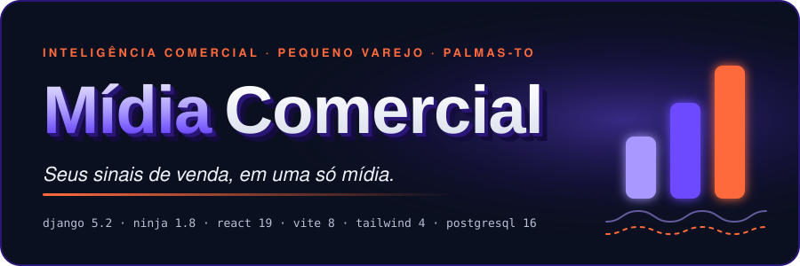
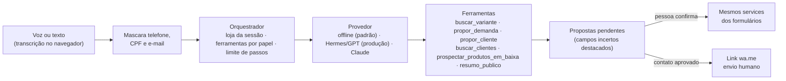
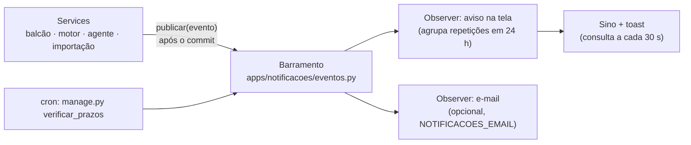

<p align="center">
  
</p>

<p align="center">
  <strong>📂 Entrega do Hackrun</strong><br>
  <a href="docs/01-PROPOSTA-E-ESTRUTURA-DAS-TELAS.md">01 · Proposta e estrutura das telas</a> ·
  <a href="docs/02-DOCUMENTACAO-INICIAL.md">02 · Documentação inicial</a> ·
  <a href="docs/03-LINGUAGEM-DE-PROGRAMACAO.md">03 · Linguagem de programação</a><br>
  <a href="docs/04-ARQUITETURA-PROPOSTA.md">04 · Arquitetura proposta</a> ·
  <a href="docs/05-PLATAFORMA-E-TECNOLOGIAS.md">05 · Plataforma e tecnologias</a> ·
  <a href="docs/06-TECNOLOGIA-SORTEADA.md">06 · Tecnologia sorteada</a>
</p>

<p align="center">
  
  
  
  
  <br>
  
  
  
  
  
</p>

<p align="center">
  <strong>Inteligência comercial para lojistas de shopping.</strong> Uma camada ao lado do PDV que junta o que vendeu, o que o cliente
  <em>procurou e não tinha</em>, o estoque, o público (período, horário e faixa de idade) e a base de clientes, entrega no máximo
  3 decisões com evidência e limitação e tem um <strong>agente que encontra clientes quando um produto está em baixa</strong>.
  Ele propõe; uma pessoa confirma e envia.
</p>

<p align="center">
  <a href="docs/README.md">Documentação</a> ·
  <a href="ARQUITETURA.md">Arquitetura</a> ·
  <a href="FRONTEND.md">Design system Mídia UI</a> ·
  <a href="docs/07-EVOLUCAO-AGENTE-PUBLICO.md">Agente e público (v0.2)</a> ·
  <a href="#api">API</a> <sub>(Swagger em <code>/api/docs</code>)</sub>
</p>

<p align="center">
  🎬 <strong><a href="https://drive.google.com/drive/folders/13QTQNEHbLM4GtA_Dw93Psi2AXd8rxsKg">Pitch de 90 segundos (Google Drive)</a></strong>
</p>

---

## 🎯 O desafio: Inteligência comercial para lojistas

> **Contexto:** o shopping reúne estabelecimentos de diferentes segmentos, que atendem públicos com interesses e comportamentos variados.
>
> **Problemática:** os lojistas precisam compreender melhor o comportamento dos consumidores, as oportunidades comerciais e os fatores que influenciam o desempenho de seus estabelecimentos.
>
> **Objetivo:** melhorar a compreensão sobre o público consumidor e as oportunidades de negócio para os lojistas.

**Para quem é:** o **lojista do shopping**, seja dono, gerente ou atendente de uma loja dentro do mall. Ele tem caixa e estoque, mas não tem
equipe de BI. Ele também não sabe quem passou pelo balcão e saiu sem comprar. O MidiaComercial é a ferramenta **dessa loja**: cada loja vê
só os próprios dados, com isolamento por loja. Não é um painel da administração do shopping.

**Como respondemos a cada ponto do desafio:**

| O desafio pede | Como o MidiaComercial responde | Onde |
| --- | --- | --- |
| Diferentes **segmentos** | O contrato de dados usa produto, categoria e variante, sem campo exclusivo de um ramo. Cada loja tem o seu `segmento`. A demo usa lojas de moda, mas o mesmo fluxo serve para calçados, acessórios, eletrônicos, presentes e outros | `apps/importacao`, `Loja.segmento` |
| Públicos com **interesses e comportamentos variados** | Quem compra, o quê e quando: período e horário fortes **por categoria**, fase do mês (efeito salário) e faixa etária que mais compra | **Meu público** |
| Entender o **comportamento do consumidor** | Mede também o que o cliente **procurou e não levou** (sem estoque, caro, sem tamanho), registrado no balcão em até 4 toques ou por voz | **Balcão** · **Procuraram e não tinha** |
| Encontrar **oportunidades comerciais** | No máximo 3 oportunidades priorizadas, cada uma com evidência, amostra e limitação. Para produto parado, o agente propõe quais clientes contatar | **Oportunidades** · **Agente de vendas** |
| Mostrar os **fatores que influenciam o desempenho** | Venda perdida, estoque parado ou desatualizado, queda por categoria e horário de pico × escala da equipe. Cada fator aparece com a origem do dado | **Oportunidades** · **Sino de avisos** |
| **Melhorar** a compreensão e o negócio | Ciclo fechado: sinal → decisão → plano de ação → medição antes/depois e conversão do contato em 14 dias | **Plano de ação** · **Agente** |

---

## 🚀 Nosso diferencial

> **O caixa só mostra o que vendeu. O MidiaComercial mostra também o que o cliente procurou e não levou, e transforma isso em venda.**

| # | O que inovamos | Por que ninguém faz | Na demo |
| --- | --- | --- | --- |
| 1 | **Mede a venda perdida.** O atendente registra em ≤ 4 toques ou por voz o que o cliente procurou e não tinha | PDV e ERP só enxergam o que passou no caixa | Balcão: *"procurou calça 42, uns 40 anos, não tinha"* |
| 2 | **Decisão com evidência.** No máximo 3 oportunidades, cada uma com origem, amostra e limitação | Painéis mostram gráfico; não dizem o que fazer nem o quanto confiar | Oportunidades: *"9 procuraram e não tinha · saldo 0"* |
| 3 | **Agente que vende o produto parado.** Encontra clientes com chance real, explica o motivo e prepara a mensagem; a pessoa aprova e envia | Ferramentas de campanha disparam para todos; aqui é por motivo, com consentimento (LGPD) | Agente: *"Já comprou Camisas · veste G (tem em estoque)"* |
| 4 | **Ciclo fechado.** Sinal → decisão → ação → medição: avisa quando o cliente contatado comprou | Relatório termina no gráfico | Sino: *"Cliente comprou depois do contato"* |

**Em uma frase para a banca:** *para o lojista do shopping, observar compras e não compras, decidir com evidência e medir o resultado.*

---

<p align="center">
  
</p>

## 👑 Equipe NidoQueen

<table align="center">
  <tr>
    <td align="center" width="170">
      <a href="https://github.com/GabrielGGC18"><br><sub><b>Gabriel Mendes</b></sub></a><br><sub>Colaborador</sub>
    </td>
    <td align="center" width="170">
      <a href="https://github.com/joaocrosara"><br><sub><b>joaocrosara</b></sub></a><br><sub>Colaborador</sub>
    </td>
    <td align="center" width="170">
      <a href="https://github.com/ArthurGuedesBrito"><br><sub><b>ArthurGuedesBrito</b></sub></a><br><sub>Colaborador</sub>
    </td>
    <td align="center" width="170">
      <a href="https://github.com/danielmiyke"><br><sub><b>danielmiyke</b></sub></a><br><sub>Colaborador</sub>
    </td>
    <td align="center" width="170">
      <a href="https://github.com/MarioMatheusPombal"><br><sub><b>Mario Matheus Pombal</b></sub></a><br><sub>🎓 Orientador</sub>
    </td>
  </tr>
</table>

**Orientador:** [Mario Matheus Pombal](https://github.com/MarioMatheusPombal)

### Contribuintes

[@GabrielGGC18](https://github.com/GabrielGGC18) ·
[@joaocrosara](https://github.com/joaocrosara) ·
[@ArthurGuedesBrito](https://github.com/ArthurGuedesBrito) ·
[@danielmiyke](https://github.com/danielmiyke) ·
[@MarioMatheusPombal](https://github.com/MarioMatheusPombal)

<sub>Nidoqueen e Pokémon são marcas de Nintendo, Creatures e Game Freak. Ilustração usada apenas como mascote da equipe, sem fins comerciais (imagem: PokeAPI/sprites).</sub>

---

## O que ele faz

| Sinal | Tela | O que o lojista ganha |
| --- | --- | --- |
| Vendas (CSV) e estoque | **Importar** | Prévia, erro por linha em português, conferência com o total de origem, reimportação sem duplicar |
| O que procuraram e não tinha | **Balcão** (celular) | Registro em ≤ 4 toques **ou por voz**, com idade aproximada |
| Quem compra, quando e com que idade | **Meu público** | Período e horário fortes **por nicho**, fase do mês (efeito salário), faixa etária que mais compra |
| Planilha de clientes | **Clientes** | Importa e exporta CSV/XLSX, busca pelos campos preenchidos, consentimento LGPD |
| Tudo junto | **Oportunidades** | Até 3 cartões priorizados (regras A/B/C), cada um com evidência, amostra e limitação |
| Produto em baixa | **Agente de vendas** | Lista de clientes com motivo legível e mensagem pronta; você aprova e envia pelo WhatsApp |
| Decisão | **Plano de ação** | Responsável, prazo, indicador e medição antes/depois calculada |
| Algo importante aconteceu | **Sino de avisos** | Padrão Observer: procuras sem estoque, oportunidade nova, campanha proposta, cliente comprou após contato, ação atrasada, importação divergente, estoque velho |

## O agente



- **Propõe, não grava.** Toda escrita passa por `confirmar()`, com as mesmas validações da tela.
- **Funciona sem internet.** O provedor offline entende frases como *"procurou calça jeans 42, uns 40 anos, não tinha"* ou *"quero vender a camisa parada"*.
- **LLM opcional:** em produção, GPT pelo Hermes (`MIDIA_IA_PROVEDOR=hermes`, sem chave na aplicação); Claude também é suportado. O LLM recebe só texto mascarado e agregados. Frases com nome de pessoa nunca saem do servidor. Qualquer falha cai no offline. Detalhes em [docs/13](docs/13-AGENTE.md).
- **Prospecção responsável:** só clientes que autorizaram contato, descanso de 14 dias, "Responda SAIR" em toda mensagem e medição de quem comprou em 14 dias.

## Notificações (padrão Observer)



Quem publica não conhece quem observa. Um observer com erro não derruba a operação, e operação desfeita (rollback) não notifica. Os avisos são só para a equipe, filtrados por loja e papel, sem dado pessoal no texto. A leitura é marcada por pessoa.

## Rodar local (sem Docker)

```bash
# 1) API (Django) em http://localhost:8000
python -m venv .venv
.venv/Scripts/activate              # Linux/macOS: source .venv/bin/activate
pip install ".[dev]"
# .env é opcional em dev (SQLite e chave de dev); em produção a SECRET_KEY é obrigatória
python manage.py migrate
python manage.py seed_demo          # 2 lojas, 90 dias de vendas, demandas, estoque e base de clientes
python manage.py runserver

# 2) SPA (React) em http://localhost:5173  (proxy /api e /admin → :8000)
cd frontend && npm install && npm run dev
```

Com Docker: `docker compose up --build` e depois `docker compose exec web python manage.py seed_demo`.

## Variáveis de ambiente

O `.env` **nunca** vai para o Git (nem o `.env.example`). Crie o seu na raiz:

```ini
DJANGO_SETTINGS_MODULE=config.settings.dev
SECRET_KEY=<gere com: python -c "import secrets; print(secrets.token_urlsafe(50))">
DEBUG=True
ALLOWED_HOSTS=localhost,127.0.0.1
CSRF_TRUSTED_ORIGINS=http://localhost:8000,http://localhost:5173
# DATABASE_URL=postgres://usuario:senha@db:5432/midia   (sem ela, o dev usa SQLite)
MIDIA_IA_HABILITADA=False
MIDIA_IA_PROVEDOR=offline        # ou claude
MIDIA_IA_API_KEY=                # só no .env, nunca no código
MIDIA_IA_MODELO=
# produção: DOMINIO, POSTGRES_PASSWORD
```

O que **nunca** sobe para o Git (veja `.gitignore`): `.env*`, chaves e certificados, bancos e dumps, planilhas e CSVs
(podem ter dados de clientes), uploads, logs e configurações locais. O pre-commit (`pre-commit install`) e a CI
bloqueiam esses arquivos e procuram segredos com o gitleaks.

## Acesso demo

Senha de todos: `demo1234`. A tela de login tem botões **Entrar na demo**.

| Usuário | Loja | Papel | Vê |
| --- | --- | --- | --- |
| `gerente.centro` / `dono.centro` | Loja Demo Centro | gerente / dono | Tudo |
| `ana` | Loja Demo Centro | atendente | Só o Balcão (voz e botões) |
| `gerente.norte` · `bruno` | Loja Demo Norte | gerente · atendente | Loja com estoque desatualizado e regras bloqueadas |

O seed planta cenários para cada regra disparar e cria uma base de clientes **fictícia** (nomes e números inventados), com cerca de 70% de consentimento.

## Roteiro de demo (6 min)

1. **Balcão** (`ana`, no celular): toque no microfone e diga *"procurou calça jeans 42, uns 40 anos, não tinha"* → cartão de proposta → **Confirmar**.
2. **Oportunidades** (`gerente.centro`): 3 cartões; a procura nova já conta na evidência.
3. **Meu público**: *Calças: sábado 10–12h*, fase do mês mais forte e faixa que mais compra, com a limitação ao lado.
4. **Agente de vendas** → **Buscar clientes**: *Oferecer Camisa social Branca G*, com os motivos de cada cliente → editar e **Aprovar** → **Abrir no WhatsApp** → **Marquei como enviada**.
5. **Clientes**: filtrar *tamanho G* + *autorizou contato*; **Exportar** a planilha.
6. **Preencher com IA**: *"cadastrar cliente Pedro Alves zap (63) 98877-1122, uns 30 anos, veste M, autoriza mensagem"* → confirmar.
7. Trocar para a **Loja Demo Norte**: o cache é limpo e aparecem as regras bloqueadas com "como liberar".

## Estrutura

```
midiacomercial/
├── config/                 settings (base/dev/test/prod), api.py (Ninja + erros {detail, erros, codigo})
├── apps/
│   ├── core/               middleware de loja, LojaQuerySet, permissões, faixas etárias, seed
│   ├── contas/             Loja, Vinculo, ConfiguracaoLoja, sessão da SPA
│   ├── importacao/         contrato CSV (Pydantic), prévia → confirmação → reconciliação
│   ├── comercio/ estoque/  pedidos (com faixa etária), itens, devoluções, snapshots
│   ├── publico/            perfil de compra, período por nicho, faixa etária, demanda, catálogo
│   ├── inteligencia/       contexto → qualidade → regras A/B/C → priorização → explicação → motor
│   ├── acoes/              plano de ação, medição, auditoria append-only
│   ├── clientes/           base de clientes (único lugar com dado pessoal), planilha CSV/XLSX
│   └── agente/             orquestrador, ferramentas, provedores (offline/Claude), privacidade, prospecção
├── frontend/src/
│   ├── app/                router com guards por papel, AppShell, BalcaoShell, gaveta "Preencher com IA"
│   ├── api/                client (CSRF + sessão), types, sessão
│   ├── components/ui/      base no padrão shadcn
│   ├── components/midia/   domínio: OpportunityCard, KpiTile, DemandQuickForm, PropostaCard, ContatoCard,
│   │                       VozButton, PeriodosNicho, FaixaEtariaBars, HeatmapWeek…
│   ├── features/           auth · oportunidades · importacao · publico · demanda · acoes · clientes · agente
│   └── lib/                format pt-BR, permissões, tema, voz (Web Speech)
├── docs/                   entrega do Hackrun (01–06) + 07 evolução + assets/banner.svg
└── .claude/agents/         product-owner · design-thinking · backend-django · frontend-react · agente-ia · infra-devops
```

## API

Documentação interativa em **`/api/docs`**. Erros sempre como `{"detail", "erros"?, "codigo"?}`.

| Área | Rotas |
| --- | --- |
| Sessão | `GET /api/csrf` · `POST /api/auth/login` · `POST /api/auth/logout` · `GET /api/me` · `POST /api/me/loja` |
| Importação | `POST /api/importacoes/preview` · `POST /api/importacoes/{id}/confirmar\|cancelar` · `GET /api/importacoes/modelo\|exemplo` |
| Público | `GET /api/analises/publico` (KPIs, categorias, heatmap, **períodos por nicho**, **faixas etárias**, recorrência) |
| Balcão | `GET /api/catalogo/?q=` · `POST /api/demandas/` (com `faixa_etaria`) · `GET /api/demandas/ranking\|recentes` · `DELETE /api/demandas/{id}` |
| Oportunidades | `GET /api/oportunidades/` · `POST /api/oportunidades/gerar` · `GET /api/oportunidades/{id}` · `POST /api/oportunidades/{id}/descartar` |
| Ações | `GET\|POST /api/acoes/` · `GET\|PATCH /api/acoes/{id}` · `GET /api/acoes/{id}/medicao-sugerida` · `POST /api/acoes/{id}/medicoes` |
| Clientes | `GET\|POST /api/clientes/` · `GET\|PUT /api/clientes/{id}` · `POST /api/clientes/importar` · `GET /api/clientes/exportar\|modelo` · `POST /api/clientes/{id}/sair` |
| Agente | `GET /api/agente/ferramentas` · `POST /api/agente/mensagens` · `GET /api/agente/propostas` · `POST /api/agente/propostas/{id}/confirmar\|rejeitar\|enviada` · `POST /api/agente/prospeccao` · `GET /api/agente/campanhas` · `POST /api/agente/campanhas/{id}/encerrar` |

## Qualidade

```bash
ruff check . && ruff format --check . && pytest                 # backend
cd frontend && npm run typecheck && npm test && npm run build   # frontend
```

Os testes cobrem:
- **Isolamento entre lojas:** IDs trocados devolvem 404, sessão adulterada e CSRF no login.
- **Papéis:** o atendente não usa ferramentas de gerente.
- **Importação:** prévia, duplicadas, reimportação e reconciliação.
- **Motor:** regras A/B/C (dispara, não dispara, bloqueada) e priorização.
- **Agente:** propõe sem gravar, marca campo incerto, mascara dados e nunca manda nome de pessoa ao LLM.
- **Prospecção:** só clientes com consentimento, com descanso de 14 dias.
- **Planilha:** CSV e XLSX com colunas alternativas.
- **Interface:** balcão em ≤ 4 toques e cartões sempre com evidência e limitação.

## Deploy

Como está no ar em **[docs/14 · Deploy e operação](docs/14-DEPLOY-E-OPERACAO.md)**: front na Vercel, API em Docker na VPS
Hostinger (nginx + Postgres), CI no GitHub Actions e CD que publica a `main` quando o CI passa. Os próximos passos de design
estão em **[`planejamento.md`](planejamento.md)**.

Alternativa com Docker (tudo na VPS):

1. VPS Ubuntu com Docker; registro `A` do domínio apontando para o IP; firewall só 22/80/443.
2. `.env` de produção: `DEBUG=False`, `SECRET_KEY`, `DOMINIO`, `ALLOWED_HOSTS`, `CSRF_TRUSTED_ORIGINS=https://<domínio>`, `POSTGRES_PASSWORD`, `DATABASE_URL`. Opcional: `MIDIA_IA_HABILITADA`, `MIDIA_IA_PROVEDOR=claude`, `MIDIA_IA_API_KEY`, `MIDIA_IA_MODELO`.
3. `docker compose -f docker-compose.prod.yml up -d --build`, depois `exec web python manage.py migrate` e `seed_demo`.
4. Plano B da apresentação: tudo local com Docker, sem internet e com o agente offline.

## Privacidade (LGPD)

- Nome e WhatsApp ficam só em `apps/clientes`, com consentimento e data registrados.
- O motor e os relatórios usam apenas o `cliente_ref`, um código opaco.
- A idade é uma **faixa estimada**, nunca a data de nascimento.
- O áudio é transcrito pelo navegador e o servidor recebe só o texto.
- O LLM recebe texto mascarado e números agregados.
- Nada é enviado ao cliente sem uma pessoa aprovar, e o envio é feito por essa pessoa.
- **Retenção do agente** (`manage.py limpar_agente`, todo dia): texto de conversa parada há 90 dias é apagado,
  a auditoria de ferramentas sai depois de 180 dias e a proposta de cadastro rejeitada (tem nome e WhatsApp),
  depois de 30. Propostas confirmadas ficam, porque são registro da loja.
