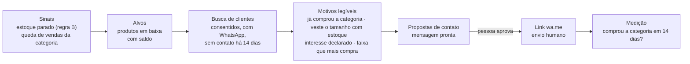

# 07. Evolução: público, período, voz, base de clientes e agente de vendas

**Projeto:** MidiaComercial · **Data:** 13/11/2026 · **Status:** implementado na versão 0.2 (dados 100% sintéticos)
**Autores (papéis):** design-thinking (descoberta e ideias) → product-owner (escopo e histórias) → backend-django, frontend-react, agente-ia, infra-devops (execução)

> Complementa [02](02-DOCUMENTACAO-INICIAL.md), [04](04-ARQUITETURA-PROPOSTA.md) e [06](06-TECNOLOGIA-SORTEADA.md). O agente segue a mesma regra da primeira entrega: **ele propõe, a pessoa confirma**.

---

## 1. Empatizar: o que o lojista ainda não enxerga

| Persona | Frase-síntese | Dor nova |
| --- | --- | --- |
| **Carlos, dono** (moda masculina, Palmas) | "Sei que vendo mais no sábado, mas para quem?" | Não sabe a **faixa de idade** de quem compra cada categoria nem o **período** forte de cada nicho |
| **Marina, gerente** | "A camisa social está parada e eu não sei para quem oferecer." | Produto **em baixa** vira prejuízo; ela tem a lista de clientes numa **planilha** que ninguém consulta |
| **Ana, atendente** | "No balcão eu não tenho mão para digitar." | Registrar demanda e perfil do cliente com o celular numa mão e a peça na outra |

**Fato × hipótese:** os dados da demo são sintéticos. "Sábado e início do mês vendem mais em moda masculina" é uma **hipótese de nicho** que o sistema mede na loja; não é verdade de mercado.

## 2. Definir

**Jobs To Be Done**
- *Quando* a semana começa, *quero* saber o período e o público que mais compram cada categoria, *para* escalar a equipe e a vitrine.
- *Quando* um produto encalha, *quero* uma lista de clientes com chance real de interesse e uma mensagem pronta, *para* vender sem queimar o relacionamento.
- *Quando* estou atendendo, *quero* falar em vez de digitar, *para* registrar sem perder o cliente.

**Como poderíamos…?**
1. …revelar o **período forte de cada nicho** (categoria) sem estatística que o lojista não entende?
2. …captar a **faixa de idade** sem pedir documento nem dado pessoal ao cliente?
3. …transformar a planilha de clientes em uma **base pesquisável** e respeitosa (LGPD)?
4. …fazer o **agente buscar os clientes** quando um produto está em baixa, sem disparo automático?

## 3. Idear e decidir (Impacto × Esforço)

| Ideia | Impacto | Esforço | Decisão |
| --- | --- | --- | --- |
| Faixa etária **estimada** pelo atendente (chips ou voz), no balcão e no cadastro | Alto | Baixo | **Agora** |
| Relatório "Quem compra o quê" por faixa etária, com cobertura exibida | Alto | Baixo | **Agora** |
| Período forte **por categoria** (dia × faixa de 2 h), turno e **fase do mês** (1–10, 11–20, 21–31) | Alto | Baixo | **Agora** |
| Voz no balcão e no agente (transcrição no navegador, servidor só recebe texto) | Alto | Médio | **Agora** |
| Base de clientes: importar e exportar **planilha** (CSV/XLSX) e buscar pelos campos preenchidos | Alto | Médio | **Agora** |
| **Agente de vendas**: produto em baixa → clientes com consentimento → mensagem → pessoa aprova → WhatsApp | Muito alto | Médio | **Agora** |
| Medir conversão do contato (comprou a categoria em até 14 dias) | Alto | Baixo | **Agora** |
| LLM (Claude) como provedor do agente | Médio | Médio | **Agora como opção** (offline é o padrão) |
| Disparo automático por API do WhatsApp | Alto | Alto + risco LGPD | **Depois** (exige opt-in formal e contrato da API) |
| Idade por câmera/reconhecimento facial | — | — | **Não fazer** (fora do escopo, invasivo) |

## 4. O que foi construído

### 4.1 Período e horário por nicho (Meu público)
- **Top períodos** da loja: melhores combinações dia × faixa de 2 h.
- **Por categoria (nicho):** o dia e o horário mais fortes e a participação nesse horário.
- **Turno** (manhã / tarde) e **fase do mês** (1–10, 11–20, 21–31): mostra o efeito do salário no nicho.
- **Limitação exibida:** "associação observada, não causa".

### 4.2 Faixa etária do público
- Faixas: até 17 · 18–24 · 25–34 · 35–44 · 45–59 · 60+. Sempre rotulada como **estimada** quando vem do balcão.
- Fontes: balcão (chips ou voz), cadastro de clientes e a coluna opcional `faixa_etaria` no CSV de vendas.
- Relatório: distribuição dos pedidos e das procuras por faixa, a categoria preferida de cada faixa e a **cobertura** (quantos pedidos têm faixa informada).

### 4.3 Voz
- Botão **Falar** no balcão e no painel do agente. O navegador transcreve (Web Speech API, pt-BR); o servidor recebe **só o texto**, nunca o áudio.
- Exemplo: *"cliente procurou camiseta azul M, uns 30 anos, não tinha"* → proposta de demanda com produto, tamanho, motivo e faixa 25–34, para confirmar.
- Aviso na tela: alguns navegadores enviam o áudio ao serviço de voz deles; quem não quiser usa o teclado.

### 4.4 Base de clientes (planilha)
- App `clientes`, o **único lugar com dado pessoal** (nome e WhatsApp), sempre com **consentimento de contato** registrado (sim/não e data).
- **Importar planilha** CSV ou XLSX (atualiza pelo `cliente_ref`, erros por linha) e **exportar** para Excel.
- **Busca pelos preenchimentos:** texto, faixa etária, categoria de interesse, tamanho, consentimento e "sem comprar há N dias", junto com o histórico de compras (último pedido, nº de pedidos, categorias).
- Atendente não vê a base. O núcleo analítico continua usando só o `cliente_ref` opaco.

### 4.5 Agente de vendas (prospecção)



- Roda sob demanda ("Buscar clientes") e mostra **campanhas propostas**, uma por produto em baixa.
- Cada sugestão traz **por que este cliente** (motivos) e a **limitação** ("interesse provável, não garantido").
- Aprovar gera a mensagem editável e o link do WhatsApp; **quem envia é a pessoa**. A mensagem sempre termina com "Responda SAIR para não receber".
- Descanso de 14 dias por cliente; cliente que pede para sair perde o consentimento na hora.

### 4.6 Estrutura do agente (app `agente`)

| Peça | Responsabilidade |
| --- | --- |
| `SessaoAgente` / `PropostaAgente` / `ChamadaFerramenta` | Conversa, propostas pendentes (com campos incertos) e auditoria de cada ferramenta usada |
| `privacidade.py` | Mascara telefone, CPF e e-mail antes de qualquer provedor externo |
| `ferramentas/` | `buscar_variante`, `propor_demanda`, `propor_cliente`, `buscar_clientes`, `prospectar_produtos_em_baixa`, `resumo_publico`; cada uma com papel mínimo |
| `provedores/offline.py` | Intérprete determinístico em português (padrão, funciona sem internet) |
| `provedores/claude.py` | Tool use com o Claude, só com `MIDIA_IA_HABILITADA=True` e chave; cai no offline se falhar |
| `orquestrador.py` | Loja da sessão, ferramentas filtradas pelo papel, limite de passos |
| `services.confirmar()` | Única porta de escrita, usando os mesmos services dos formulários |

## 5. Histórias (product-owner)

**H1. Período por nicho.** Como gerente, quero ver o dia e o horário fortes de cada categoria, para planejar a escala e a vitrine.
```gherkin
Dado que a loja tem vendas de Calças concentradas no sábado das 10h às 12h
Quando abro "Meu público"
Então vejo "Calças: sábado 10–12h" com a participação nesse horário
E vejo a fase do mês com mais receita
E a limitação "associação observada, não causa"
```

**H2. Faixa etária por voz.** Como atendente, quero dizer a frase da procura com a idade aproximada, para registrar sem digitar.
```gherkin
Dado que estou no balcão
Quando digo "procurou calça jeans 42, uns 40 anos, sem estoque"
Então aparece uma proposta com Calça jeans, tamanho 42, motivo "Sem estoque" e faixa 35–44
E nada é gravado até eu tocar em "Confirmar"
```

**H3. Planilha de clientes.** Como gerente, quero importar minha planilha e buscar clientes pelos campos preenchidos, para usar a base que já tenho.
```gherkin
Dado uma planilha com cliente_ref, nome, whatsapp, faixa_etaria, tamanhos e consentimento
Quando importo
Então vejo quantos foram criados, atualizados e rejeitados, com o erro de cada linha
E consigo filtrar por "tamanho G" e "consentiu contato"
```

**H4. Agente busca clientes para produto em baixa.** Como gerente, quero que o agente encontre clientes para um produto parado, para vender sem disparar mensagem para todo mundo.
```gherkin
Dado que "Camisa social Branca G" tem saldo e não vende há 44 dias
E há clientes consentidos que já compraram Camisas e vestem G
Quando toco em "Buscar clientes"
Então vejo uma campanha com esses clientes e os motivos de cada um
E clientes sem consentimento ou contatados há menos de 14 dias não aparecem
E só depois de aprovar vejo o link do WhatsApp com a mensagem
```

**H5. Medir o contato.** Como dono, quero saber se os contatos viraram venda, para decidir se vale repetir.
```gherkin
Dado contatos marcados como enviados
Quando o cliente compra a categoria em até 14 dias
Então a campanha mostra "convertidos" com a limitação "associação, não prova de efeito"
```

**Métricas de sucesso:** % de pedidos com faixa informada, tempo de registro por voz ≤ 15 s, % de sugestões aprovadas e taxa de conversão em 14 dias.

## 6. Privacidade (LGPD)

| Garantia | Como |
| --- | --- |
| Finalidade e consentimento | Contato só com `consentimento_contato=True` e data registrada; "SAIR" revoga |
| Minimização | Faixa etária, não data de nascimento; idade estimada é rotulada como estimada |
| Separação | Nome e WhatsApp só em `apps/clientes`; motor e relatórios usam `cliente_ref` opaco |
| LLM | Recebe texto mascarado e agregados; nunca nome, telefone ou CPF |
| Áudio | Transcrito no navegador; servidor não recebe nem guarda áudio |
| Auditoria | Propostas, confirmações, aprovações e envios registrados em `EventoAuditoria` e `ChamadaFerramenta` |
| Papel | Atendente não acessa a base de clientes nem a prospecção |

## 7. Roadmap

| Agora (v0.2) | Próximo | Depois |
| --- | --- | --- |
| Período por nicho, faixa etária, voz, base de clientes, agente de vendas com aprovação humana, provedor Claude opcional | Mapeamento de planilha fora do padrão pelo agente, "contei 3 camisetas" para estoque por voz, relatório falado | API oficial do WhatsApp com opt-in formal, segmentos salvos, previsão de reposição |
