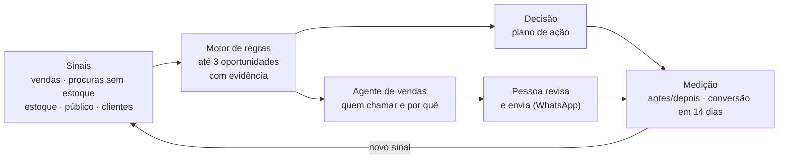

# 11. Problema e solução

**Para quem:** o lojista do shopping (dono, gerente ou atendente de uma loja dentro do mall).
**Desafio:** Inteligência comercial para lojistas.

---

## 1. O problema

O shopping reúne lojas de segmentos diferentes, com públicos diferentes. O lojista tem caixa (PDV) e estoque,
mas não tem equipe de BI. Os sinais que explicariam o desempenho da loja estão espalhados:

| Sinal | Onde está hoje | O que se perde |
| --- | --- | --- |
| O que vendeu | PDV/ERP, em relatórios que ninguém cruza | Não vira decisão |
| O que o cliente **procurou e não levou** | Na memória do atendente | Venda perdida invisível: nenhum sistema registra |
| Estoque parado ou desatualizado | Planilha ou ERP | Capital parado sem plano |
| Quem compra, quando e com que idade | Em lugar nenhum | Escala e vitrine no chute |
| Base de clientes | Caderno, WhatsApp do vendedor | Contato sem critério, sem medir resultado |

Resultado: decisões por intuição, sem como saber se a ação funcionou.

## 2. A solução: MidiaComercial

Uma camada de inteligência **ao lado do PDV** (não substitui o caixa). Cada loja vê só os próprios dados.

**O que a ferramenta entrega:**

1. **Junta os sinais numa só mídia.** Importa vendas e estoque (CSV/XLSX, com prévia e erro por linha em português)
   e registra no balcão, em até 4 toques ou por voz, o que o cliente procurou e não tinha.
2. **Até 3 decisões por semana, com evidência.** O motor de regras cruza os sinais e prioriza oportunidades. Cada
   cartão mostra origem do dado, amostra e limitação: sem score mágico.
3. **Mostra o público.** Período e horário fortes por categoria, fase do mês (efeito salário) e faixa etária
   que mais compra.
4. **Vende o produto parado.** O agente de vendas indica quais clientes chamar e por quê (só quem autorizou
   contato) e deixa a mensagem pronta. A pessoa revisa e envia pelo WhatsApp.
5. **Fecha o ciclo.** Plano de ação com responsável, prazo e indicador; medição antes/depois e aviso quando um
   cliente contatado comprou em até 14 dias.

## 3. Diferencial

> O caixa só mostra o que vendeu. O MidiaComercial mostra também o que o cliente procurou e não levou, e
> transforma isso em venda.

- **Mede a não compra** (demanda não atendida), que PDV e ERP não enxergam.
- **Decisão, não gráfico:** no máximo 3 cartões, com o quanto confiar em cada um.
- **Agente que propõe, pessoa que decide:** nenhum dado é gravado nem mensagem é enviada sem uma pessoa.
- **Funciona sem IA:** o provedor offline atende o balcão sem internet; o LLM é ganho, não dependência.

## 4. Princípios de produto

| Princípio | Como aparece |
| --- | --- |
| Evidência antes de opinião | Todo cartão tem origem, amostra e limitação |
| Pouco e acionável | Máximo de 3 oportunidades; balcão em ≤ 4 toques |
| Humano no comando | Agente só cria propostas; envio pelo WhatsApp é manual |
| Privacidade (LGPD) | Contato só com consentimento, descanso de 14 dias, "Responda SAIR", dado pessoal mascarado antes de qualquer LLM |
| Isolamento por loja | Toda consulta filtra pela loja da sessão |

## 5. Papéis

| Papel | Usa |
| --- | --- |
| Atendente | Balcão (registro de procura, por toque ou voz) e agente nas ferramentas de balcão |
| Gerente | Tudo do atendente + oportunidades, público, clientes, agente de vendas, plano de ação |
| Dono | Tudo do gerente + configurações da loja e equipe |

## 6. Demo

Dados 100% sintéticos: duas lojas de moda (centro e norte). Acessos e roteiro no [README](../README.md#acesso-demo).

Leia em seguida: [12 · Arquitetura atual](12-ARQUITETURA-ATUAL.md) · [13 · Agente](13-AGENTE.md) ·
[14 · Deploy e operação](14-DEPLOY-E-OPERACAO.md).
