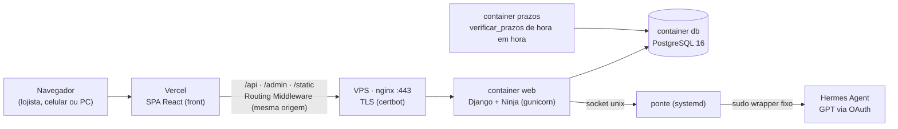

# 12. Arquitetura atual (como está construído)

> O [04](04-ARQUITETURA-PROPOSTA.md) e o [ARQUITETURA.md](ARQUITETURA.md) registram o plano inicial. Este
> documento descreve o sistema **como ele está no ar**. Onde os dois divergem, vale este.

## 1. Visão geral

- **Monólito modular** em Django: cada domínio é um app com regra de dependência (núcleo analítico não importa
  dado pessoal).
- **Front e API na mesma origem** para o navegador: o middleware da Vercel encaminha `/api`, `/admin` e
  `/static` para a API. Sessão por cookie e CSRF funcionam sem CORS.
- **IA isolada:** a API nunca tem chave de LLM em produção. O agente fala com o Hermes por uma ponte local;
  se ela falhar, o agente responde pelo provedor offline.

## 2. Stack

| Camada | Tecnologia |
| --- | --- |
| Backend | Python 3.12 · Django 5.2 · Django Ninja 1.8 (API JSON, OpenAPI em `/api/docs`) · Pydantic |
| Banco | PostgreSQL 16 (SQLite só em dev local sem Docker) |
| Front | React 19 · TypeScript · Vite 8 · Tailwind 4 · TanStack Query · React Router · design system Mídia UI |
| Efeitos | Inspirados no React Bits, só CSS (CardSwap, Marquee, Aurora sem WebGL, RotatingText, GradientText), respeitando `prefers-reduced-motion` |
| IA | Provedor offline (padrão) · Hermes (GPT por OAuth, produção) · Claude (opcional, SDK direto) |
| Infra | Docker Compose na VPS · nginx do host · certbot · Vercel (front) · GitHub Actions (CI) · timer systemd (CD) |

## 3. Apps Django (`apps/`)

| App | Responsabilidade |
| --- | --- |
| `core` | Loja da sessão (multi-tenant por linha), permissões por papel, saúde, demo, **limites de requisição** (`limites.py`) |
| `contas` | Login/sessão, `Loja`, `Vinculo` (usuário × loja × papel), desbloqueio de login |
| `comercio` | Produtos, variantes (tamanho/cor), pedidos e itens |
| `estoque` | Saldos e data da última contagem |
| `importacao` | CSV/XLSX de vendas, estoque e clientes: prévia, erro por linha, idempotência |
| `publico` | Período, horário, fase do mês e faixa etária por categoria |
| `inteligencia` | Motor de regras A/B/C (lacuna de mix, pouca saída, padrão de público), priorização e explicação |
| `acoes` | Plano de ação: responsável, prazo, indicador e medição antes/depois |
| `clientes` | Base de clientes com consentimento (único lugar com nome e WhatsApp) |
| `agente` | Orquestrador, ferramentas, provedores, propostas e prospecção ([13](13-AGENTE.md)) |
| `notificacoes` | Barramento de eventos (padrão Observer) e sino de avisos |

**Regra de dependência:** `inteligencia` e `publico` trabalham com agregados; dado pessoal só existe em
`clientes` e só sai de lá mascarado ou para a pessoa autorizada.

## 4. Front (`frontend/`)

| Pasta | Conteúdo |
| --- | --- |
| `src/api/` | `client.ts` (sessão + CSRF, mensagens de erro amigáveis), `sessao.tsx`, tipos |
| `src/app/` | Rotas, layout (`AppShell`), providers (TanStack Query) |
| `src/features/` | Uma pasta por tela: auth (login institucional), demanda (balcão), oportunidades, público, clientes, importação, ações, agente, notificações |
| `src/components/` | `ui/` (base), `midia/` (componentes do produto e institucional), `efeitos/` (efeitos estilo React Bits) |
| `middleware.ts` | Proxy da Vercel para a API ([14](14-DEPLOY-E-OPERACAO.md#2-front-na-vercel)) |
| `public/` | Fotos (com créditos), prints das telas, ilustrações |

**Tratamento de erro:** respostas 5xx, timeouts e páginas de erro do proxy viram mensagens em português
("O sistema está em manutenção…"); o detalhe técnico nunca aparece para o visitante.

## 5. Segurança

| Tema | Como está |
| --- | --- |
| Isolamento | Toda consulta usa `.da_loja(request.loja)`; teste obrigatório "loja A não vê loja B" |
| Papéis | `atendente < gerente < dono` (`apps/core/permissoes.py`); ferramentas do agente também filtradas por papel |
| Sessão | Cookie `Secure`/`HttpOnly`, CSRF em toda escrita, mesma origem (sem CORS) |
| Rate limit | Throttling do Ninja com escopo por rota: login por IP (30/min), agente (20/min), importação (10/min); cache compartilhado em produção (DatabaseCache) |
| Login | Falhas contadas por usuário + IP (ninguém tranca a conta alheia de outro IP) e por conta (força bruta distribuída), exceto contas da demo; `manage.py desbloquear_login` |
| IP do cliente | Nunca do `X-Forwarded-For`. Pela Vercel: `X-Midia-Cliente-Ip` só vale com o segredo compartilhado `X-Midia-Proxy`. Sem ele, `X-Real-IP` só de proxy confiável (`MIDIA_PROXIES_CONFIAVEIS`) |
| Segredos | Só no `.env` da VPS e nas variáveis da Vercel. Repositório público: gitleaks no pre-commit e no CI, bloqueio de `.env`/banco/planilha versionados |
| LGPD | Consentimento de contato, descanso de 14 dias, opção de sair, mascaramento antes do LLM, áudio transcrito no navegador (servidor não guarda áudio) |

## 6. Fluxo de uma requisição

1. Navegador chama `/api/...` no domínio do front.
2. Middleware da Vercel valida `API_ORIGEM`, remove cabeçalhos `x-midia-*` vindos do cliente, adiciona o IP real
   e o segredo, e reescreve para a API.
3. nginx (TLS) entrega para o gunicorn em `127.0.0.1`.
4. Django resolve loja e papel da sessão, aplica limite, executa o service e responde JSON.

## 7. Testes

- Backend: pytest (isolamento, papéis, regras, importação, agente com provedores falsos, rate limit).
- Front: vitest + Testing Library (componentes do agente, cliente da API, normalização do `API_ORIGEM`).
- CI no GitHub Actions a cada push/PR: segredos, ruff, migrações pendentes, pytest com Postgres, typecheck, testes e
  build do front.
