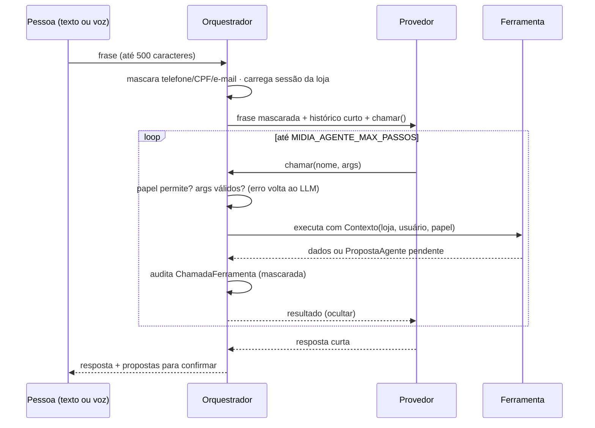

# 13. O agente

> Complementa o [07](07-EVOLUCAO-AGENTE-PUBLICO.md) (produto) e o [09](09-DECISAO-FRAMEWORK-IA.md) (por que sem
> framework). Aqui: como o agente está estruturado no código e como estendê-lo.

## 1. Princípio

**O agente propõe, a pessoa confirma.** Nenhuma ferramenta grava dado de domínio: elas leem e criam
`PropostaAgente` pendentes. Toda escrita passa por `services.confirmar()`, com as mesmas validações dos
formulários. Mensagem ao cliente: o agente prepara o texto e o link `wa.me`; quem envia é a pessoa.

## 2. Estrutura (`apps/agente/`)

```
apps/agente/
├── orquestrador.py      laço principal: sessão, papel, validação, auditoria, fallback; FABRICAS de provedores
├── ferramentas/
│   ├── __init__.py      registro @ferramenta, Contexto, validar_args (JSON Schema), obter() por papel
│   ├── balcao.py        buscar_variante, propor_demanda
│   ├── clientes.py      propor_cliente, buscar_clientes, prospectar_produtos_em_baixa
│   └── publico.py       resumo_publico
├── provedores/
│   ├── __init__.py      contrato Provedor / Uso
│   ├── prompts.py       SISTEMA (regras fixas) + contexto_da_loja() (vocabulário, sem dado pessoal)
│   ├── offline.py       determinístico, sem internet (padrão e fallback)
│   ├── hermes.py        GPT via OAuth do Hermes, protocolo JSON por rodadas
│   └── claude.py        tool use nativo pelo SDK da Anthropic (opcional)
├── privacidade.py       mascarar / restaurar / ocultar (telefone, CPF, e-mail)
├── prospeccao.py        produtos em baixa → clientes com consentimento → propostas de contato
├── services.py          confirmar() / rejeitar()
├── models.py            SessaoAgente, PropostaAgente, ChamadaFerramenta, Campanha
└── api.py               /api/agente/* (mensagens, propostas, campanhas, uso)
```

## 3. Fluxo de uma mensagem



**Fallback:** qualquer exceção do provedor externo → propostas pela metade são apagadas e a mensagem é refeita
no offline, inteira. A sessão registra `fallback` com o motivo. Frases de cadastro de cliente (têm nome de
pessoa) nunca vão para LLM: são tratadas pelo offline.

## 4. Provedores

| Provedor | Quando | Como decide ferramentas | Custo/latência |
| --- | --- | --- | --- |
| `offline` | Padrão; IA desligada; fallback | Regras e extração por palavras (tamanho, cor, motivo, faixa etária) | Zero · instantâneo |
| `hermes` | Produção (`MIDIA_IA_PROVEDOR=hermes`) | JSON por rodadas: `{"chamadas":[...],"resposta":...}` | Assinatura GPT do Hermes · ~6–10 s por rodada |
| `claude` | Opcional (`claude`, com chave) | Tool use nativo, prompt caching | Tokens (contados em `/api/agente/uso`) |

Escolha em `orquestrador.escolher_provedor()`, por tabela:

```python
FABRICAS = {"hermes": _hermes, "claude": _claude}
```

IA desligada, nome desconhecido ou erro ao montar o provedor → offline, com aviso no log. O agente nunca trava
por causa da IA.

### 4.1 Hermes em produção

```
container web ──socket unix──► ponte (systemd, usuário de serviço sem shell)
                                 └─ sudo de UM wrapper fixo ─► docker exec hermes -p midiacomercial -z "<prompt>"
```

- **Sem chave na API:** o OAuth do GPT fica no perfil `midiacomercial` do Hermes, na VPS.
- A ponte limita concorrência (2), tempo (35 s) e tamanho do prompt (64 KB), e **nunca registra o prompt** no log.
- O modo `-z` só devolve texto, então o protocolo é JSON: o modelo pede várias ferramentas numa rodada e
  responde junto quando a resposta não depende do resultado (economiza rodadas de ~10 s).
- `MIDIA_HERMES_MAX_RODADAS` (padrão 3) e o timeout do gunicorn (90 s) limitam o pior caso.

## 5. Ferramentas

| Ferramenta | Papel mínimo | Faz |
| --- | --- | --- |
| `buscar_variante` | atendente | Acha produto/variante pelo texto |
| `propor_demanda` | atendente | Proposta de "procurou e não tinha" (campos incertos marcados) |
| `propor_cliente` | gerente | Proposta de cadastro de cliente |
| `buscar_clientes` | gerente | Busca na base (com consentimento) |
| `prospectar_produtos_em_baixa` | gerente | Produtos em queda → clientes com chance → propostas de contato explicadas |
| `resumo_publico` | gerente | Quem compra, quando e com que idade |

## 6. Privacidade

- `mascarar()` troca telefone, CPF e e-mail por marcadores (`[TELEFONE_1]`) antes do provedor; `restaurar()`
  devolve só no servidor.
- Saída de ferramenta passa por `ocultar()` antes de ir ao LLM; o LLM recebe agregados, não a base de clientes.
- Prospecção: só consentidos, descanso de 14 dias, "Responda SAIR", medição de compra em 14 dias.

## 7. Limites e observabilidade

| Item | Onde |
| --- | --- |
| 20 mensagens/min por usuário | `MIDIA_LIMITE_AGENTE` (`LimiteAgente`) |
| Passos por mensagem | `MIDIA_AGENTE_MAX_PASSOS` (6) |
| Histórico reenviado | `MIDIA_AGENTE_HISTORICO` (6 falas, mascaradas) |
| Auditoria | `ChamadaFerramenta` (entrada mascarada, resumo, ok, duração) |
| Uso | `/api/agente/uso` (gerente): sessões, mensagens, quantas com LLM (Claude ou Hermes), quedas no offline, tokens (só Claude informa), tempo médio |

## 8. Como estender

- **Nova ferramenta:** skill [`.claude/skills/agente-nova-ferramenta`](../.claude/skills/agente-nova-ferramenta/SKILL.md).
- **Novo provedor de LLM:** skill [`.claude/skills/agente-novo-provedor`](../.claude/skills/agente-novo-provedor/SKILL.md).
- **Mudar regras do prompt:** só em `provedores/prompts.py` (vale para Hermes e Claude). Atualize o offline se a
  regra também valer sem IA.

Testes: `pytest apps/agente` (provedores com cliente/ponte falsos; nunca chamar LLM real em teste).
