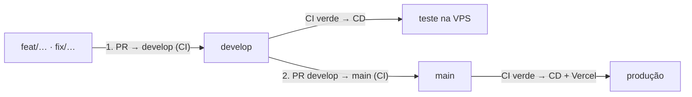
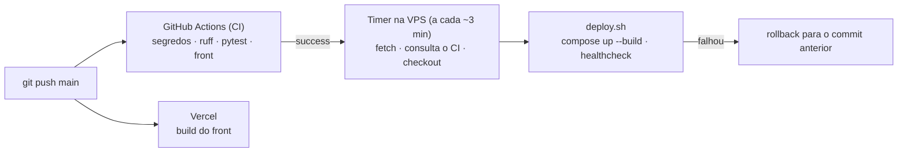

# 14. Deploy e operação

> Repositório **público**: este documento descreve o desenho, sem IP, usuários, domínio da API ou segredos.
> Os comandos reais e os scripts de infraestrutura ficam fora do Git (pasta `deploy/` e um runbook local, os
> dois no `.gitignore`).

## 0. Fluxo de branches e ambientes

> **Regra:** todo trabalho entra **primeiro na `develop`**. Só depois a `develop` vai para a `main`.
> Nada vai direto para a `main` (exceto `hotfix/…`, que depois volta para a `develop`).

| Branch | Papel | Ambiente | Publicação |
| --- | --- | --- | --- |
| `feat/…`, `fix/…` | Trabalho, a partir da `develop` | — | CI no PR |
| `develop` | Integração e **teste** | API de teste na VPS (projeto `midiacomercial-dev`, porta 8002, banco próprio com a demo) | CI + CD do teste, automáticos |
| `main` | **Produção** | Front na Vercel + API na VPS (projeto `midiacomercial`, porta 8001) | CI + Vercel + CD da produção, automáticos |

1. Crie a branch a partir da `develop` e abra PR para a `develop`. O CI precisa passar.
2. Mergeou na `develop`: o CD publica a API de teste na VPS. Confira lá.
3. Para ir ao ar: PR `develop → main`. Mergeou: a Vercel publica o front e o CD publica a API.
4. Depois do merge na `main`, alinhe a `develop` com a `main` (fast-forward), para as duas não divergirem.

### Antes de enviar para a `main` (obrigatório)

Tudo é tratado na `develop` primeiro. Só abra o PR `develop → main` com:

- [ ] CI verde na `develop` (segredos, ruff, migrações, pytest, typecheck, testes e build do front).
- [ ] API de teste publicada pelo CD com o último commit da `develop` e conferida: `/api/saude`, login da demo
      e o fluxo que mudou (ex.: agente, oportunidades, importação).
- [ ] Erros e avisos tratados, sem "arrumo depois": teste quebrado, lint, conflito ou bug achado no teste.
- [ ] Migrações revisadas: nada destrutivo sem backup e sem plano de volta.
- [ ] Sem dado sensível no diff (IP, segredo, `.env`, domínio da API, planilha real).
- [ ] Documentação e status das tasks atualizados quando o comportamento mudou.

O CI recusa PR para a `main` que não venha da `develop` (ou de `hotfix/…`).

O teste não tem domínio público nem preview configurado na Vercel: a API de teste responde só dentro da VPS
(`127.0.0.1:8002`). Os dois ambientes usam o mesmo `docker-compose.vps.yml`; `MC_PROJETO` e `MC_PORTA` no `.env`
de cada pasta separam projeto Docker (rede, volume do banco), imagem e porta. O teste tem segredos próprios e
compartilha só a ponte do Hermes.

## 1. Desenho

| Parte | Onde | Publicação |
| --- | --- | --- |
| Front (SPA) | Vercel · `midia-comercial.midia63.com.br` | Automática a cada push na `main` |
| API Django | VPS Hostinger (compartilhada com outros projetos) · Docker Compose atrás do nginx com TLS | Automática a cada push na `main` **com CI verde** (timer na VPS) |
| IA | Hermes Agent já existente na VPS (perfil próprio) | Fora do deploy da aplicação |

**Por que a VPS busca o código (pull) em vez do GitHub empurrar (push):** nenhuma credencial da VPS fica no
GitHub. O repositório é público e a VPS é compartilhada; um segredo de SSH vazado daria acesso a todos os
projetos dela.

## 2. Front na Vercel

| Campo | Valor |
| --- | --- |
| Root Directory | `frontend` |
| Build | `npm run build` → `dist` |
| `vercel.json` | Fallback da SPA (exceto `api`, `admin`, `static` e assets) e cache dos assets |
| `middleware.ts` | Routing Middleware: `/api`, `/admin` e `/static` → API |

Variáveis de ambiente (Production):

| Variável | Para quê |
| --- | --- |
| `API_ORIGEM` | Endereço da API (`https://<dominio-da-api>`). Tolera aspas, espaços, `API_ORIGEM=` colado, falta de `https://` e barra no fim |
| `API_SEGREDO` | Igual a `MIDIA_PROXY_SEGREDO` da API. Autentica o IP real do visitante para o rate limit |

Variável nova só vale depois de um **Redeploy**. Se `API_ORIGEM` faltar ou for inválida, o visitante vê
"O sistema está em manutenção" e o motivo vai só para o log da Vercel.

## 3. API na VPS

| Peça | Papel |
| --- | --- |
| `Dockerfile` (alvo `web`) | Imagem sem dependências de dev, usuário não-root, `collectstatic` no build |
| `docker/entrypoint.sh` | `migrate` e `createcachetable` a cada start |
| `docker-compose.vps.yml` | `db` (Postgres 16, volume próprio) · `web` (gunicorn só em `127.0.0.1`, healthcheck `/api/saude`) · `prazos` (verificação de prazos de hora em hora); limites de memória |
| nginx do host | Site próprio, TLS do certbot, upload até 20 MB, sobrescreve `X-Real-IP` |
| Ponte do Hermes | Serviço systemd + wrapper com sudo restrito a um comando ([13 §4.1](13-AGENTE.md#41-hermes-em-produção)) |

**Isolamento na VPS compartilhada:** usuário de serviço próprio, pasta própria, projeto Docker próprio (rede e
volume), porta só em loopback, site nginx próprio. Regras: nunca reiniciar nginx (só `reload` após `nginx -t`),
nunca reiniciar Docker ou containers de outros projetos, nunca ler `.env` alheio.

## 4. CI

`.github/workflows/ci.yml`, em todo push na `main` e em PR:

| Job | Verifica |
| --- | --- |
| `segredos` | gitleaks no histórico + bloqueio de `.env`, banco, dump, planilha, chave |
| `backend` | `ruff check`, `ruff format --check` (só Python), `makemigrations --check`, pytest com Postgres 16 |
| `frontend` | `npm ci`, typecheck, vitest, build |

O ruff tem versão fixa no `pyproject.toml`: versão nova muda a formatação e quebraria o CI sem mudança de código.

## 5. CD da API (timer na VPS)

A cada ~3 minutos:

1. `git fetch` da `main` (HTTPS, sem credencial).
2. Commit novo? Consulta a API pública do GitHub: o workflow **CI** do *push* desse commit, na `main` **deste
   repositório**, precisa estar `success`. PR de fork com o mesmo SHA não conta. Pendente → espera; falhou → não
   publica.
3. `git checkout` do commit e `deploy.sh`: `docker compose up -d --build`, espera o `web` ficar saudável e testa
   `/api/saude`.
4. Falhou → volta ao commit anterior, publica de novo e marca o commit como falho (não tenta de novo; o próximo
   commit destrava).

O build roda com prioridade baixa de CPU e disco para não atrapalhar os outros projetos da VPS.

**Limites conhecidos:**
- O rollback volta o código, não o banco. Migração destrutiva exige backup antes.
- Quem tem push na `main` publica código construído pelo Docker na VPS: 2FA obrigatório e escrita restrita no
  repositório.

## 6. Verificação depois de publicar

- [ ] `https://midia-comercial.midia63.com.br/api/saude` → `{"status": "ok"}`
- [ ] Login da demo (gerente e atendente) com o papel certo
- [ ] Agente responde (`provedor: hermes`; até ~20 s)
- [ ] `/admin/` com CSS
- [ ] Importação de CSV sem 413
- [ ] Outros sites da VPS respondendo

## 7. Rollback manual

- **Front:** Vercel → Deployments → *Promote* no deploy anterior.
- **API:** reverter o commit na `main` (o CD publica a reversão quando o CI passar). Em emergência, pausar o timer
  e publicar um commit específico pela VPS.
- **IA:** `MIDIA_IA_PROVEDOR=offline` no `.env` da API desliga o LLM sem tirar o agente do ar.
