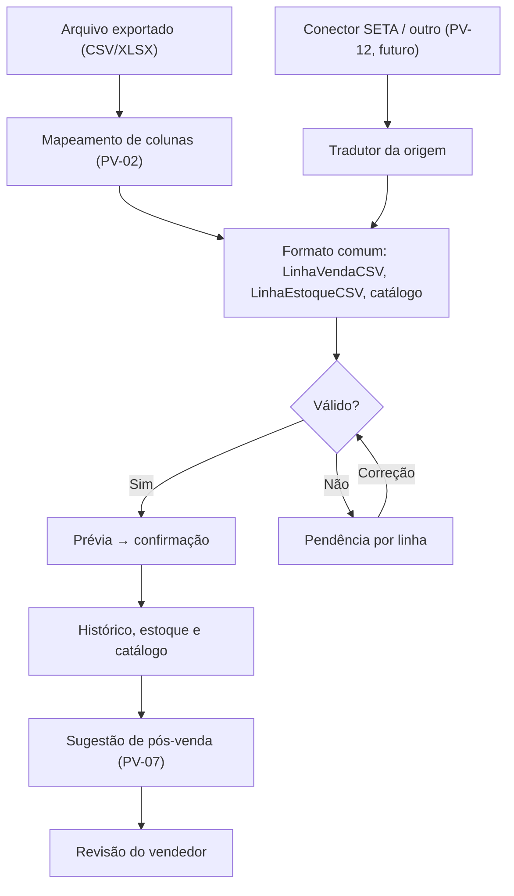

# 16 · Análise estratégica: pesquisa, integração, avaliação e pitch

> **Data:** 13/11/2026 · **Base:**
> - relatos das visitas da equipe aos lojistas do shopping;
> - o documento [docs/10](10-POS-VENDA-E-ADEQUACAO-A-PESQUISA.md), conferido contra o código da `main`;
> - os critérios de avaliação do hackathon.
>
> **O que este documento é:** a visão de negócio que amarra a pesquisa, o produto, a integração e a apresentação. O detalhe técnico e as tasks estão no docs/10 e em [`docs/tasks/`](tasks/README.md).
> **O que não é:** prova de resultado comercial nem de conector pronto. Nenhum conector com sistema de loja existe hoje.

**Direção:** uma camada de integração que aproveita vendas, clientes, produtos e estoque que a loja já tem para organizar o pós-venda e sugerir a próxima ação ao vendedor.

**Mensagem central:** *"Da venda registrada ao próximo contato com o cliente."*

## 1. O que as visitas ensinaram

| Relato | Implicação |
| --- | --- |
| Algumas franquias já têm recursos parecidos | Não vender para quem já está atendido; avaliar a necessidade de cada loja |
| Lojas menores têm dificuldade para preencher dados e não recebem sugestões automáticas | Público inicial: essas lojas, com autonomia para testar |
| Pós-venda e contato com o cliente são difíceis | Organizar o histórico e dizer **quem chamar e com qual produto** |
| A procura do cliente se perde | Ligar a procura ao cliente (com autorização) e avisar quando o item chegar |
| Exemplo: comprou boné preto → oferecer camisa ou short | Recomendação de produto **complementar** |

**Limite:** a pesquisa é qualitativa e exploratória, sem número de entrevistas nem frequência medida. Serve para orientar o piloto, não para estimar mercado.

## 2. Público inicial

Pequenos e médios lojistas de **moda e acessórios** que:
- têm algum registro de vendas, estoque ou clientes;
- repetem digitação ou não aproveitam esses dados no pós-venda;
- têm autonomia para testar e uma fonte de dados acessível.

Franquias já atendidas ficam com prioridade menor. Isso não quer dizer que todas estejam atendidas.

## 3. Sistemas citados nas visitas

| Loja | Sistema informado | Situação | Falta confirmar |
| --- | --- | --- | --- |
| Melissa | **SETA** | Relato da visita (correção do Gabriel) | Fornecedor, produto, versão, módulos e acesso aos dados |
| Loja de bonés (nome não anotado) | **"UNIX"** | Relato da visita | Nome exato e fornecedor. "Unix" é nome de sistema operacional, não de produto de varejo: pode ser o nome de um ERP de mercado mal ouvido ou abreviado. **Confirmar na próxima visita, com foto da tela de login ou do cupom** |

- **Sem acesso real:** não houve acesso autenticado, nem confirmação de API, webhook, permissão, custo ou formato de exportação.
- **Decisão:** SETA e "UNIX" são **alvos de investigação** (task [PV-12](tasks/PV-12-conector-loja-piloto.md)). Só podem ser apresentados como compatíveis depois de validados e testados.

## 4. Problema e proposta de valor

- **Problema:** a loja registra a venda ou ouve a procura, mas não transforma isso em histórico organizado nem num próximo contato útil. Quando o acompanhamento depende de redigitar e de lembrar, o pós-venda não acontece.
- **Pergunta do desafio:** como aproveitar os dados que a loja já registra para reduzir o preenchimento repetido e achar oportunidades de atendimento e venda?
- **Proposta:** receber os dados do sistema da loja, ligar venda, cliente e produto, e preparar sugestões de pós-venda para o vendedor revisar.
- **Benefícios a validar no piloto:**
  - menos digitação;
  - mais continuidade entre atendimento, compra e retorno;
  - clareza sobre o que oferecer e por quê;
  - acompanhamento dos resultados.

  **Ainda não há medição** de tempo economizado nem de vendas.

## 5. Onde o produto está hoje (conferido no código)

| Área | Já funciona | Lacuna (task) |
| --- | --- | --- |
| Importação | CSV de vendas e estoque com prévia, validação, conferência do total e anti-duplicação | Colunas fixas ([PV-02](tasks/PV-02-mapeamento-de-colunas.md)); correção e cancelamento ignorados na reimportação ([PV-04](tasks/PV-04-correcao-e-cancelamento-de-vendas.md)) |
| Catálogo | Produto e variante criados a partir da venda | Variante sem cor e sem tamanho; um produto por SKU ([PV-03](tasks/PV-03-catalogo-cor-tamanho.md)) |
| Clientes | Cadastro, importação e histórico calculado pelo código | Um só código por cliente; sem pendências de vínculo ([PV-05](tasks/PV-05-vinculo-de-cliente.md)) |
| Balcão | Procura anônima, por voz ou por toque | Não liga a procura ao cliente ([PV-09](tasks/PV-09-avisar-quando-chegar.md)) |
| Agente | Propostas de contato para produto parado ou queda de vendas, sempre com revisão humana | Sem gatilho por compra ([PV-07](tasks/PV-07-recomendacao-por-compra-recente.md)); mensagem promete reserva e tamanho ([PV-01](tasks/PV-01-mensagem-honesta.md)) |
| Telas | Importação, clientes, balcão, oportunidades e agente | Menu técnico, jargão e detalhe repetitivo ([UX-01](tasks/UX-01-inicio-hoje-e-menu-pela-rotina.md), [UX-02](tasks/UX-02-linguagem-de-loja.md), [UX-07](tasks/UX-07-detalhe-da-oportunidade.md)) |

O histórico derivado das vendas já existe e deve ser reaproveitado. O trabalho novo está na **entrada de dados**, na **qualidade dos vínculos** e na **próxima ação**.

## 6. Integração: o requisito central

### O formato comum já existe

Os contratos de importação (`LinhaVendaCSV` e `LinhaEstoqueCSV`, em `apps/importacao/schemas.py`) **já são o formato comum interno**: validados, com a loja vinda da sessão, prévia e confirmação. Um conector não precisa de outro caminho. Ele só **traduz** a origem para essas linhas e reaproveita a prévia, a validação, a anti-duplicação e a auditoria.

### Formas de entrada, da mais fácil à mais difícil

| Forma | Como funciona | Condição | Hoje |
| --- | --- | --- | --- |
| Arquivo exportado | A loja exporta e envia; o sistema lembra as colunas | Um arquivo de exemplo real ou anonimizado | Funciona com colunas fixas; o mapeamento vem na PV-02 |
| Exportação agendada | O sistema da loja grava o arquivo numa pasta, e nós lemos | O sistema precisa ter esse recurso | Não existe |
| API | O conector busca os dados autorizados de tempos em tempos | Documentação, autenticação, limites e contrato | Não existe |
| Webhook | A origem avisa quando algo muda | O fornecedor precisa oferecer o recurso | Não existe |

**Dizer na apresentação:** "a entrada demonstrada é por arquivo". A importação de CSV **não prova** que lemos o arquivo do SETA ou do "UNIX". Cada origem precisa de um mapeamento testado.

### Regras que não mudam com a origem

1. **Vínculo de cliente:** só por código verificável, nunca por nome parecido.
2. **Códigos externos:** separados por loja e por sistema.
3. **Reenvio:** repetir uma importação ou um evento não duplica venda, histórico nem proposta.
4. **Alterações:** repetição, correção e cancelamento têm tratamentos diferentes.
5. **Estoque:** saldo antigo nunca sobrescreve um saldo mais novo.
6. **Falhas:** ficam registradas e podem ser reprocessadas. Para conectores, uma **fila durável** é obrigatória, porque o barramento de eventos atual não repete falhas.
7. **Campos ausentes:** viram pendência; nunca são completados por IA.
8. **Consentimento:** tem registro próprio, com a origem e a data. Nunca é deduzido de uma compra.

**Escrever de volta** no sistema da loja (CRM ou ERP) é outra entrega, com contrato e permissão próprios. Não faz parte do escopo atual.

## 7. Papel do agente

| Informação | Quem produz |
| --- | --- |
| Produto, quantidade, data e valor da compra | Origem validada (fato) |
| Cliente da compra | Vínculo verificável |
| Produtos elegíveis | Regras: combinações aprovadas, estoque fresco, tamanho por categoria |
| Justificativa e mensagem | O agente prepara; o vendedor revisa |
| Campo ausente ou ambíguo | Sinalizado como pendência |

O agente propõe e a pessoa confirma. Os services e o orquestrador atuais bastam: não é preciso adotar outro framework ([docs/09](09-DECISAO-FRAMEWORK-IA.md)).

## 8. Escopo do hackathon: duas trilhas em paralelo

A versão anterior desta análise começava por "identificar a origem da loja piloto". Isso **trava** a construção enquanto se espera uma resposta da loja. Por isso, o trabalho foi dividido em duas trilhas:

| Trilha | Quem | Entrega | Evidência |
| --- | --- | --- | --- |
| **A · Produto** | Pessoas 1, 2 e 3 | Fluxo completo do boné preto por arquivo: mapeamento → catálogo → compra → sugestão → revisão → reimportação sem duplicar | Demo de ponta a ponta + testes de aceitação ([PV-11](tasks/PV-11-aceitacao-e-cenario-de-demo.md)) |
| **B · Descoberta** | Gabriel + quem visitou | Confirmar o SETA e o "UNIX": fornecedor, exportação e amostra anonimizada | `docs/integracoes/<sistema>.md`, sem segredo ([PV-12](tasks/PV-12-conector-loja-piloto.md)) |

**Se a trilha B trouxer um arquivo real a tempo,** basta salvar o mapeamento (PV-02) e a demo passa a usar esse layout. Se não trouxer, usamos dados sintéticos, apresentados como "demonstração genérica".

**Ordem da trilha A:** bloqueios + PV-01 → PV-02 → PV-03 → PV-06 → PV-07 → PV-08 + UX-01, UX-02 e UX-07 → PV-11. A reposição por procura (PV-09) é a próxima entrega.

## 9. Critérios de avaliação → o que mostrar

| Critério | Pontos | O que mostrar | Tasks que sustentam |
| --- | ---: | --- | --- |
| Resolução do problema e aderência | 25 | O relato das visitas leva direto ao fluxo de pós-venda, para o público escolhido | PV-07, PV-08, docs/10 |
| Qualidade e funcionalidade | 25 | O fluxo de ponta a ponta funcionando ao vivo, com a reimportação sem duplicar | PV-02, PV-03, PV-04, PV-11 |
| Inovação e viabilidade | 20 | Compra + procura + estoque numa só sugestão; integração viável começando por arquivo | PV-06, PV-09, PV-12 |
| Experiência e clareza | 15 | A rotina em 3 entradas, palavras de loja, o motivo e a limitação visíveis, tudo no celular | UX-01, UX-02, UX-03, UX-07 |
| Apresentação e pitch | 15 | Uma história de 3 minutos, com demo e próximo passo concreto | Roteiro (seção 10) |

Resolução e funcionalidade somam **50 pontos**: um fluxo completo e confiável vale mais que muitas funções pela metade.

**Não afirmar** que nenhum concorrente faz algo parecido: as próprias visitas mostraram franquias com recursos semelhantes. O diferencial é o **fluxo para a pequena loja**: entrada simples, sugestão explicada e revisão humana.

## 10. Demonstração e pitch (3 min)

**História:** a venda de um boné preto é importada, o cliente aparece ligado à compra, uma camiseta complementar com estoque é sugerida com motivo e mensagem, o vendedor revisa, e a reimportação não duplica nada.

| Tempo | Conteúdo |
| --- | --- |
| 0:00–0:30 | O problema observado nas visitas e o público escolhido |
| 0:30–0:50 | Como o Mídia Comercial aproveita os dados que a loja já tem |
| 0:50–2:10 | Demo: importar → cliente ligado → sugestão → revisar → reimportar |
| 2:10–2:40 | Diferencial (compra + procura + estoque) e caminho de integração (arquivo hoje; SETA em investigação) |
| 2:40–3:00 | Próximo passo: piloto acompanhado numa loja |

**Fala de abertura:**

> A loja registra a venda. Mas essa informação ajuda no próximo contato com o cliente?
> Nas visitas ao shopping, lojistas menores contaram que têm dificuldade de organizar esse acompanhamento.
> O Mídia Comercial liga os dados que a loja já tem ao trabalho de pós-venda.
> Depois da compra de um boné, por exemplo, ele sugere uma peça que combina e que está em estoque, e prepara a mensagem para o vendedor revisar.
> Vamos mostrar esse caminho no sistema.

**Pode dizer:**
- "entrada por arquivo";
- "dados fictícios";
- "o vendedor revisa antes de enviar";
- "SETA em investigação";
- "vamos medir no piloto".

**Não diga:**
- "integrado com o SETA";
- "aumenta as vendas em X%";
- "a IA decide";
- "ninguém faz isso".

Ajuste a fala ao que estiver de fato funcionando no dia. Ensaie no aparelho da apresentação.

## 11. Riscos

| Risco | Mitigação |
| --- | --- |
| Prometer uma integração que não existe | Separar sempre "arquivo hoje" de "conector em investigação" |
| Dados ruins da loja (sem código de cliente, sem tamanho) | Pendências visíveis (PV-05), nunca suposição |
| Mensagem invasiva ou sem autorização | Consentimento obrigatório, descanso entre contatos, "Responda SAIR" e revogação (PV-10) |
| Sugestão irrelevante | Combinações aprovadas pelo lojista, motivo de rejeição registrado (PV-08) |
| Demo falhar ao vivo | Seed fixo, roteiro ensaiado duas vezes e vídeo de reserva |

## 12. Pendências e próxima decisão

Confirmar com as lojas:
- nome exato e fornecedor do SETA e do "UNIX";
- versão, módulos e se há exportação ou API;
- como o cliente é identificado nos arquivos;
- se existem cancelamentos e devoluções na exportação;
- frequência de atualização possível;
- quem vai testar e avaliar as sugestões.

**Próxima decisão:** escolher **uma** loja piloto com necessidade real e dados acessíveis, validar a entrada dela e rodar o fluxo completo de venda → histórico → sugestão → contato.
