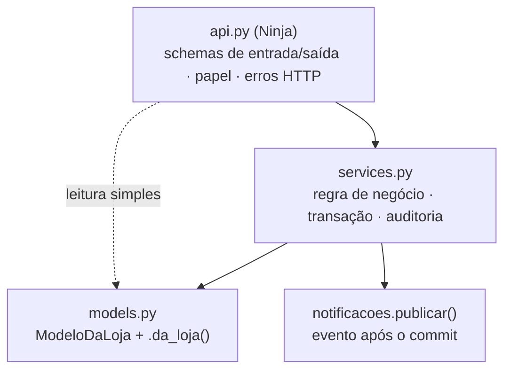

# 2. Backend: camadas e padrões

Django 5.2 + Django Ninja 1.8 (API JSON), PostgreSQL 16. Monólito modular: um app por domínio em `apps/`.

## 2.1 Camadas

| Camada | Regra |
| --- | --- |
| `api.py` | Só HTTP: resolve loja e papel (`loja_com_papel`), valida o schema, chama o service, monta a saída. Sem regra de negócio |
| `services.py` | Toda escrita de domínio passa por aqui, inclusive a do agente (`agente.services.confirmar` usa os services dos formulários) |
| `models.py` | Herdam `ModeloDaLoja`; consultas sempre com `.da_loja(loja)` |
| Motor (`inteligencia/regras`) | Funções puras sobre um `ContextoAnalise` imutável: sem ORM, sem request, testáveis sem banco |

**Regra de dependência:** `inteligencia` e `publico` trabalham com agregados; nome e WhatsApp só existem em
`clientes`. O núcleo analítico usa o `cliente_ref`, um código opaco.

## 2.2 Multi-loja (isolamento por linha)

- `apps/core/models.py`: `ModeloDaLoja` tem `loja` (FK) e `criado_em`. O manager expõe `.da_loja(loja)`, que
  **recusa** `loja=None`.
- `apps/core/middleware.py` (`LojaAtualMiddleware`): a cada requisição, lê `loja_id` da **sessão** e valida o
  `Vinculo` do usuário. Preenche `request.loja` e `request.papel`. A loja nunca vem do corpo, da URL nem do arquivo.
- Sessão adulterada para outra loja: sem vínculo, `request.loja = None` e a API responde 409 `sem_loja`.
- ID de outra loja numa rota (`/oportunidades/{id}`): a busca é `.da_loja(loja).filter(pk=id)`, então o objeto
  "não existe" (404), sem revelar que existe em outra loja.

## 2.3 Papéis

`apps/core/permissoes.py`: `HIERARQUIA = {"atendente": 1, "gerente": 2, "dono": 3}`.

- `loja_com_papel(request, "gerente")` devolve a loja ou levanta `SemLoja` (409) ou `PermissionDenied` (403).
- `tem_papel(request, minimo)` para decisões dentro da rota (ex.: mascarar WhatsApp para atendente).
- O papel mínimo de cada rota está em [referencia-api.md](referencia-api.md).
- As ferramentas do agente também têm papel mínimo (`@ferramenta(..., papel_minimo)`).

## 2.4 Formato de erro

`config/api.py` converte tudo para `{"detail": str, "codigo"?: str, "erros"?: [...]}`:

| Situação | Status | `codigo` |
| --- | --- | --- |
| Sem login | 401 | `nao_autenticado` |
| Sem loja na sessão | 409 | `sem_loja` |
| Papel insuficiente | 403 | `proibido` |
| Objeto inexistente ou de outra loja | 404 | `nao_encontrado` |
| Schema inválido | 422 | `validacao` (com `erros[campo, mensagem]` em português) |
| Limite de requisições | 429 | `limite` (+ `Retry-After`) |
| Regra de negócio (`HttpError`) | 409/400 | mensagem pronta para a tela |

O front mostra o `detail` dos 4xx e troca 5xx por mensagem genérica.

## 2.5 Apps

| App | Modelos | Pontos de entrada |
| --- | --- | --- |
| `core` | `ModeloDaLoja` (abstrato) | saúde, limites (`limites.py`), `paginacao.paginar`, demo (`demo.py`), `gerar_referencia` |
| `contas` | `Loja`, `Vinculo`, `ConfiguracaoLoja` (limiares das regras) | `/auth/login`, `/auth/logout`, `/me`, `/me/loja`, `/csrf`; `desbloquear_login` |
| `comercio` | `Produto`, `Variante`, `Pedido`, `ItemPedido`, `Devolucao` | populado pela importação |
| `estoque` | `SnapshotEstoque` | saldo atual = snapshot mais recente por variante (`publico.services.saldos_atuais`) |
| `importacao` | `LoteImportacao`, `LinhaRejeitada` | `/importacoes/preview`, `/confirmar`, `/cancelar`, modelo e exemplo |
| `publico` | `DemandaNaoAtendida` | `/demandas` (balcão), `/demandas/ranking`, `/analises/publico`, `/catalogo` |
| `inteligencia` | `ExecucaoMotor`, `Oportunidade`, `Evidencia` | `/oportunidades`, `/gerar`, `/{id}`, `/descartar`, `/adiar` |
| `acoes` | `PlanoAcao`, `Medicao`, `EventoAuditoria` | `/acoes`, medição sugerida, medições |
| `clientes` | `Cliente` | `/clientes` (paginado), importar/exportar CSV/XLSX, `/sair` (revoga consentimento) |
| `agente` | `SessaoAgente`, `Campanha`, `PropostaAgente`, `ChamadaFerramenta` | `/agente/mensagens`, propostas, conversas, prospecção, uso |
| `notificacoes` | `Notificacao`, `Leitura` | `/notificacoes`, contagem, ler; `verificar_prazos` |

Detalhes de cada campo: [referencia-modelos.md](referencia-modelos.md).

## 2.6 Padrões que se repetem

- **Proposta antes de gravar:** o agente e a importação nunca gravam direto. Agente → `PropostaAgente` pendente,
  confirmada por uma pessoa. Importação → `LoteImportacao` em prévia, confirmado pelo gerente.
- **Auditoria append-only:** `acoes.auditoria.registrar_evento(loja, usuario, acao, objeto, **detalhes)` para
  descarte, adiamento, importação e planos.
- **Eventos depois do commit:** `notificacoes.eventos.publicar(tipo, loja, chave=..., **dados)` despacha em
  `transaction.on_commit`. Operação desfeita não notifica; observer com erro não derruba a operação.
- **Decimal para dinheiro:** cálculos com `Decimal`; na API nova, valores de `numeros[]` vêm como texto.
- **Trava contra duplicidade:** `select_for_update` onde duas requisições podem colidir (confirmação de proposta,
  publicação da análise, criação de plano) e constraints únicas no banco.
- **Limites por rota:** classes em `core/limites.py`, cada uma com escopo próprio (`login_ip`, `agente`,
  `importacao`).
