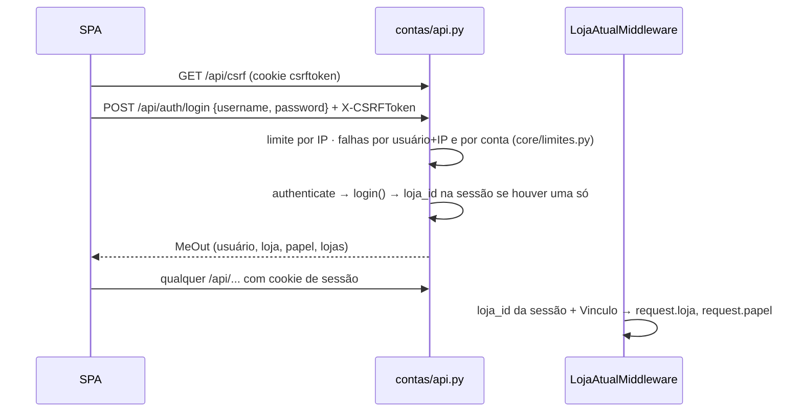
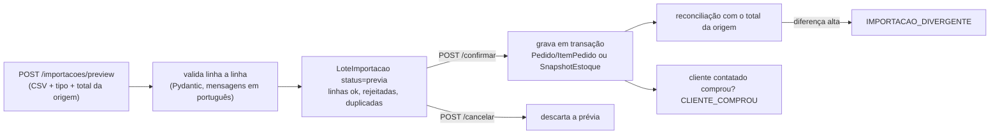

# 3. Fluxos ponta a ponta

Cada fluxo mostra o caminho real no código: rota → service → modelo → evento.

## 3.1 Login, sessão e loja

- Mais de uma loja: a SPA vai para `/lojas` e chama `POST /api/me/loja` (valida o vínculo).
- `POST /api/auth/logout` limpa a sessão; a SPA remove o cache de dados e volta para `/`.
- Senha errada conta falha; o acerto zera. Detalhes em [05-seguranca.md](05-seguranca.md).

## 3.2 Balcão: "procurou e não tinha"

1. Atendente registra por botões ou voz. A voz é transcrita **no navegador**; o servidor recebe texto.
2. Pelos botões: `POST /api/demandas/` → `publico.services.registrar_demanda`. A variante é resolvida por
   produto + tamanho + cor. Combinação que não existe no catálogo vira texto livre, que é justamente a
   "variação ausente".
3. Pela voz/texto: `POST /api/agente/mensagens` → o agente prepara uma `PropostaAgente` do tipo `demanda`
   → a pessoa confere e chama `POST /api/agente/propostas/{id}/confirmar`, que usa o **mesmo**
   `registrar_demanda`.
4. O registro pode ser desfeito pelo próprio autor por até 10 minutos (`DELETE /api/demandas/{id}`).
5. Ao chegar a N procuras sem estoque na janela, publica `DEMANDA_LIMIAR` (sino de avisos).

## 3.3 Importação de vendas e estoque

- **Idempotência:** SHA-256 do arquivo por loja e tipo (constraint `lote_unico_por_arquivo`). Mesmo arquivo de
  novo → "já foi importado, nada foi duplicado". Linhas já existentes contam como duplicadas.
- **Contrato do CSV:** `GET /api/importacoes/modelo?tipo=vendas|estoque`. Separador `;`, decimal com vírgula,
  data ISO com fuso.
- **Privacidade:** o CSV bruto não é guardado; ficam o hash, os totais e até 500 linhas rejeitadas, com o erro.
- **Limites:** prévia limitada por usuário (`MIDIA_LIMITE_IMPORTACAO`); até 20 MB no proxy.
- **Limitação atual:** reimportar com valor corrigido ou cancelado não atualiza o pedido existente (task PV-04).

## 3.4 Motor de oportunidades

`POST /api/oportunidades/gerar` → `inteligencia.motor.calcular(loja)`:

1. **Revisão dos dados** (`revisao.py`): assinatura dos agregados das fontes. Igual à da análise vigente →
   devolve a mesma (`reaproveitada: true`), sem gravar.
2. **Coleta** (`coleta.montar_contexto`): a única parte com ORM. Monta o `ContextoAnalise` imutável (vendas,
   procuras, estoque, catálogo, limiares da loja) na janela (`ConfiguracaoLoja.janela_dias`).
3. **Qualidade** (`qualidade.indicadores`): receita, ticket, cobertura de `cliente_ref`, idade do estoque.
4. **Regras** (funções puras):

   | Regra | Dispara | Bloqueia |
   | --- | --- | --- |
   | A · Lacuna de mix | ≥ N procuras de uma variante e saldo 0 ou inexistente | Sem procura na janela |
   | B · Pouca saída | Saldo > 0 e sem venda em X dias | Estoque sem captura ou mais velho que H horas |
   | C · Padrão de público | Categoria concentrada num dia × faixa de 2 h | Sem venda na janela |
   | C2 · Recorrência | Recorrência baixa de clientes | Cobertura de `cliente_ref` abaixo do mínimo |

5. **Priorização** (`priorizacao.py`): no máximo 3 cartões, por urgência, esforço e status dos dados. Alvos com
   plano aberto ou recente, descarte recente ou adiamento ativo ficam de fora (`chave` estável).
6. **Explicação:** template, ou LLM opcional que só reescreve o texto. A saída do LLM é rejeitada se trouxer
   número que não está nos fatos.
7. **Publicação** numa transação curta, com trava na loja: `ExecucaoMotor` imutável + cartões com campos
   estruturados (`resumo`, `numeros`, `passos`, `alternativas`, `frescor`) + evidências. Avisa
   `OPORTUNIDADE_NOVA` só para alvo novo.

`GET /api/oportunidades/` só lê a análise vigente e indica `desatualizada` quando há dado novo. Detalhes e
decisões: [docs/18](../18-BACKEND-DE-OPORTUNIDADES.md).

## 3.5 Decisão e medição

- `POST /api/acoes/` com `oportunidade_id` → `acoes.services.criar_plano`: título e indicador herdados do
  cartão, responsável e prazo. Uma ação aberta por alvo, mesmo entre análises.
- `GET /api/acoes/{id}/medicao-sugerida`: período antes e depois (7 dias na regra A, 14 nas demais) e valores
  calculados das fontes. `POST /medicoes` grava a medição.
- Antes/depois mostra **associação**, não prova efeito (está escrito na tela).
- `PATCH` muda a situação; descartar exige justificativa. Prazo vencido → `ACAO_ATRASADA`, disparado por
  `verificar_prazos`.
- Alternativas ao plano: `POST /descartar` (com justificativa) e `POST /adiar` (1 a 14 dias).

## 3.6 Agente (mensagem)

`POST /api/agente/mensagens` → `agente.orquestrador.processar`:

1. Mascara telefone, CPF e e-mail; carrega a sessão da própria pessoa nesta loja.
2. Escolhe o provedor (`FABRICAS`): offline, Hermes (produção) ou Claude. Qualquer erro → offline.
3. O provedor pede ferramentas por `chamar(nome, args)`. O orquestrador confere o papel, valida o JSON Schema,
   executa com `Contexto(loja, usuario, papel)`, audita em `ChamadaFerramenta` e devolve o resultado com
   `ocultar()`.
4. Ferramentas só leem ou criam `PropostaAgente` pendente.
5. Guarda a conversa (até 100 falas mascaradas) com os passos; ao LLM vão só as 6 últimas.

Estrutura completa, provedores e como estender: [docs/13](../13-AGENTE.md).

## 3.7 Prospecção (vender o produto parado)

`POST /api/agente/prospeccao` ou a ferramenta `prospectar_produtos_em_baixa` → `agente.prospeccao.rodar`:

1. `alvos_em_baixa`: produtos parados ou em queda (até 3).
2. `candidatos`: só clientes com **consentimento**, fora do descanso de 14 dias e com relação com a categoria.
   Pontos e motivos legíveis ("Já comprou Camisas", "Veste G (tem em estoque)").
3. `mensagem`: texto que não promete reserva nem tamanho não confirmado, com "Responda SAIR".
4. Cria uma `Campanha` e uma `PropostaAgente` de contato por cliente. Avisa `CAMPANHA_PROPOSTA`.
5. A pessoa aprova (`confirmar`), abre o link `wa.me` e envia ela mesma; depois marca `enviada`.
6. Compra do cliente contatado em até 14 dias → `CLIENTE_COMPROU`, detectado na importação.

## 3.8 Notificações (Observer)

- `notificacoes/eventos.py`: tipos `DEMANDA_LIMIAR`, `OPORTUNIDADE_NOVA`, `CAMPANHA_PROPOSTA`,
  `CLIENTE_COMPROU`, `ACAO_ATRASADA`, `IMPORTACAO_DIVERGENTE`, `ESTOQUE_DESATUALIZADO`.
- `publicar()` despacha após o commit para os observers de `observadores.py`:
  - `notificar_na_tela`: cria ou atualiza `Notificacao`, agrupando a mesma `chave` em 24 h para não fazer spam;
  - `avisar_por_email`: opcional (`NOTIFICACOES_EMAIL=True`).
- Canal novo: outra função com `@observa(tipo)`. Quem publica não conhece quem observa.
- `Leitura` guarda o "lido" por usuário; `GET /api/notificacoes/contagem` alimenta o sino.
