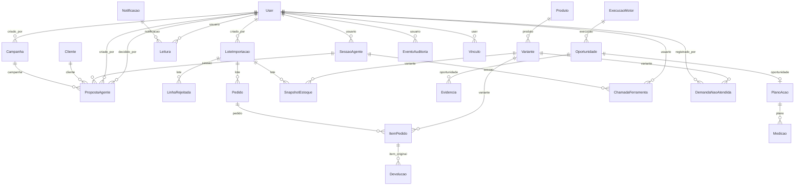

# Referência dos modelos

> Gerado por `python manage.py gerar_referencia`. Não edite à mão: rode o comando de novo.

Todo modelo de domínio herda `ModeloDaLoja` (campo `loja` + `.da_loja()`): o isolamento por loja é por linha. Por isso a `Loja` fica fora do diagrama.

## Relações

## `contas`

### Loja

| Campo | Tipo | Observação |
| --- | --- | --- |
| `nome` | Char |  |
| `segmento` | Char |  |
| `horario_funcionamento` | JSON | Ex.: {"seg": ["09:00", "18:00"], "dom": null} |
| `fuso` | Char |  |
| `demo` | Boolean | Dados sintéticos (selo DEMO na UI) |
| `criado_em` | DateTime |  |

### Vinculo

| Campo | Tipo | Observação |
| --- | --- | --- |
| `user` | ForeignKey | → User |
| `loja` | ForeignKey | → Loja |
| `papel` | Char | valores: dono, gerente, atendente |

### ConfiguracaoLoja

Limiares das regras (§4.3). Editáveis, nunca fixos no código.

| Campo | Tipo | Observação |
| --- | --- | --- |
| `loja` | OneToOne | → Loja |
| `janela_dias` | PositiveSmallInteger |  |
| `a_min_demandas` | PositiveSmallInteger |  |
| `b_dias_sem_venda` | PositiveSmallInteger |  |
| `b_max_horas_estoque` | PositiveSmallInteger |  |
| `c_limiar_concentracao` | Decimal |  |
| `c_min_cobertura_cliente` | Decimal |  |

## `importacao`

### LoteImportacao

| Campo | Tipo | Observação |
| --- | --- | --- |
| `loja` | ForeignKey | → Loja |
| `criado_em` | DateTime |  |
| `tipo` | Char | valores: vendas, estoque |
| `arquivo_hash` | Char | SHA-256 do arquivo |
| `status` | Char | valores: previa, confirmado, cancelado, falhou |
| `linhas_ok` | PositiveInteger |  |
| `linhas_rejeitadas` | PositiveInteger |  |
| `linhas_duplicadas` | PositiveInteger |  |
| `total_importado` | Decimal |  |
| `total_origem_informado` | Decimal | opcional |
| `criado_por` | ForeignKey | → User |
| `confirmado_em` | DateTime | opcional |
| `nome_arquivo` | Char |  |
| `linhas_pendentes` | JSON |  |

### LinhaRejeitada

Erro por linha. Não guarda conteúdo bruto do CSV (§8.3).

| Campo | Tipo | Observação |
| --- | --- | --- |
| `lote` | ForeignKey | → LoteImportacao |
| `numero_linha` | PositiveInteger |  |
| `erros` | JSON | [{"campo": "quantidade", "mensagem": "deve ser > 0"}] |

## `comercio`

### Produto

| Campo | Tipo | Observação |
| --- | --- | --- |
| `loja` | ForeignKey | → Loja |
| `criado_em` | DateTime |  |
| `referencia` | Char | Código do produto-pai |
| `nome` | Char |  |
| `categoria` | Char |  |

### Variante

Uma variante por SKU: Camiseta Azul M ≠ Camiseta Azul G.

| Campo | Tipo | Observação |
| --- | --- | --- |
| `loja` | ForeignKey | → Loja |
| `criado_em` | DateTime |  |
| `produto` | ForeignKey | → Produto |
| `sku` | Char |  |
| `tamanho` | Char |  |
| `cor` | Char |  |

### Pedido

| Campo | Tipo | Observação |
| --- | --- | --- |
| `loja` | ForeignKey | → Loja |
| `criado_em` | DateTime |  |
| `sistema_origem` | Char |  |
| `pedido_id_origem` | Char |  |
| `data_hora` | DateTime |  |
| `status` | Char | valores: concluida, cancelada |
| `cliente_ref` | Char | opcional; Opaco. Nunca CPF, nome ou telefone. |
| `canal` | Char |  |
| `faixa_etaria` | Char | valores: ate_17, 18_24, 25_34, 35_44, 45_59, 60_mais; Estimada; nunca data de nascimento |
| `lote` | ForeignKey | → LoteImportacao; opcional |

### ItemPedido

| Campo | Tipo | Observação |
| --- | --- | --- |
| `loja` | ForeignKey | → Loja |
| `criado_em` | DateTime |  |
| `pedido` | ForeignKey | → Pedido |
| `item_id` | Char |  |
| `variante` | ForeignKey | → Variante |
| `quantidade` | PositiveInteger |  |
| `receita_item` | Decimal | Com desconto, sem frete/tributo |
| `custo_total_item` | Decimal | opcional |

### Devolucao

| Campo | Tipo | Observação |
| --- | --- | --- |
| `loja` | ForeignKey | → Loja |
| `criado_em` | DateTime |  |
| `item_original` | ForeignKey | → ItemPedido |
| `data` | DateTime |  |
| `quantidade` | PositiveInteger |  |
| `valor` | Decimal |  |

## `estoque`

### SnapshotEstoque

| Campo | Tipo | Observação |
| --- | --- | --- |
| `loja` | ForeignKey | → Loja |
| `criado_em` | DateTime |  |
| `variante` | ForeignKey | → Variante |
| `saldo` | Integer |  |
| `capturado_em` | DateTime |  |
| `lote` | ForeignKey | → LoteImportacao; opcional |

## `publico`

### DemandaNaoAtendida

Cliente procurou e não encontrou. Sem dados pessoais (§8.3).

| Campo | Tipo | Observação |
| --- | --- | --- |
| `loja` | ForeignKey | → Loja |
| `criado_em` | DateTime |  |
| `variante` | ForeignKey | → Variante; opcional |
| `produto_texto` | Char | Quando o item não existe no catálogo |
| `categoria` | Char |  |
| `tamanho` | Char |  |
| `cor` | Char |  |
| `motivo` | Char | valores: indisponivel, variacao_ausente, preco, prazo, outro |
| `qtd_procurada` | PositiveSmallInteger | opcional |
| `faixa_etaria` | Char | valores: ate_17, 18_24, 25_34, 35_44, 45_59, 60_mais; Estimada; nunca data de nascimento |
| `registrado_por` | ForeignKey | → User |
| `registrado_em` | DateTime |  |

## `inteligencia`

### ExecucaoMotor

Fotografia imutável de uma análise. Recalcular cria outra; a anterior fica (com os

| Campo | Tipo | Observação |
| --- | --- | --- |
| `loja` | ForeignKey | → Loja |
| `criado_em` | DateTime |  |
| `janela_inicio` | Date |  |
| `janela_fim` | Date |  |
| `executado_em` | DateTime |  |
| `qualidade` | JSON | Cobertura cliente_ref, idade do estoque, completude de custo... |
| `bloqueios` | JSON | Regras bloqueadas e como liberar |
| `revisao_dados` | Char |  |
| `versao_motor` | Char |  |
| `fontes` | JSON | Datas das fontes no momento da análise |
| `duracao_ms` | PositiveInteger |  |

### Oportunidade

| Campo | Tipo | Observação |
| --- | --- | --- |
| `loja` | ForeignKey | → Loja |
| `criado_em` | DateTime |  |
| `execucao` | ForeignKey | → ExecucaoMotor |
| `regra` | Char |  |
| `versao_regra` | Char |  |
| `status` | Char | valores: suficiente, amostra_limitada, bloqueada |
| `titulo` | Char |  |
| `acao_sugerida` | Text |  |
| `limitacao` | Text |  |
| `medicao_sugerida` | Text |  |
| `alvo` | JSON |  |
| `chave` | Char |  |
| `prioridade` | PositiveSmallInteger |  |
| `explicacao` | Text | Texto por template (ou IA validada) |
| `resumo` | Text |  |
| `numeros` | JSON |  |
| `passos` | JSON |  |
| `alternativas` | JSON |  |
| `frescor` | JSON |  |
| `descartada_em` | DateTime | opcional |
| `justificativa_descarte` | Text |  |
| `adiada_ate` | DateTime | opcional |

### Evidencia

| Campo | Tipo | Observação |
| --- | --- | --- |
| `loja` | ForeignKey | → Loja |
| `criado_em` | DateTime |  |
| `oportunidade` | ForeignKey | → Oportunidade |
| `fonte` | Char | valores: vendas, demanda, estoque, acao |
| `descricao` | Char |  |
| `valor` | Decimal |  |
| `periodo_inicio` | Date |  |
| `periodo_fim` | Date |  |
| `amostra` | PositiveInteger |  |

## `acoes`

### PlanoAcao

| Campo | Tipo | Observação |
| --- | --- | --- |
| `loja` | ForeignKey | → Loja |
| `criado_em` | DateTime |  |
| `oportunidade` | OneToOne | → Oportunidade; opcional |
| `titulo` | Char |  |
| `responsavel` | Char |  |
| `prazo` | Date |  |
| `indicador` | Char |  |
| `situacao` | Char | valores: aberta, concluida, descartada |
| `justificativa` | Text |  |

### Medicao

| Campo | Tipo | Observação |
| --- | --- | --- |
| `loja` | ForeignKey | → Loja |
| `criado_em` | DateTime |  |
| `plano` | ForeignKey | → PlanoAcao |
| `periodo_antes_inicio` | Date |  |
| `periodo_antes_fim` | Date |  |
| `periodo_depois_inicio` | Date |  |
| `periodo_depois_fim` | Date |  |
| `valor_antes` | Decimal |  |
| `valor_depois` | Decimal | opcional |
| `contexto` | Text |  |
| `versao_calculo` | Char |  |

### EventoAuditoria

Append-only: não pode ser alterado nem apagado pela aplicação.

| Campo | Tipo | Observação |
| --- | --- | --- |
| `loja` | ForeignKey | → Loja |
| `criado_em` | DateTime |  |
| `usuario` | ForeignKey | → User |
| `acao` | Char |  |
| `objeto` | Char |  |
| `detalhes` | JSON |  |

## `clientes`

### Cliente

| Campo | Tipo | Observação |
| --- | --- | --- |
| `loja` | ForeignKey | → Loja |
| `criado_em` | DateTime |  |
| `ref` | Char | Mesmo código opaco do cliente_ref das vendas |
| `nome` | Char |  |
| `whatsapp` | Char | Só dígitos, com DDI 55 |
| `faixa_etaria` | Char | valores: ate_17, 18_24, 25_34, 35_44, 45_59, 60_mais |
| `tamanhos` | JSON |  |
| `categorias_interesse` | JSON |  |
| `observacao` | Char |  |
| `consentimento_contato` | Boolean |  |
| `consentimento_em` | DateTime | opcional |
| `origem` | Char | valores: planilha, balcao, agente, manual |
| `ultimo_contato_em` | DateTime | opcional |
| `atualizado_em` | DateTime |  |

## `agente`

### SessaoAgente

| Campo | Tipo | Observação |
| --- | --- | --- |
| `loja` | ForeignKey | → Loja |
| `criado_em` | DateTime |  |
| `usuario` | ForeignKey | → User |
| `provedor` | Char |  |
| `modelo` | Char | Modelo do LLM, se usado |
| `canal` | Char |  |
| `historico` | JSON |  |
| `turnos` | PositiveSmallInteger |  |
| `passos` | PositiveSmallInteger |  |
| `tokens_entrada` | PositiveInteger |  |
| `tokens_saida` | PositiveInteger |  |
| `duracao_ms` | PositiveInteger |  |
| `fallback` | Char | Por que caiu no provedor offline |
| `atualizado_em` | DateTime |  |

### Campanha

Grupo de propostas de contato para um produto/categoria em baixa.

| Campo | Tipo | Observação |
| --- | --- | --- |
| `loja` | ForeignKey | → Loja |
| `criado_em` | DateTime |  |
| `titulo` | Char |  |
| `gatilho` | Char |  |
| `alvo` | JSON |  |
| `motivo` | Char |  |
| `status` | Char | valores: proposta, ativa, encerrada |
| `criado_por` | ForeignKey | → User |

### PropostaAgente

| Campo | Tipo | Observação |
| --- | --- | --- |
| `loja` | ForeignKey | → Loja |
| `criado_em` | DateTime |  |
| `sessao` | ForeignKey | → SessaoAgente; opcional |
| `campanha` | ForeignKey | → Campanha; opcional |
| `cliente` | ForeignKey | → Cliente; opcional |
| `tipo` | Char | valores: demanda, cliente, contato |
| `status` | Char | valores: pendente, confirmada, rejeitada, enviada |
| `resumo` | Char |  |
| `dados` | JSON |  |
| `campos_incertos` | JSON |  |
| `motivos` | JSON | Por que o agente propôs (legível) |
| `limitacao` | Char |  |
| `pontuacao` | PositiveSmallInteger |  |
| `criado_por` | ForeignKey | → User |
| `decidido_por` | ForeignKey | → User; opcional |
| `decidido_em` | DateTime | opcional |
| `enviado_em` | DateTime | opcional |
| `objeto_criado` | Char |  |

### ChamadaFerramenta

Auditoria de cada ferramenta usada pelo agente (entrada já mascarada).

| Campo | Tipo | Observação |
| --- | --- | --- |
| `loja` | ForeignKey | → Loja |
| `criado_em` | DateTime |  |
| `sessao` | ForeignKey | → SessaoAgente; opcional |
| `usuario` | ForeignKey | → User |
| `ferramenta` | Char |  |
| `entrada` | JSON |  |
| `saida_resumo` | Char |  |
| `ok` | Boolean |  |
| `duracao_ms` | PositiveInteger |  |

## `notificacoes`

### Notificacao

Aviso para a EQUIPE da loja (nunca para o cliente). Sem dado pessoal no texto.

| Campo | Tipo | Observação |
| --- | --- | --- |
| `loja` | ForeignKey | → Loja |
| `criado_em` | DateTime |  |
| `tipo` | Char |  |
| `nivel` | Char | valores: info, atencao, sucesso, erro |
| `titulo` | Char |  |
| `texto` | Char |  |
| `link` | Char | Rota da SPA, ex.: /agente |
| `papel_minimo` | Char |  |
| `chave` | Char | Agrupa repetições do mesmo evento |
| `contador` | PositiveInteger |  |
| `atualizada_em` | DateTime |  |

### Leitura

Estado de leitura por usuário (cada pessoa marca a sua).

| Campo | Tipo | Observação |
| --- | --- | --- |
| `notificacao` | ForeignKey | → Notificacao |
| `usuario` | ForeignKey | → User |
| `lida_em` | DateTime |  |
