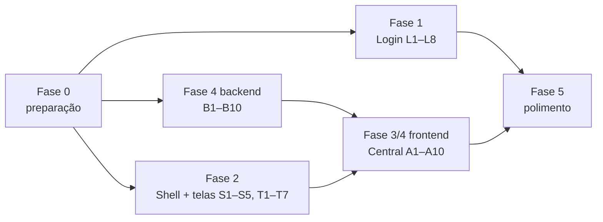

# Planejamento: redesign do login, telas internas e Central do Agente

**Projeto:** MidiaComercial · **Data:** 13/11/2026 · **Status:** PR 1 em execução; demais fases planejadas
**Base:** leitura do código atual (v0.3) e dos docs [07](docs/07-EVOLUCAO-AGENTE-PUBLICO.md) e [08](docs/08-DESIGN-GEOMETRIA-E-EFEITOS-REACT-BITS.md)
**Escopo:** frontend (`frontend/src`) e, na Fase 4, backend novo em `apps/agente` e `apps/clientes`

---

## 0. Como usar este documento

- Cada tarefa tem **ID** (`L1`, `S2`, `A5`...), arquivos, critério de pronto e dependência.
- Ordem sugerida: Fase 0 → 1 → 2 → 3 → 4 → 5. Fases 1 e 2 são independentes entre si.
- Validação ao fim de cada tarefa (regra do projeto):
  ```bash
  cd frontend && npm run typecheck && npm test && npm run build
  pytest            # quando tocar backend
  ```
- Regras herdadas que **não mudam**: geometria reta (2/4/6/8 px), só tokens (sem hex solto), um efeito de destaque por tela, `prefers-reduced-motion` desliga tudo, sem WebGL nem efeito de cursor, orçamento de **+25 kB gzip** no bundle inicial, "o agente propõe, a pessoa confirma", LGPD.

---

## 1. Diagnóstico: arquitetura atual

### 1.1 Visão geral

```
Navegador (React 19 + Vite 8 + Tailwind 4)
  └─ /api/* (cookie de sessão + CSRF)
Django 5.2 + Django Ninja  (config/api.py)
  ├─ contas        login, /me, troca de loja, papéis (dono > gerente > atendente)
  ├─ core          ModeloDaLoja (isolamento por loja), middleware, seed_demo
  ├─ importacao    CSV de vendas/estoque: prévia → confirmar
  ├─ comercio      pedidos e itens       ┐
  ├─ estoque       saldos                ├─ núcleo analítico (só cliente_ref opaco)
  ├─ publico       perfil, períodos, faixas, demanda não atendida (balcão)
  ├─ inteligencia  motor de regras A/B/C → até 3 oportunidades
  ├─ acoes         plano de ação + medição antes/depois + auditoria
  ├─ clientes      ÚNICO lugar com dado pessoal (nome, WhatsApp, consentimento)
  ├─ agente        orquestrador, ferramentas por papel, provedor offline/Claude,
  │                propostas, campanhas de prospecção, medição de conversão
  └─ notificacoes  barramento Observer (7 eventos) → aviso na tela / e-mail
```

### 1.2 Frontend

| Camada | Onde | Observação |
| --- | --- | --- |
| Rotas | `app/router.tsx` | `/login`, `/lojas`, `/balcao` (atendente), resto sob `AppShell` (gerente) com `lazy` |
| Shell | `app/layouts/AppShell.tsx` | Sidebar em grupos Analisar/Agir/Dados, menu inferior mobile, **botão flutuante "Preencher com IA"** em toda tela exceto `/agente` |
| Efeitos | `components/efeitos/*` | Reimplementações enxutas do React Bits: SpotlightCard, CountUp, ShinyText, ClickSpark, Squares, StarBorder, AnimatedList, BlurText, FadeContent |
| Ponte | `components/midia/destaques.tsx` | Nomes de domínio (`Processando`, `AcaoPrincipal`, `CartaoExploravel`, `FundoGrade`, `TituloAnimado`, `Confirmacao`, `Entrada`). Features não importam efeito direto |
| Dados | `api/client.ts`, TanStack Query, `useChaveLoja` | Cache por loja |
| Avisos | `features/notificacoes/Sino.tsx` | Polling 30 s em `/api/notificacoes` |

### 1.3 Problemas encontrados

| # | Problema | Onde |
| --- | --- | --- |
| P1 | Login em 2 colunas, formulário à esquerda e mensagem só no desktop (painel some no celular). Não explica **quem somos, o que é, para que serve** | `LoginPage.tsx` |
| P2 | Agente espalhado: página `/agente` (campanhas + chat) **e** botão flutuante com o mesmo chat em todas as telas. Duas portas, nenhuma é "a central" | `AppShell.tsx`, `AgentePage.tsx`, `AgenteChat.tsx` |
| P3 | O que acontece no sistema (eventos Observer) só aparece no sino, em lista curta. Não há linha do tempo nem ligação com o agente | `Sino.tsx`, `apps/notificacoes` |
| P4 | Ferramentas do agente (`GET /api/agente/ferramentas`) existem na API mas **não aparecem na tela**; o usuário precisa adivinhar frases | `apps/agente/api.py` |
| P5 | Não existe "o que cada cliente gosta". Há dados soltos (`categorias_interesse`, `tamanhos`, `faixa_etaria`, histórico de compras, procuras), mas nenhum perfil de afinidade calculado nem recomendação fora da prospecção de produto em baixa | `apps/clientes`, `apps/agente/prospeccao.py` |
| P6 | Meu público mostra agregados, mas não liga ao próximo passo (ex.: "faixa 25–34 compra Calças no sábado → ver clientes") | `PublicoPage.tsx` |
| P7 | Telas internas sem atalho entre si: oportunidade não leva ao agente, cliente não mostra campanhas em que entrou | várias |

---

## 2. Fase 0: preparação

| ID | Tarefa | Arquivos | Pronto quando |
| --- | --- | --- | --- |
| F0.1 | Branch `feat/login-institucional` a partir de `main` para o PR 1 | — | Branch criada |
| F0.2 | Medir bundle inicial atual (`npm run build`, somar gzip de index + modulepreload) e registrar aqui | este arquivo §9 | Número base anotado |
| F0.3 | Screenshots "antes" de todas as telas em 375 e 1280 px, claro e escuro | `docs/assets/antes/` | Pasta com imagens |
| F0.4 | Confirmar no reactbits.dev nome e dependência dos efeitos novos (§3.3, §5.2) antes de copiar | — | Lista conferida |

---

## 3. Fase 1: tela de login centralizada e institucional

### 3.1 Objetivo

Uma coluna central, que funcione igual no celular e no desktop, e que em 10 segundos responda:
**Quem somos** (Equipe NidoQueen, Hackrun Palmas), **o que somos** (camada de inteligência comercial ao lado do PDV) e **para que serve** (transformar o que vendeu e o que procuraram e não tinha em decisões e vendas).

### 3.2 Layout proposto

```
┌──────────────────────── fundo Squares (grade, ≤ 8%) ────────────────────────┐
│                                                                              │
│                         [logo MidiaComercial]                                │
│               Seus sinais de venda, em uma só mídia.   ← BlurText           │
│     Inteligência comercial para o pequeno lojista, ao lado do seu caixa.    │
│                                                                              │
│                 ┌────────── card login (SpotlightCard) ─────────┐            │
│                 │ Usuário  [______________]                      │            │
│                 │ Senha    [______________]  (mostrar/ocultar)   │            │
│                 │ [  Entrar  ]  ← StarBorder (ação principal)    │            │
│                 │ ── ou entre na demo ──                         │            │
│                 │ [Gerente (Centro)]   [Atendente (balcão)]      │            │
│                 │ Dados 100% sintéticos                          │            │
│                 └────────────────────────────────────────────────┘            │
│                                                                              │
│   ┌ O que somos ┐   ┌ Para que serve ┐   ┌ Como funciona ┐   ← 3 blocos     │
│   │ camada ao   │   │ venda perdida, │   │ Sinal → Decisão │     FadeContent  │
│   │ lado do PDV │   │ produto parado │   │ → Ação → Medição│                  │
│   └─────────────┘   └────────────────┘   └─────────────────┘                  │
│                                                                              │
│   Quem somos: Equipe NidoQueen · Hackrun Palmas · orientação Mario Pombal   │
│   [avatares retos da equipe]                    LGPD · dados sintéticos      │
└──────────────────────────────────────────────────────────────────────────────┘
```

- Celular (375 px): mesma ordem, blocos em 1 coluna, card de login logo abaixo do título (sem rolar para entrar).
- Desktop: largura máxima ~ 960 px; card de login 400 px centralizado; 3 blocos em linha.

### 3.3 Efeitos (React Bits) na tela de login

| Efeito | Uso | Status no projeto |
| --- | --- | --- |
| Squares | Fundo de grade | Já existe |
| BlurText | Título | Já existe |
| SpotlightCard | Card de login (desligado no toque) | Já existe |
| StarBorder | Botão "Entrar" (única ação principal) | Já existe |
| FadeContent | Entrada dos 3 blocos ao rolar | Já existe |
| **RotatingText** (novo) | Subtítulo alterna: "o que vendeu" · "o que procuraram e não tinha" · "o que está parado" · "quem vai comprar" | Novo: reimplementar com CSS, **sem motion** (login fica no bundle inicial) |
| **GradientText** (novo, opcional) | Palavra "uma só mídia" em violeta → coral via tokens | Novo: só CSS |

Fora: Aurora, Silk, Threads (WebGL), cursores, DecryptedText (regra do docs/08 §5.2).

### 3.4 Tarefas

| ID | Tarefa | Arquivos | Pronto quando | Dep. |
| --- | --- | --- | --- | --- |
| L1 | Reescrever `LoginPage` em coluna única centralizada; remover `PainelOndas` | `features/auth/LoginPage.tsx` | Layout do §3.2 em 375 e 1280 px | — |
| L2 | Componente `BlocoInstitucional` (O que somos / Para que serve / Como funciona), texto vindo de uma constante única | `components/midia/institucional.tsx` | Texto revisado, sem jargão | — |
| L3 | Seção "Quem somos" com equipe (avatares locais em `public/`, não chamar GitHub em tempo real) | `components/midia/institucional.tsx`, `public/equipe/*` | Funciona offline | L2 |
| L4 | Efeito `RotatingText` em CSS puro + reduced motion | `components/efeitos/RotatingText.tsx`, `destaques.tsx`, `efeitos/index.ts` | Teste em `efeitos.test.tsx` com reduced motion | — |
| L5 | `GradientText` só com tokens (opcional) | `components/efeitos/GradientText.tsx` | Sem hex | — |
| L6 | Mostrar/ocultar senha; mensagem de erro com `role="alert"` mantida; foco no usuário | `LoginPage.tsx`, `components/ui/input.tsx` | Teclado: Tab → Enter funciona | L1 |
| L7 | Alinhar `LojasPage` ao mesmo visual (centralizado, Squares, card reto) | `features/auth/LojasPage.tsx` | Mesma linguagem do login | L1 |
| L8 | Medir bundle: login não pode passar do orçamento | — | Diferença registrada no §9 | L1–L5 |

**Andamento do PR 1 (13/11/2026):** L1–L8 implementadas na branch `feat/login-institucional`. Os efeitos novos são reimplementações em CSS; nenhum código externo foi copiado e nenhuma dependência foi adicionada. F0.1 e F0.2 concluídas. F0.3 (capturas do estado anterior de todas as telas) e F0.4 (consulta ao catálogo externo) continuam pendentes; F0.4 não bloqueia as reimplementações locais.

---

## 4. Fase 2: shell e telas internas (visual e funcional)

### 4.1 Padrões que valem para todas as telas

| ID | Tarefa | Arquivos | Pronto quando |
| --- | --- | --- | --- |
| S1 | `PageHeader` com 3 linhas fixas: título · destaque ("o que mudou") · **próximo passo** (link para a tela que resolve) | `components/midia/estado.tsx` | Toda tela tem destaque ou ação visível sem rolar |
| S2 | Barra de contexto no topo do shell: loja atual, período da análise, frescor dos dados ("vendas até 12/11 · estoque de 3 dias") | `AppShell.tsx`, novo `components/midia/contexto.tsx` | Visível em todas as telas do gerente |
| S3 | Paleta de comandos `Ctrl+K`: ir para tela, buscar cliente, buscar produto, "perguntar ao agente" | novo `features/comandos/Paleta.tsx` | Abre por teclado e por botão; sem dependência nova pesada |
| S4 | Estados vazios com próximo passo (Squares + botão) padronizados | `estado.tsx` | Nenhuma tela com vazio "seco" |
| S5 | Links cruzados (P7): oportunidade → "ver clientes com o agente"; cliente → "campanhas em que entrou"; demanda → "avisar quem procurou quando chegar" (proposta, não envio) | várias `features/*` | Cada tela leva a pelo menos uma outra |

### 4.2 Por tela

| Tela | Melhorias visuais | Melhorias funcionais | ID |
| --- | --- | --- | --- |
| **Oportunidades** | Cartões numerados "1 de 3" grandes; régua reta no topo por regra (A/B/C); SpotlightCard | Botão "Resolver com o agente" em cada cartão (abre Central com contexto); histórico das últimas execuções do motor | T1 |
| **Meu público** (prioridade) | Ver §4.3 | Ver §4.3 | T2 |
| **Procuraram e não tinha** | Ranking com barra coral reta; destaque "mais procurado sem estoque" | Filtro por faixa etária; ação "criar plano de reposição"; agrupar por motivo (sem estoque, caro, tamanho) | T3 |
| **Plano de ação** | Colunas por situação (kanban reto) com contador; `shadow-bloco` no ativo; ClickSpark em Concluir | Filtro por responsável; atrasadas no topo; ligação com a oportunidade de origem | T4 |
| **Clientes** | Tabela densa, cabeçalho fixo; mobile em cards; selos "em descanso", "consentiu" | **Perfil do cliente em gaveta** com "o que ele gosta" (Fase 4), histórico, campanhas e botão "sugerir contato" | T5 |
| **Importar dados** | Stepper de 3 etapas (pendente no docs/08 §12) | Mostrar o que mudou depois da importação ("+120 pedidos, 2 oportunidades novas") | T6 |
| **Balcão** | Mantém ≤ 4 toques; histórico do dia em AnimatedList | Chips com os 5 produtos mais procurados hoje (atalho) | T7 |

### 4.3 Meu público (prioridade)

Hoje: KPIs, série de receita, heatmap semana × hora, barras de categoria, faixas etárias, períodos por nicho.

| ID | Tarefa | Detalhe |
| --- | --- | --- |
| T2.1 | **Resumo em frase** no topo | "Quem mais compra: 25–34 anos, Calças, sábado 10–12h, início do mês". Calculado no cliente a partir de `perfil_publico`/`perfil_faixas` já carregados |
| T2.2 | **Persona da loja** | 2–3 cartões "público típico" montados dos agregados (faixa + categoria + período), com cobertura e limitação. Sem dado pessoal |
| T2.3 | **Filtro cruzado** | Clicar numa faixa etária filtra heatmap e categorias para aquela faixa (exige parâmetro novo `faixa` em `/api/publico`: ver B6) |
| T2.4 | **Comparação de período** | Seta ↑↓ e % contra o período anterior em cada KPI e categoria |
| T2.5 | **Do público para a ação** | Em cada nicho: "ver clientes desse perfil" (abre Clientes filtrado) e "pedir sugestão ao agente" |
| T2.6 | Visual | KPIs em bloco com divisórias + CountUp; heatmap com célula de pico destacada por borda reta; tooltip com valor e amostra; coluna do dia fixa no celular |
| T2.7 | Limitação sempre visível | "Associação observada, não causa" e cobertura (% pedidos com faixa) no rodapé de cada card |

---

## 5. Fase 3 e 4: Central do Agente (tela única)

### 5.1 Decisão de produto

Hoje o agente tem **duas portas** (P2). Proposta: **uma tela só, `/agente`, chamada "Central do Agente"**, que concentra:

1. todas as ferramentas do agente;
2. o que está acontecendo no sistema (linha do tempo ao vivo);
3. o que cada cliente gosta (perfil de afinidade, o "algoritmo");
4. campanhas, propostas pendentes e medição.

As outras telas continuam **integradas**, mas não têm mais um chat próprio: o botão flutuante vira **atalho para a Central com contexto** (ex.: vindo de Oportunidades, a Central abre com "Oportunidade #12 · Camisa social parada" já preenchido).

> **Decisão pendente (Mestre Gabriel):** (a) botão flutuante vira atalho para `/agente?contexto=...` (recomendado), ou (b) botão é removido e o acesso fica só pelo menu e pelos links "Resolver com o agente". O planejamento segue com (a).

### 5.2 Layout da Central

```
┌ Central do Agente ─────────────────────────────── [Buscar clientes p/ produtos em baixa] ┐
│ Destaque: 3 propostas esperando você · 1 cliente comprou após contato · estoque de 3 dias │
├──────────────┬──────────────────────────────────────────────┬───────────────────────────┤
│ FERRAMENTAS  │  ÁREA PRINCIPAL (abas)                        │  AO VIVO (linha do tempo) │
│              │  [Pendentes][Campanhas][Clientes][Conversa]   │                           │
│ ▸ Registrar  │                                              │ 10:42 Cliente comprou     │
│   procura    │  Pendentes: propostas do agente em           │       após contato ✓      │
│ ▸ Cadastrar  │  AnimatedList, campo incerto em coral        │ 10:30 3 procuras de       │
│   cliente    │  tracejado, Confirmar com ClickSpark          │       Calça 42 sem estoque│
│ ▸ Buscar     │                                              │ 09:58 Oportunidade nova   │
│   clientes   │  Campanhas: funil Sugeridos → Aprovados →    │ 09:10 Importação: +120    │
│ ▸ Prospectar │  Enviados → Compraram (CountUp)               │       pedidos             │
│   em baixa   │                                              │ 08:00 Ação atrasada       │
│ ▸ Resumo do  │  Clientes: "quem gosta do quê" (afinidade)   │                           │
│   público    │  com motivo legível e sugestão de produto    │ [filtro: tudo · vendas ·  │
│ ▸ Recomendar │                                              │  agente · estoque · ações]│
│   (novo)     │  Conversa: chat + voz, sugestões de frase    │                           │
│              │  por ferramenta                              │                           │
├──────────────┴──────────────────────────────────────────────┴───────────────────────────┤
│ Limitações: interesse provável, não garantido · só clientes que autorizaram · envio humano │
└──────────────────────────────────────────────────────────────────────────────────────────┘
```

- Desktop ≥ 1280: 3 colunas (ferramentas 220 px · principal · ao vivo 320 px).
- 768–1279: ferramentas viram faixa horizontal no topo; "ao vivo" vira aba.
- < 768: abas Pendentes · Campanhas · Clientes · Conversa · Ao vivo; ação principal fixa embaixo.

### 5.3 Painel de ferramentas (P4)

- Lista vinda de `GET /api/agente/ferramentas` (já existe), filtrada pelo papel.
- Cada ferramenta: nome legível, uma linha do que faz, **frase de exemplo** clicável que preenche o chat, e o papel mínimo.
- Mapa nome técnico → rótulo fica no frontend (`lib/ferramentas.ts`).
- Contador de uso de cada ferramenta (a partir de `ChamadaFerramenta`) para mostrar as mais usadas primeiro.

### 5.4 Ao vivo: o que acontece no sistema (P3)

Fonte: barramento Observer que já existe (`apps/notificacoes/eventos.py`) + `EventoAuditoria` + `ChamadaFerramenta`.

| Evento | Já existe? | Texto na linha do tempo |
| --- | --- | --- |
| `demanda_limiar` | Sim | "5 procuras de Calça jeans 42 sem estoque" |
| `oportunidade_nova` | Sim | "Nova oportunidade: …" |
| `campanha_proposta` | Sim | "Agente propôs 6 contatos para Camisa social" |
| `cliente_comprou` | Sim | "Cliente contatado comprou Camisas" (sem nome) |
| `acao_atrasada` | Sim | "Plano X passou do prazo" |
| `importacao_divergente` | Sim | "Importação com diferença de 8% no total" |
| `estoque_desatualizado` | Sim | "Estoque com 9 dias, regra B bloqueada" |
| `importacao_concluida` | **Novo** | "+120 pedidos importados" |
| `proposta_confirmada` / `contato_enviado` | **Novo** | "Marina aprovou 3 contatos" |
| `afinidade_recalculada` | **Novo** | "Perfis de 214 clientes atualizados" |

Regras: mesma visibilidade por loja e papel do sino; **sem dado pessoal no texto**; cada item com link para a tela; agrupamento de repetição (já existe via `chave`/`contador`).
Atualização: polling 15–30 s com TanStack Query (mesmo padrão do sino). SSE/WebSocket fica para depois (exige ASGI em produção).

### 5.5 "O que o cliente gosta": algoritmo de afinidade (P5)

**Objetivo:** para cada cliente consentido, saber as categorias, tamanhos e momentos de que ele mais gosta e sugerir **qual produto oferecer e quando**, com motivo legível. Sempre proposta; nunca disparo.

**Entradas (todas já existem no banco):**

| Sinal | Fonte | Peso inicial |
| --- | --- | --- |
| Comprou a categoria | itens de pedido por `cliente_ref` | 3 × decaimento por tempo |
| Interesse declarado | `Cliente.categorias_interesse` | 2 |
| Tamanho que veste com estoque | `Cliente.tamanhos` × saldo | 2 |
| Procurou e não tinha (se vinculado) | `DemandaNaoAtendida` | 1,5 |
| Faixa etária que mais compra a categoria | `perfil_faixas` | 1 |
| Converteu em campanha anterior | `prospeccao.medir` | +1 (reforço) |
| Ignorou 2 contatos seguidos | propostas enviadas sem compra | −2 (fadiga) |

**Cálculo (determinístico, explicável, sem ML no início):**

```
afinidade(cliente, categoria) = Σ peso_sinal × decaimento(dias)
decaimento(d) = 0,5 ^ (d / 60)          # meia-vida de 60 dias
recência/frequência/valor (RFV) do cliente → faixa: novo · ativo · esfriando · inativo
momento preferido = dia × faixa de 2h mais comum nos pedidos dele (se ≥ 3 pedidos)
```

Saída por cliente: top 3 categorias com nota 0–100, tamanhos, momento preferido, faixa RFV e **motivos em texto** ("comprou Calças 3× em 90 dias", "veste 42, que tem em estoque").

**Uso na Central:**
- Aba **Clientes**: lista "quem gosta do quê", filtros por categoria/RFV, botão "sugerir contato" (gera `PropostaAgente` tipo contato pelos services existentes).
- Ferramenta nova do agente `recomendar_para_cliente` e `quem_gosta_de` ("quem gosta de bermuda?").
- Prospecção atual (`prospeccao.candidatos`) passa a ordenar pela afinidade em vez da pontuação fixa.
- Gaveta do cliente (T5) mostra o mesmo perfil.

**LGPD e limites (não negociável):**
- Só clientes com `consentimento_contato=True` entram em recomendação de contato; o perfil de quem não consentiu não é usado para contato.
- Nada de inferência sensível (saúde, religião, renda). Só categoria, tamanho, momento e recência.
- Explicável: todo número tem motivo; limitação "interesse provável, não garantido" sempre visível.
- Provedor Claude, se ligado, recebe só agregados e `cliente_ref`, nunca nome/telefone (regra atual de `privacidade.py`).
- Cliente que responde SAIR sai do cálculo de contato na hora (já existe).
- Recalcular em lote (comando `manage.py recalcular_afinidade` + após importação), não a cada requisição.

### 5.6 Tarefas: backend

| ID | Tarefa | Arquivos | Pronto quando | Dep. |
| --- | --- | --- | --- | --- |
| B1 | Modelo `AfinidadeCliente` (loja, cliente, categoria, nota, motivos, calculado_em) + `PerfilCliente` (rfv, momento, tamanhos) | `apps/clientes/models.py` + migração | Migração aplica e reverte | — |
| B2 | Serviço `afinidade.calcular(loja)` com os pesos do §5.5 em constantes | `apps/clientes/afinidade.py` | Testes com dados sintéticos: ordem esperada, decaimento, fadiga, consentimento | B1 |
| B3 | Comando `recalcular_afinidade` e chamada após `importacao.confirmar` | `apps/clientes/management/commands/`, `apps/importacao/services.py` | Roda no seed em < 5 s | B2 |
| B4 | Endpoints `GET /api/clientes/{id}/afinidade` e `GET /api/clientes/afinidade?categoria=&rfv=` (gerente) | `apps/clientes/api.py` | Testes de isolamento por loja e papel | B2 |
| B5 | Endpoint `GET /api/agente/central` (resumo: pendentes, campanhas abertas, conversões 14 d, frescor dos dados) e `GET /api/agente/atividade?desde=&tipo=` (linha do tempo) | `apps/agente/api.py`, `apps/notificacoes` | Sem dado pessoal; filtrado por papel | — |
| B6 | Parâmetro `faixa` em `/api/publico` para o filtro cruzado (T2.3) | `apps/publico/api.py`, `services.py` | Testes | — |
| B7 | Novos eventos `importacao_concluida`, `proposta_confirmada`, `contato_enviado`, `afinidade_recalculada` com observer de tela | `apps/notificacoes/eventos.py`, `observadores.py`, services de origem | Rollback não publica (teste) | — |
| B8 | Ferramentas `recomendar_para_cliente` e `quem_gosta_de` (papel gerente) + frases no provedor offline | `apps/agente/ferramentas/clientes.py`, `provedores/offline.py` | Testes do orquestrador | B2 |
| B9 | `prospeccao.candidatos` ordenando por afinidade | `apps/agente/prospeccao.py` | Testes atuais continuam verdes | B2 |
| B10 | `GET /api/agente/ferramentas` devolve também `exemplo` e `usos_30d` | `apps/agente/api.py`, `ferramentas/__init__.py` | Schema atualizado no Swagger | — |

### 5.7 Tarefas: frontend

| ID | Tarefa | Arquivos | Pronto quando | Dep. |
| --- | --- | --- | --- | --- |
| A1 | Esqueleto da Central em 3 colunas + abas responsivas (§5.2) | `features/agente/AgentePage.tsx` → `CentralPage.tsx` | Layout em 375/768/1280/1536 | — |
| A2 | Painel de ferramentas (§5.3) | `features/agente/Ferramentas.tsx`, `lib/ferramentas.ts` | Clique em exemplo preenche o chat | B10 |
| A3 | Aba Pendentes: todas as propostas pendentes (`GET /api/agente/propostas`) em AnimatedList | `features/agente/Pendentes.tsx` | Confirmar/descartar sem recarregar | — |
| A4 | Aba Campanhas: reaproveitar cards atuais com funil horizontal | `features/agente/Campanhas.tsx` | Igual ao atual, sem regressão | — |
| A5 | Aba Clientes: "quem gosta do quê" + gaveta de perfil | `features/agente/Afinidade.tsx`, `components/midia/afinidade.tsx` | Motivos e limitação visíveis | B4 |
| A6 | Coluna Ao vivo (linha do tempo com filtros) | `features/agente/AoVivo.tsx` | Item novo entra no topo; `aria-live="polite"` | B5, B7 |
| A7 | Linha de destaque da Central a partir de `/api/agente/central` | `CentralPage.tsx` | Frase muda com os dados | B5 |
| A8 | Contexto vindo de outras telas (`/agente?contexto=oportunidade:12`) pré-preenche o chat | `CentralPage.tsx`, `AgenteChat.tsx` | Oportunidades, Público, Demanda e Clientes têm o link | A1 |
| A9 | Botão flutuante vira atalho para a Central com contexto (decisão §5.1) | `AppShell.tsx` | Um só chat no produto | A8 |
| A10 | Testes: Central renderiza por papel, reduced motion, sem dado pessoal para atendente | `components/midia/agente.test.tsx`, novos | `npm test` verde | A1–A9 |

---

## 6. Fase 5: polimento e entrega

| ID | Tarefa | Pronto quando |
| --- | --- | --- |
| P1 | Revisão em 375, 768, 1280, 1536 px, claro e escuro | Screenshots "depois" em `docs/assets/depois/` |
| P2 | Reduced motion ligado: nenhuma animação | Verificado manualmente + teste |
| P3 | Orçamento de bundle | ≤ +25 kB gzip no inicial (§9) |
| P4 | Acessibilidade: foco visível, contraste AA, navegação só por teclado na Central | Checklist ok |
| P5 | Atualizar `README.md`, `FRONTEND.md` e criar `docs/09-CENTRAL-DO-AGENTE-E-AFINIDADE.md` | Docs coerentes com o código |
| P6 | Seed demo com clientes que geram afinidades interessantes para a banca | `seed_demo` mostra pelo menos 3 casos claros |

---

## 7. Ordem e dependências



Sugestão de lotes (cada um vira um PR):

1. **PR 1:** F0 + L1–L8 (login institucional)
2. **PR 2:** S1–S5 (padrões de shell)
3. **PR 3:** T2 (Meu público) + B6
4. **PR 4:** B5, B7, B10 + A1–A4, A6, A7 (Central sem afinidade)
5. **PR 5:** B1–B4, B8, B9 + A5 (algoritmo de afinidade)
6. **PR 6:** A8, A9, T1, T3–T7 (integração entre telas)
7. **PR 7:** P1–P6

---

## 8. Riscos

| Risco | Mitigação |
| --- | --- |
| Login fica pesado (está no bundle inicial) | Efeitos novos só em CSS; sem `motion` no login; medir em L8 |
| "Algoritmo" parecer vigilância | Só dados já consentidos, sem inferência sensível, motivos à vista, limitação sempre exibida |
| Central virar tela poluída | Um efeito de destaque (StarBorder no botão principal); ao vivo e ferramentas recolhíveis |
| Polling da linha do tempo + sino duplicar requisições | Sino e Ao vivo usam a mesma query key/endpoint |
| Afinidade com pouca amostra | Exigir ≥ 3 pedidos para "momento preferido"; mostrar "amostra limitada" |
| Outra sessão editando `frontend/src` ao mesmo tempo (aviso do docs/08 §9) | Um PR por vez, árvore parada |

---

## 9. Métricas

| Métrica | Antes | Meta |
| --- | --- | --- |
| Bundle inicial (gzip) | 217.037 bytes (HTML + JS inicial + modulepreload + CSS, medido com `gzipSync` após build da `main`) | ≤ 242.037 bytes; PR 1: 218.513 bytes (+1.476) |
| Tempo para entender o produto no login (teste com 3 pessoas) | — | ≤ 10 s |
| Cliques para aprovar uma proposta do agente | 2 telas (chat ou /agente) | 1 tela, 1 clique |
| % propostas aprovadas | medir | subir após afinidade |
| Conversão em 14 dias das campanhas | medir | subir após afinidade |
| Telas com link para outra tela | parcial | 100% |

---

## 10. Decisões para a implementação

1. **Botão flutuante:** virar atalho contextual para `/agente`. Mantém acesso rápido e elimina o segundo chat.
2. **Nome:** "Central do Agente". Explica que ferramentas, propostas, clientes e atividade ficam no mesmo lugar.
3. **Equipe no login:** ilustração local de sinais e crédito textual à Equipe NidoQueen. O repositório não tem fotos locais da equipe.
4. **Afinidade:** começar com os pesos explícitos do §5.5 e validar os casos sintéticos antes de ajustar. Nenhum ajuste automático ou inferência sensível.
5. **Atualização da atividade:** polling compartilhado com o sino. SSE/ASGI fica para uma etapa posterior se a latência medida justificar.

Essas escolhas definem o trabalho dos PRs; o domínio e o uso de `seed_demo` em produção pertencem ao plano de deploy.
